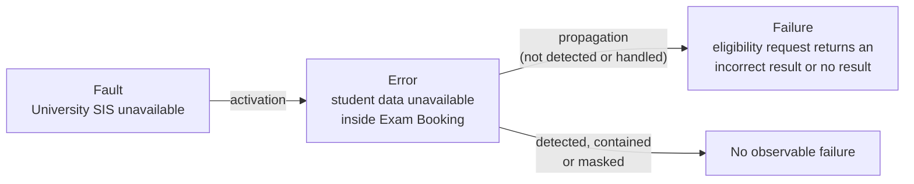

# Availability (disponibilità)

## Definizione

> 📄 Fonte: [[02-Availability.pdf#page=3]]

> 🔑 Definizione chiave: la **disponibilità** (*availability*) è il grado in cui un sistema è **operativo e accessibile quando serve usarlo**.

La disponibilità riguarda anche la capacità del sistema di:
- **impedire** che i guasti (*faults*) causino **malfunzionamenti** (*failures*) osservabili dall'esterno;
- **continuare a fornire il servizio** nonostante alcuni guasti;
- **recuperare e ripristinare** il servizio dopo un malfunzionamento.

L'obiettivo è garantire che l'**interruzione cumulativa del servizio** (*cumulative service outage*) **non superi un valore accettabile** in un **intervallo di tempo specificato**.

È un attributo **osservabile a runtime** ([[Programma Syllabus]]; nella Lez. 1 «runtime» → [[01-IntroductionOnSoftwareArchitecture-2 parte.pdf#page=6]]).

## Failure, fault, error

> 📄 Fonte: [[02-Availability.pdf#page=4]], [[02-Availability.pdf#page=13]]

| Termine | Definizione della slide | Esempio |
|---|---|---|
| **Failure** (malfunzionamento) | comportamento **scorretto** del sistema **osservabile dall'esterno** | l'utente riceve un risultato sbagliato o nessun risultato |
| **Fault** (guasto) | la **causa**, interna (o esterna), di un malfunzionamento | un difetto software, il crash di un server |
| **Error** (errore) | uno **stato interno scorretto** del sistema, causato da un guasto | dati dello studente non disponibili dentro il sistema |

Definizione più precisa di failure ([[02-Availability.pdf#page=13]]): si ha un malfunzionamento quando il sistema **non fornisce più un servizio coerente con la sua specifica** e questo è **osservabile dagli attori** del sistema. Un guasto (o una combinazione di guasti) **ha il potenziale** di causare un malfunzionamento.

La disponibilità dipende soprattutto da tre proprietà ([[02-Availability.pdf#page=4]]):

| Proprietà | Significato | 🧩 Su quale anello della catena agisce |
|---|---|---|
| **Faultlessness** | ridurre il verificarsi di guasti e malfunzionamenti | evita che il guasto nasca |
| **Fault tolerance** (tolleranza ai guasti) | continuare a funzionare nonostante i guasti | evita che l'errore diventi malfunzionamento |
| **Recoverability** (recuperabilità) | ripristinare servizio e dati dopo un malfunzionamento | riduce la durata del malfunzionamento |

### La catena causale fault → error → failure

> 📄 Fonte: [[02-Availability.pdf#page=5]]

![[lez02-av-p5-catena-fault-error-failure.png]]
*Figura di [[02-Availability.pdf#page=5]]. **In alto, schema generale**: *Fault* (causa di un problema, interna o esterna) → **activation** → *Error* (stato interno scorretto) → **propagation** → *Failure* (deviazione dal servizio atteso, osservabile dall'esterno). Dall'errore parte un secondo ramo: se l'errore viene **rilevato, contenuto o mascherato** (*detected, contained or masked*) → **nessun malfunzionamento osservabile**. **In basso, l'esempio del Booking System**: Fault «University SIS non disponibile» → Error «i dati dello studente non sono disponibili dentro l'Exam Booking System» → *se non rilevato né gestito* → Failure «la richiesta di ammissibilità restituisce un risultato scorretto o nessun risultato».*

*🧩 Ricostruzione Mermaid di [[02-Availability.pdf#page=5]], con l'esempio al posto dello schema generale.*

> 🧩 Elaborazione mia: la catena spiega dove agiscono le tattiche. Non si può impedire che il SIS cada (è esterno), ma si può **rilevare** l'errore (timeout) e **gestirlo** (risposta «SIS non disponibile» invece di una decisione di ammissibilità sbagliata): il guasto resta, il malfunzionamento no. È la riga «University SIS unavailable» della tabella di [[02-Availability.pdf#page=21]] e la tattica *increase competence set* di [[02-Availability.pdf#page=17]] ([[tattiche-availability]]).

## Misure della disponibilità

> 📄 Fonte: [[02-Availability.pdf#page=6]], [[02-Availability.pdf#page=7]]

La disponibilità si misura come la **probabilità** che il sistema fornisca i servizi specificati entro i limiti richiesti in un intervallo di tempo specificato. Espressione nota:

> 🧩 Formula chiave:
> $$\text{Availability} \approx \frac{MTBF}{MTBF + MTTR}$$

| Simbolo | Significato | Unità |
|---|---|---|
| $MTBF$ | *Mean Time Between Failures*, tempo medio tra malfunzionamenti | tempo (h) |
| $MTTR$ | *Mean Time To Repair*, tempo medio di riparazione | tempo (h) |

La disponibilità attesa è spesso espressa in uno **SLA** (*Service Level Agreement*): specifica il **livello di disponibilità garantito** e, di solito, le **penali** per il fornitore se lo SLA viene violato.

### Derivazione — da dove viene la formula

**Fonte:** [[02-Availability.pdf#page=6]] (formula data senza spiegazione)

> 🧩 Elaborazione mia — ipotesi: il sistema alterna periodi di funzionamento (durata media $MTBF$) e di riparazione (durata media $MTTR$).

$$
\begin{aligned}
A &= \frac{\text{tempo in servizio}}{\text{tempo totale}} && \text{definizione come frazione di tempo} \\
  &= \frac{MTBF}{MTBF + MTTR} && \text{un ciclo medio = un periodo di funzionamento + una riparazione}
\end{aligned}
$$

Il «≈» della slide ricorda che è una media sul lungo periodo: su un intervallo breve la frazione osservata può scostarsi. **Esempio numerico:** $MTBF = 1000\ \text{h}$, $MTTR = 1\ \text{h}$ ⇒ $A = 1000/1001 \approx 0.999$ (99,9 %). **Conseguenza:** a parità di $MTBF$, dimezzare il tempo di riparazione riduce di circa la metà l'indisponibilità $1 - A \approx MTTR/MTBF$ (per $MTTR \ll MTBF$) — per questo le tattiche di *recover* contano quanto quelle di *prevent*.

### Tabella dei «nove»

![[lez02-av-p7-tabella-disponibilita-downtime.png]]
*Figura di [[02-Availability.pdf#page=7]]: requisiti di disponibilità tipici, come percentuale di tempo in cui il sistema è disponibile rispetto al tempo in cui è in servizio, e downtime corrispondente su 90 giorni e su un anno.*

| Disponibilità | Downtime / 90 giorni | Downtime / anno | 🧩 Verifica |
|---|---|---|---|
| 99,0 % | 21 h 36 min | 3 giorni 15,6 h | ✔ |
| 99,9 % | 2 h 10 min | **8 h 0 min 46 s** (slide) | ✘ dovrebbe essere **8 h 45 min 36 s** |
| 99,99 % | 12 min 58 s | 52 min 34 s | ✔ |
| 99,999 % | 1 min 18 s | 5 min 15 s | ✔ |
| 99,9999 % | 8 s | 32 s | ✔ |

### Derivazione — downtime dalla percentuale

**Fonte:** [[02-Availability.pdf#page=7]] (valori dati senza passaggi)

$$
\begin{aligned}
\text{downtime} &= (1 - A)\cdot T && \text{frazione di tempo non disponibile per l'intervallo } T \\
T_{90} &= 90 \times 24\ \text{h} = 2160\ \text{h} && \text{intervallo di 90 giorni} \\
T_{anno} &= 365 \times 24\ \text{h} = 8760\ \text{h} && \text{anno di 365 giorni (è quello che usa la tabella)}
\end{aligned}
$$

| $A$ | $1-A$ | $(1-A)\,T_{90}$ | $(1-A)\,T_{anno}$ |
|---|---|---|---|
| 99 % | $10^{-2}$ | $21.6\ \text{h}$ = 21 h 36 min | $87.6\ \text{h}$ = 3 d 15,6 h |
| 99,9 % | $10^{-3}$ | $2.16\ \text{h}$ = 2 h 9,6 min ≈ 2 h 10 min | $8.76\ \text{h}$ = **8 h 45 min 36 s** |
| 99,99 % | $10^{-4}$ | $12.96\ \text{min}$ = 12 min 58 s | $52.56\ \text{min}$ = 52 min 34 s |
| 99,999 % | $10^{-5}$ | $77.8\ \text{s}$ = 1 min 18 s | $315.4\ \text{s}$ = 5 min 15 s |
| 99,9999 % | $10^{-6}$ | $7.8\ \text{s}$ ≈ 8 s | $31.5\ \text{s}$ ≈ 32 s |

**Sanity check:** ogni «nove» in più divide il downtime per 10 — le colonne scendono di un fattore 10 per riga. La riga 99,9 % / anno della slide (8 h 0 min 46 s) rompe questa regola: 52 min 34 s × 10 = 8 h 45 min 40 s, non 8 h 1 min. È un refuso.
**Ipotesi:** anno di 365 giorni e 90 giorni da 24 h; tutte le altre righe della slide tornano con queste ipotesi.

## Scenari di disponibilità

> 📄 Fonte: [[02-Availability.pdf#page=8]]–[[02-Availability.pdf#page=12]], [[02-Availability.pdf#page=20]]

### Scenario generale

![[lez02-av-p10-scenario-generale-1.png]]
![[lez02-av-p11-scenario-generale-2.png]]
![[lez02-av-p12-scenario-generale-3.png]]
*Figure di [[02-Availability.pdf#page=10]] (sorgente, stimolo, artefatto, ambiente), [[02-Availability.pdf#page=11]] (risposta) e [[02-Availability.pdf#page=12]] (misura della risposta): tabella a tre colonne (parte dello scenario, descrizione, valori possibili) presa dal libro di Bass, Clements, Kazman.*

| Parte | Descrizione | Valori possibili |
|---|---|---|
| Sorgente | da dove viene il guasto | interna/esterna: persone, hardware, software, infrastruttura fisica, ambiente fisico |
| Stimolo | lo stimolo di uno scenario di disponibilità è un **guasto** | omissione, crash, tempistica errata, risposta errata |
| Artefatto | quali parti del sistema sono responsabili del guasto e ne sono colpite | processori, canali di comunicazione, memoria, processi, artefatti nell'ambiente del sistema |
| Ambiente | interessa come si comporta il sistema non solo in condizioni «normali», ma anche quando sta già recuperando da un guasto | funzionamento normale, avvio, spegnimento, modalità riparazione, funzionamento degradato, sovraccarico |
| Risposta | la risposta più desiderata è **impedire che il guasto diventi un malfunzionamento**, ma contano anche notificare le persone o registrare il guasto per analisi successive | impedire il malfunzionamento; **rilevare** il guasto (registrarlo, notificare le entità interessate); **recuperare** (disattivare la sorgente degli eventi che lo causano, essere temporaneamente indisponibili durante la riparazione, correggere o mascherare il guasto/contenerne i danni, operare in modalità degradata durante la riparazione) |
| Misura | si possono scegliere varie misure, secondo la criticità del servizio | intervallo di tempo in cui il sistema deve essere disponibile; percentuale di disponibilità (es. 99,999 %); tempo per rilevare il guasto; tempo per ripararlo; intervallo in cui il sistema può restare in modalità degradata; proporzione (es. 99 %) o tasso (es. fino a 100 al secondo) di una classe di guasti che il sistema previene o gestisce senza fallire |

Rispetto allo scenario generale della Lez. 1 ([[01-IntroductionOnSoftwareArchitecture-2 parte.pdf#page=13]]) questa versione aggiunge la colonna delle descrizioni e più misure possibili.

### Scenario concreto: server farm

![[lez02-av-p8-scenario-server-farm.png]]
*Figura di [[02-Availability.pdf#page=8]]: un server di una server farm si guasta durante il funzionamento normale; il sistema informa l'operatore e continua a funzionare senza downtime.*

| Sorgente | Stimolo | Artefatto | Ambiente | Risposta | Misura |
|---|---|---|---|---|---|
| server in una server farm | il server si guasta | server | funzionamento normale | il sistema informa l'operatore e continua a funzionare | nessun downtime |

### Scenario concreto: Exam Booking System

> 📄 Fonte: [[02-Availability.pdf#page=9]] (ripetuto identico a [[02-Availability.pdf#page=20]])

*«Durante un periodo di prenotazione un application server smette di rispondere. Il load balancer rileva il guasto, toglie l'istanza dal pool e reindirizza le nuove richieste. Misura: rilevare entro 30 s, ripristinare entro 60 s, completare almeno il 99 % delle richieste e non perdere nessuna prenotazione confermata.»*

![[lez02-av-p9-scenario-exam-booking.png]]
*Figura di [[02-Availability.pdf#page=9]]: il riquadro giallo contiene lo scenario dell'Exam Booking System; lo schema a destra è lo stesso della server farm di p. 8.*

| Parte | Valore |
|---|---|
| Sorgente | ❓ non esplicitata (🧩 interna: hardware o software dell'application server) |
| Stimolo | un application server smette di rispondere |
| Artefatto | application server (istanza del pool) |
| Ambiente | periodo di prenotazione |
| Risposta | il load balancer rileva il guasto, toglie l'istanza dal pool, reindirizza le nuove richieste |
| Misura | rilevazione ≤ 30 s; ripristino ≤ 60 s; ≥ 99 % richieste completate; nessuna prenotazione confermata persa |

> ⚠️ Contraddizione: lo schema accanto al testo di p. 9 e p. 20 riporta i valori della server farm di p. 8 («system informs operator», «no downtime»), non quelli dello scenario dell'Exam Booking System (≥ 99 % delle richieste, cioè un downtime parziale è ammesso). Vale il testo.

## Dallo scenario alle decisioni architetturali

> 📄 Fonte: [[02-Availability.pdf#page=21]]

![[lez02-av-p21-da-scenario-a-decisioni.png]]
*Figura di [[02-Availability.pdf#page=21]]: tabella che, per tre guasti dell'Exam Booking System, indica come si rileva, qual è la risposta architetturale e la misura.*

| Guasto / interruzione | Rilevazione | Risposta architetturale | Misura della risposta |
|---|---|---|---|
| l'application server non risponde | health check del load balancer | togliere l'istanza e reindirizzare le richieste | rilevazione ≤ 30 s; ripristino ≤ 60 s |
| University SIS non disponibile | timeout e probe falliti | retry limitato; fallire in modo sicuro; segnalare l'ammissibilità come «non disponibile» | **nessuna decisione di ammissibilità scorretta** |
| il database primario si guasta | replicazione e monitoraggio del database (da parte del monitor del cluster) | promuovere lo standby; riconnettere le istanze applicative allo standby promosso | **RTO ≤ 5 min; RPO ≤ 1 min** |

- **RTO** (*Recovery Time Objective*): 🧩 tempo massimo accettabile per ripristinare il servizio dopo il guasto.
- **RPO** (*Recovery Point Objective*): 🧩 quantità massima di dati che si accetta di perdere, espressa come intervallo di tempo — con RPO ≤ 1 min si possono perdere al più le scritture dell'ultimo minuto prima del guasto.

**Domanda di discussione della slide:** *quali single point of failure restano dopo aver replicato gli application server?*
> 🧩 Risposta (dalle figure di [[02-Availability.pdf#page=22]] e [[01-IntroductionOnSoftwareArchitecture.pdf#page=40]]): il **load balancer** (unico nelle figure), il **SIS** esterno (non replicabile da noi, quindi va gestito con timeout, retry e fallback), e — se non replicati — database e message broker. Nella figura «before» di p. 22 DB e broker hanno uno standby, quindi il candidato principale resta il load balancer.

![[lez02-av-p22-configurazioni-prima-dopo-guasto.png]]
*Figura di [[02-Availability.pdf#page=22]]: la stessa figura «before/after» della Lez. 1 ([[01-IntroductionOnSoftwareArchitecture-2 parte.pdf#page=26]], spiegata in [[tattiche-architetturali]]): prima del guasto due application server con health check, DB primario replicato su standby e due message broker replicati; dopo il guasto l'Application Server 1 è FAILED, rimosso temporaneamente dal pool, e le richieste vanno all'Application Server 2.*

## Perché importa

È il primo attributo di qualità trattato in dettaglio. Il corso lo usa per mostrare il percorso completo **definizione → misura → scenario → tattiche → pattern → tecnologie** ([[tattiche-availability]]); lo stesso schema si ripete per gli altri attributi (→ [[modifiability]]).

> 🎯 Esame: definizione; fault/error/failure e catena causale; faultlessness, fault tolerance, recoverability; formula MTBF/MTTR e significato dei «nove»; scenario di disponibilità con misure (anche RTO/RPO).

## Connessioni

- [[tattiche-availability]]: come si ottiene la disponibilità.
- [[scenari-di-qualita]]: lo scenario generale di disponibilità è l'esempio della Lez. 1.
- [[calcolo-disponibilita]]: esercizi sui «nove» e su MTBF/MTTR.
- [[strutture-di-allocazione]]: il deployment mostra i single point of failure.

## Fonti

- [[quality-attributes-availability]] — [[02-Availability.pdf#page=3]]–[[02-Availability.pdf#page=12]], [[02-Availability.pdf#page=20]]–[[02-Availability.pdf#page=22]]

_Aggiornato: 2026-09-30 — ingest 02-Availability.pdf_
