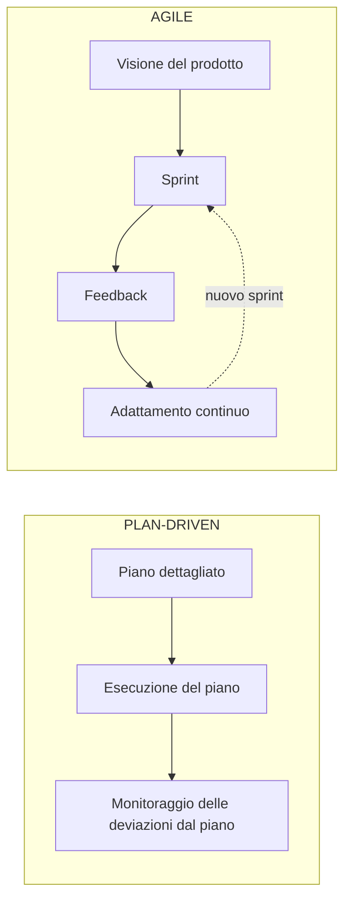

# Gestione di progetto: plan-driven vs Agile

## Definizione

> 📄 Fonte: [[04_Agile_02 (1).pdf#page=4]]

Nella **gestione di progetto tradizionale** (*traditional project management*, detta anche *plan-driven*) il lavoro viene **pianificato nel dettaglio all'inizio** del progetto e il **piano è lo strumento principale di controllo** del progetto. Nella **gestione Agile** (*Agile project management*) serve invece «un approccio diverso, adattato allo sviluppo incrementale e alle pratiche dei metodi Agile» ([[04_Agile_02 (1).pdf#page=6]]).

## Spiegazione

### Quando il piano dettagliato funziona

> 📄 Fonte: [[04_Agile_02 (1).pdf#page=5]]

L'approccio guidato dal piano è molto efficace quando sono veri **tutti** questi fattori: requisiti stabili, tecnologia consolidata, prodotto ben definito, poche modifiche. Gli esempi della slide sono opere materiali: **costruire un ponte, un edificio, installare un impianto industriale**.

> 🧩 Elaborazione mia — perché proprio questi esempi: in un ponte la progettazione si chiude prima di posare la prima pietra e cambiare un pilone a lavori iniziati costa moltissimo; per questo ha senso prevedere tutto in anticipo. Il piano funziona quando **la previsione è affidabile** (quattro condizioni sopra) e **il costo di una deviazione è alto**.

La slide pone poi quattro domande che mettono in crisi il piano: *cosa succede se* i requisiti continuano a cambiare, il cliente scopre nuovi bisogni, la tecnologia evolve durante il progetto, gli utenti vedono il software e cambiano idea? «In tali casi, aderire a un piano dettagliato definito mesi prima può diventare difficile» ([[04_Agile_02 (1).pdf#page=5]]). Sono i problemi dei progetti software già emersi nel sondaggio della Lezione 6 ([[sviluppo-agile]]).

### Due cicli a confronto

> 📄 Fonte: [[04_Agile_02 (1).pdf#page=7]] — slide «Plan-driven vs Agile»

*🧩 Ricostruzione in Mermaid della slide [[04_Agile_02 (1).pdf#page=7]]: le due colonne sono elenchi verticali di tre e quattro passi. La freccia tratteggiata (ritorno dall'adattamento allo sprint) non è disegnata nella slide: l'ho aggiunta perché «continuous adaptation» e la ripetizione degli sprint (pp. 19, 40) implicano un ciclo.*

Cosa dice il confronto:

| | Plan-driven | Agile |
|---|---|---|
| **Punto di partenza** | un piano dettagliato | una **visione del prodotto** (*product vision*, → [[ciclo-di-vita-scrum]]) |
| **Cosa si controlla** | la **deviazione dal piano**: si confronta lo stato reale con quello previsto | il **feedback** ricevuto a ogni sprint: si cambia ciò che serve |
| **Atteggiamento verso il cambiamento** | la modifica è uno scostamento da gestire | l'**adattamento è continuo** e previsto |

Fonte: [[04_Agile_02 (1).pdf#page=7]] per le due colonne; la riga «atteggiamento verso il cambiamento» è una sintesi 🧩.

### Perché serve un framework di gestione (e non solo buone pratiche tecniche)

> 📄 Fonte: [[04_Agile_02 (1).pdf#page=8]]

In molti progetti la gestione non è presa sul serio: l'attenzione va alle buone pratiche di sviluppo (design pattern, stili architetturali, principi di progettazione, *clean code*). Ma **senza un approccio strutturato di gestione è facile perdere visibilità** sullo stato reale del lavoro, sulle priorità e su ciò che resta da fare. Conclusione della slide: **Agile non sostituisce le competenze tecniche; fornisce un quadro per organizzare il lavoro, rendere trasparente l'avanzamento e adattarsi al cambiamento.**

## Esempi espansi

### Analisi dei vostri progetti passati

> 📄 Fonte: [[04_Agile_02 (1).pdf#page=9]]

La slide elenca ciò che gli studenti hanno «certamente applicato»: design pattern, architettura software, principi SOLID, *clean code*, Git e controllo di versione, testing. Poi cinque domande; se si è risposto spesso «non sempre», **mancava un framework di gestione del progetto**. Ecco a quale elemento di Scrum risponde ogni domanda (🧩, collegamento mio con le pagine di questa lezione):

| Domanda della slide | Cosa manca se non sai rispondere | Elemento Scrum che dà la risposta |
|---|---|---|
| Sapevi esattamente **quanto lavoro restava**? | una misura del lavoro rimanente | punti storia residui, grafico burndown → [[stima-story-points-velocity-capacity]], [[cerimonie-e-artefatti-agile]] |
| Sapevi **quali funzionalità erano le più importanti** ora? | un ordine di priorità | **Product Backlog** ordinato dal Product Owner → [[product-backlog-e-sprint-backlog]] |
| Avevate una **lista condivisa** dei compiti ancora da completare? | un elenco visibile a tutti | Product Backlog e **Sprint Backlog** → [[product-backlog-e-sprint-backlog]] |
| Sapevi **cosa poteva essere rilasciato oggi**? | un criterio di «completato» | **Incremento** e Definition of Done → [[product-backlog-e-sprint-backlog]] |
| Tutti condividono **la stessa visione dello stato** del progetto? | trasparenza | pilastro della **trasparenza**, scrum board, Daily Scrum → [[scrum]], [[daily-scrum-review-retrospective]] |

## Perché importa

Introduce Scrum come **risposta a un problema di gestione**, non come moda: il punto è la *visibilità* e la *capacità di adattarsi*. Per il progetto d'esame conta perché il gruppo lavora come un team Scrum ([[progetto-di-corso]]) e all'orale va giustificato il metodo ([[00_IntroduzioneAlCorso_SAD.pdf#page=29]]).

> 🎯 Esame: differenza plan-driven/Agile; quando il piano dettagliato è adatto; perché la sola competenza tecnica (pattern, clean code, Git) non basta a gestire un progetto.

## Connessioni

- [[sviluppo-agile]]: il Manifesto e lo sviluppo iterativo ed evolutivo (Lez. 6) sono la base; qui si passa alla gestione.
- [[scrum]]: il framework che dà la struttura mancante.
- [[buone-pratiche-architetturali]]: le «buone pratiche di sviluppo» citate a p. 8 (pattern, stili, principi) sono il contenuto di gran parte di questo corso.

## Fonti

- [[agile-scrum-framework]] — [[04_Agile_02 (1).pdf#page=3]]–[[04_Agile_02 (1).pdf#page=10]] (p. 3 e p. 10 sono slide-titolo)

_Aggiornato: 2026-10-22 — ingest 04_Agile_02 (1).pdf_
