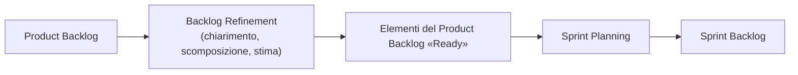

# Product Backlog, Sprint Backlog, refinement e Incremento

## Definizione

> 📄 Fonte: [[04_Agile_02.pdf#page=25]]

Gli **artefatti di Scrum** sono tre:

| Artefatto | Definizione (slide) |
|---|---|
| **Product Backlog** | **lista ordinata** degli elementi necessari per completare il prodotto; **l'ordine stabilisce la priorità** dei compiti da svolgere |
| **Sprint Backlog** | il **piano di sviluppo dettagliato** di ogni Sprint; è un insieme di elementi (**task da completare per costruire il prodotto**) |
| **Potentially Shippable Product Increment** (Incremento) | **tutto ciò che è stato prodotto durante uno Sprint**; in alcuni casi coincide con lo Sprint Backlog |

![[lez07-ag2-p25-artefatti-scrum.png]]
*Figura di [[04_Agile_02.pdf#page=25]], «Scrum Framework». Un parallelepipedo alto e azzurro (il Product Backlog, lungo perché contiene molto lavoro) → un parallelepipedo più piccolo (lo Sprint Backlog, il pezzo scelto) → un anello da «2–4 weeks» che contiene un ciclo più piccolo da «24 hours» (il Daily Scrum) → un piccolo parallelepipedo finale, il «Potentially shippable Product Increment». Mostra la riduzione progressiva: da tutto il lavoro possibile, a ciò che si fa in uno sprint, a ciò che si consegna.*

## Spiegazione

### Product Backlog e Sprint Backlog

> 📄 Fonte: [[04_Agile_02.pdf#page=26]]

- Il **Product Owner** definisce le funzionalità da costruire nel Product Backlog (**lista prioritaria**).
- Contiene **user story, bug, miglioramenti, debito tecnico (*technical debt*) e *spike***, tutti **prioritizzati dal PO**. (*Spike*: la slide non lo definisce; è un elemento di lavoro del backlog distinto dalle storie — ❓ da chiarire a lezione.)
- Mentre il lavoro procede, il backlog viene **aggiornato e raffinato**.
- **All'inizio di ogni Sprint** il team **seleziona** dal backlog un insieme di elementi da sviluppare in quell'iterazione («the Sprint Goal», sic) e **crea lo Sprint Backlog**, cioè i **task da eseguire** per raggiungere lo Sprint Goal.

> ❓ Nota terminologica: la slide chiama «Sprint Goal» l'insieme di elementi selezionati. Alle pp. 41–42 lo Sprint Goal è invece **l'obiettivo** che quegli elementi realizzano insieme ([[sprint-e-sprint-planning]]); le due letture vanno distinte e la seconda è quella corretta in seguito.

### Un backlog di esempio (tipi di elementi e stime)

> 📄 Fonte: [[04_Agile_02.pdf#page=27]] — «A kind of TODO List»

La slide dice: ogni attività ha una **stima di impegno** e, in Scrum, è prassi comune stimare in **story point** ([[stima-story-points-velocity-capacity]]).

![[lez07-ag2-p27-esempio-product-backlog.png]]
*Figura di [[04_Agile_02.pdf#page=27]], tabella «PRODUCT BACKLOG» trascritta qui sotto.*

| Ordine | ID | Elemento | Tipo | Stato | Stima (SP) |
|---|---|---|---|---|---|
| 1 | 121 | *As an Administrator, I want to link accounts to profiles, so that customers can access new accounts* | Requirement | Not Started | 5 |
| 2 | 113 | Update requirements traceability matrix | Overhead | Not Started | 2 |
| 3 | 403 | *As a Customer, I want to transfer money between my active accounts, so that I can adjust each account's balance* | Improvement | Not Started | 3 |
| 4 | 97 | Refactor Login Class | Maintenance | Not Started | 8 |
| 5 | 68 | *As a Site Visitor, I want to find locations, so that I can use bank services* | Requirement | Not Started | 8 |

> 🧩 Elaborazione mia — cosa mostra la tabella:
> - **Ordine ≠ ID**: l'ID (121, 113, 403, 97, 68) è un identificatore arbitrario; la colonna *Ordine* è la priorità decisa dal PO. Si può riordinare senza cambiare gli ID.
> - **Non solo user story**: le righe 2 e 4 non sono storie ma lavoro di *overhead* (matrice di tracciabilità) e *maintenance* (rifattorizzare una classe, un esempio di debito tecnico); la 3 è un *improvement*. È l'elenco di p. 26 applicato.
> - **Le stime sono in SP**, non in giorni: 5 + 2 + 3 + 8 + 8 = 26 SP in tutto. «Refactor Login Class» (8) vale quanto «trovare le sedi» (8): stessa dimensione relativa, anche se i lavori sono di natura diversa.
> - **Stato**: tutte *Not Started*, come all'inizio di un ciclo di pianificazione.

### Dal Product Backlog allo Sprint Backlog

> 📄 Fonte: [[04_Agile_02.pdf#page=28]]

![[lez07-ag2-p28-product-e-sprint-backlog.png]]
*Figura di [[04_Agile_02.pdf#page=28]]. A sinistra il **Product Backlog**: pila verticale di note verdi «WORK ITEM 1, 2, 3, 4, …, n». A destra lo **Sprint Backlog**: solo i primi tre elementi (WORK ITEM 1, 2, 3), collegati da frecce, ciascuno con a destra una fila di note azzurre «Task» (circa cinque, sei e quattro). Al centro la dicitura «Product increment». Si legge così: lo sprint prende **la testa** della lista ordinata e **scompone ogni elemento in task**; ciò che viene completato forma l'incremento.*

### Un backlog che evolve

> 📄 Fonte: [[04_Agile_02.pdf#page=29]]

La prima bozza del backlog definisce **solo i requisiti inizialmente noti e meglio compresi**. Il Product Backlog **evolve durante gli Sprint**, come il prodotto a cui si riferisce e l'ambiente in cui sarà usato. Il **raffinamento del Product Backlog** (*Backlog Refinement*) è l'atto di **aggiungere dettaglio, stime e ordine** agli elementi; è un **processo continuo** in cui **Product Owner e Development Team collaborano** sui dettagli degli elementi.

#### Esempio: backlog iniziale di un e-commerce

> 📄 Fonte: [[04_Agile_02.pdf#page=30]]

| Priorità | Elemento |
|---|---|
| 1 | Login |
| 2 | Product search |
| 3 | Shopping cart |
| 4 | PayPal checkout |
| 5 | Wishlist |
| 6 | Product reviews |
| 7 | Mobile app |
| 8 | AI-powered product recommendations |

La slide osserva che gli **elementi iniziali sono meno vaghi di quelli successivi** (si rimanda alla n. 7, «Mobile app») e che **i primi andranno raffinati prima del prossimo Sprint**. 🧩 Perché: la priorità alta coincide con la «prossima cosa da fare», quindi è la prima a essere compresa bene; in fondo restano idee.

#### Raffinare lo user story «Login»

> 📄 Fonte: [[04_Agile_02.pdf#page=31]]

| Passo | Prima | Dopo |
|---|---|---|
| Formulazione | *As a user, I want to log in.* | *As a registered user, I want to authenticate using my email and password to access my personal area.* |
| Criteri di accettazione aggiunti | — | email obbligatoria; password obbligatoria; messaggio di errore; **blocco dopo 5 tentativi** |
| Stima (fatta dal team) | — | **3 Story Point** |
| Stato | idea | **Ready** («ora è pronta») |

Intanto la storia «Mobile App» resta semplicemente *«Create a mobile app»*: **nessuno perde tempo a discuterla** perché è probabile che **non sarà sviluppata prima di sei mesi**.

> 🧩 Elaborazione mia — il principio: **raffinare «appena in tempo»**. Il dettaglio ha un costo (tempo di discussione) e un'obsolescenza (in sei mesi cambiano requisiti e priorità); quindi si dettaglia in profondità solo ciò che entrerà nello sprint imminente. È la stessa logica di «posticipare la stima» già vista per le storie ([[user-stories]], [[criteri-di-accettazione-e-bdd]]): i criteri di accettazione aggiunti qui sono quelli che il BDD trasforma poi in scenari Given–When–Then.

#### Quando una storia è «Ready»

> 📄 Fonte: [[04_Agile_02.pdf#page=32]]

Esempio: *As a customer, I want to recover my password.* «È pronta?» Sei domande; **se tutte le risposte sono sì, è READY**:

| Domanda della slide | Cosa controlla 🧩 | Legame con INVEST 🧩 ([[user-stories]]) |
|---|---|---|
| È **chiara**? | tutti capiscono cosa si chiede | (nessuna lettera diretta; è il presupposto della conversazione) |
| È **abbastanza piccola**? | entra in uno sprint | **S**mall |
| Ha **criteri di accettazione**? | si sa quando è finita | **T**estable / verificabile |
| È **stimata**? | il team ha dato i punti | **E**stimable |
| È **indipendente**? | non attende un'altra storia | **I**ndependent |
| È **verificabile**? | si può provare che funziona | **T**estable |

La slide non usa il termine «Definition of Ready»: parla di storia «Ready» ([[agile-scrum-framework]]).

#### Stato degli elementi: chi può entrare nel prossimo sprint

> 📄 Fonte: [[04_Agile_02.pdf#page=33]] — «Next sprint in two weeks…»

| Elemento | Stato |
|---|---|
| Login | Ready |
| Product search | Ready |
| Shopping cart | Almost ready |
| PayPal | Needs further clarification |
| Wishlist | Too broadly defined |
| Mobile app | Just an idea |

**Solo i primi 2 o 3 saranno candidati allo Sprint.** Si noti che il titolo dice «next sprint in two weeks»: lo sprint dura due settimane e ci sono due settimane per raffinare il resto. Ciò che non è ancora «pronto» deve prima passare dal refinement.

> ❓ La tabella riporta **sei** voci delle otto del backlog di p. 30: mancano *Product reviews* (6) e *AI-powered product recommendations* (8). La slide non lo spiega; plausibilmente sono troppo in fondo per essere discusse. 

### Il flusso complessivo

> 📄 Fonte: [[04_Agile_02.pdf#page=34]] — «What is the total flow?»

*Ricostruzione in Mermaid della catena di cinque frecce di p. 34 (le parole tra parentesi nella slide sono in italiano).* **Il refinement prepara il lavoro; lo Sprint Planning lo seleziona.** 🧩 Sono due momenti diversi: nel primo si rende il lavoro *pronto* (anche per sprint futuri), nel secondo si sceglie *quanto* ne entra nello sprint ([[sprint-e-sprint-planning]]).

### Sprint Backlog con task dettagliati

> 📄 Fonte: [[04_Agile_02.pdf#page=35]]

La slide spiega: **lo Sprint è pianificato in Story Point**; l'**esecuzione quotidiana** può essere organizzata con **task**, che possono essere **stimati in ore**.

![[lez07-ag2-p35-sprint-backlog-task.png]]
*Figura di [[04_Agile_02.pdf#page=35]], un foglio di calcolo (colonne in italiano e inglese) trascritto qui sotto.*

Intestazione: **Goal: «Completare User Account»**; casella «Ore di sviluppo ideali» con valore **192**. Colonne: ID, Story/Task, SP, Comments, **Planned Hours**, poi i giorni **Lun Mar Mer Gio Ven Lun Mar Mer Gio Ven** (due settimane lavorative) sotto «Remaining Hours».

| ID | Story / task | SP | Ore pianificate | Commento |
|---|---|---|---|---|
| **1** | *As a user I want to login so that I can access the user area* | **3** | | |
| | Create login form UI | | 3 | |
| | Create login form controller | | 1 | |
| | Create login business logic | | 4 | «Set cookie! (name=agileway.it)» |
| | Implement "remember me" check | | 1 | |
| | Write Selenium test case | | 3 | |
| | Manual test on device | | 2 | verificare che il cookie sia impostato; che il form di login sia irraggiungibile; che appaia il benvenuto; che cambi la UI dell'intestazione |
| **2** | *As a user I want to logout so that I can browse the website anonymously* | **1** | | |
| | Create logout business logic | | 2 | |
| | Check if logout button is present on UI | | 0,5 | |
| | Manual test on device | | 2 | verificare che il form di login sia raggiungibile; che il cookie non ci sia più; … |

> 🧩 Elaborazione mia — cosa mostra l'esempio:
> - **Due livelli di misura**: le storie sono pesate in **SP** (3 e 1), i task in **ore**. Le ore sono una stima di dettaglio per il lavoro quotidiano, non la conversione degli SP: la storia da 3 SP richiede 3+1+4+1+3+2 = **14 h**, quella da 1 SP richiede 2+0,5+2 = **4,5 h**; il rapporto è 4,7 h/SP nella prima e 4,5 h/SP nella seconda, non uguale, come ci si aspetta da punti *relativi* ([[stima-story-points-velocity-capacity]]).
> - **Ogni storia è scomposta in task di sviluppo e di verifica**: UI, controller, logica, test automatico (Selenium) e test manuale su dispositivo; i test manuali coincidono con i criteri di accettazione ([[criteri-di-accettazione-e-bdd]]).
> - **Le colonne dei giorni** riportano le ore **rimanenti** per ogni task: partendo dal valore pianificato scendono (ad esempio «Create login form UI»: 3, 2, 2, 1 nei primi quattro giorni) fino a una cella vuota quando il task è finito. La somma delle ore rimanenti giorno per giorno è ciò che alimenta un **burndown in ore** ([[cerimonie-e-artefatti-agile]]).
> - ❓ Non ricostruito: la cella «192» ore ideali non si ottiene dalle ore pianificate visibili (18,5 h in tutto); probabilmente riguarda una capacità del team su due settimane, ma la slide non lo dice.

### Incremento potenzialmente rilasciabile

> 📄 Fonte: [[04_Agile_02.pdf#page=36]]

Un **Potentially Shippable Product Increment** è l'insieme delle funzionalità completate durante uno Sprint che **soddisfano la Definition of Done** e **potrebbero essere rilasciate** agli utenti, **anche se si decide di non farlo**. Per esserlo devono:

1. **rispettare i criteri di accettazione**;
2. essere **testate**;
3. essere **integrate**;
4. essere **distribuite nell'ambiente previsto** (*deployed*).

> 🧩 Elaborazione mia — «potenzialmente» significa che il prodotto è **sempre in uno stato rilasciabile**; se rilasciarlo è una decisione di business (del PO), non una scusa tecnica del team. Le quattro condizioni sono un esempio di **Definition of Done**; un'altra lista, con codice sviluppato, test unitari passati, code review, documentazione aggiornata e *demo-ready*, era a p. 30 della Lezione 6 ([[cerimonie-e-artefatti-agile]]). La **DoD vale per tutte le storie**, i **criteri di accettazione** sono propri di ogni storia ([[user-stories]]). Solo le storie che rispettano la DoD contano nella velocity ([[stima-story-points-velocity-capacity]]).

La slide di p. 37 è **vuota** (solo lo sfondo).

## Perché importa

I backlog sono lo strumento per fare **trasparenza e adattamento** ([[scrum]]): il Product Backlog dice cosa e in che ordine; il refinement lo rende pronto; lo Sprint Backlog dice cosa si fa adesso. Nel progetto di corso il Product Backlog è sul GitHub Project e i task dello sprint sono issue stimate: il burndown è costruito su questi numeri ([[burndown-github-project]]).

> 🎯 Esame: tre artefatti con definizioni; cosa contiene un Product Backlog (storie, bug, miglioramenti, debito tecnico, spike); refinement vs planning; quando una storia è «Ready»; cos'è un incremento potenzialmente rilasciabile e come lo definisce la DoD.

> ⚖️ Trade-off: **dettaglio anticipato vs obsolescenza**: più si raffina in anticipo, meno sorprese nello sprint, ma più rischio di dettagliare cose che cambieranno.

## Connessioni

- [[user-stories]]: l'elemento principale del backlog; INVEST; DoD vs criteri di accettazione.
- [[criteri-di-accettazione-e-bdd]]: i criteri aggiunti nel refinement.
- [[sprint-e-sprint-planning]]: come si passa dal backlog «Ready» allo Sprint Backlog.
- [[pianificare-uno-sprint]] *(esercizio)*: applicazione sui dati di queste slide.
- [[cerimonie-e-artefatti-agile]]: versione generale di backlog, DoD e burndown (Lez. 6).

## Fonti

- [[agile-scrum-framework]] — [[04_Agile_02.pdf#page=25]]–[[04_Agile_02.pdf#page=37]]

_Aggiornato: 2026-10-22 — ingest 04_Agile_02.pdf_
