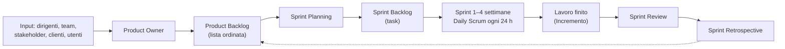

# Scrum

## Definizione

> 🔑 Definizione chiave — 📄 Fonte: [[04_Agile_02.pdf#page=11]]
> **Scrum** è un *framework* Agile per gestire lo sviluppo di **prodotti complessi**, introdotto nei primi anni Novanta da **Ken Schwaber e Jeff Sutherland**. Si basa su un approccio **iterativo e incrementale** e organizza il lavoro attraverso **Sprint, ruoli, eventi e artefatti**.

Scrum **non prescrive come sviluppare il software**: fornisce la *struttura* dentro cui il team sceglie le pratiche tecniche più adatte (la slide cita **TDD**, **Pair Programming**, **Continuous Integration**). È quindi complementare alle pratiche tecniche, non un loro sostituto (→ [[gestione-progetto-plan-driven-vs-agile]]).

## Spiegazione

### Empirismo: la teoria alla base

> 📄 Fonte: [[04_Agile_02.pdf#page=12]] — citazione dalla *Scrum Guide* di Schwaber e Sutherland (versione italiana v1, indirizzo scrumguides.org riportato sulla slide)

- Scrum si fonda sulla teoria del **controllo empirico del processo** (*empirical process control*), o **empirismo** (*empiricism*): la conoscenza deriva dall'**esperienza** e le decisioni si prendono su **ciò che è noto**.
- Scrum usa un metodo **iterativo** e un approccio **incrementale** per **ottimizzare la prevedibilità e controllare il rischio**.
- I **pilastri** di ogni implementazione del controllo empirico sono **trasparenza, ispezione e adattamento**.

### I tre pilastri

> 📄 Fonte: [[04_Agile_02.pdf#page=13]]

| Pilastro | Significato (slide) | Dove si realizza in Scrum 🧩 |
|---|---|---|
| **Trasparenza** (*transparency*) | il processo è trasparente | backlog visibili a tutti, scrum board, Definition of Done condivisa ([[product-backlog-e-sprint-backlog]], [[daily-scrum-review-retrospective]]) |
| **Ispezione** (*inspection*) | ispezione **frequente** del prodotto in costruzione | l'Incremento ispezionato nella Sprint Review, il lavoro ispezionato ogni giorno nel Daily Scrum |
| **Adattamento** (*adaptation*) | si adattano il processo o il prodotto, **se necessario** | il Product Backlog aggiornato dopo la review, le azioni di miglioramento della retrospettiva |

> 🧩 Elaborazione mia — il legame tra i tre pilastri e gli eventi è esplicito nella slide sugli eventi: «ogni evento Scrum è un'opportunità formale per **ispezionare e adattare** qualcosa» ([[04_Agile_02.pdf#page=39]], → [[sprint-e-sprint-planning]]). Se non vedi lo stato (trasparenza) non puoi ispezionarlo, e se non puoi cambiare rotta (adattamento) ispezionare non serve.

### Gli elementi del framework

> 📄 Fonte: [[04_Agile_02.pdf#page=14]]

Il framework consiste nello **Scrum Team** e in: **ruoli** (*roles*), **eventi** (*events*), **artefatti** (*artifacts*) e **regole** che legano insieme eventi, ruoli e artefatti, governando le loro relazioni e interazioni.

| Elemento | Contenuto | Pagina |
|---|---|---|
| Ruoli | Product Owner, Development Team, Scrum Master (sotto) | questa pagina |
| Eventi | Sprint, Sprint Planning, Daily Scrum, Sprint Review, Sprint Retrospective | [[sprint-e-sprint-planning]], [[daily-scrum-review-retrospective]] |
| Artefatti | Product Backlog, Sprint Backlog, Incremento | [[product-backlog-e-sprint-backlog]] |
| Regole | timebox degli eventi, durata costante degli sprint, backlog come previsione (vedi pagine sopra) | — |

### Lo Scrum Team e i tre ruoli

> 📄 Fonte: [[04_Agile_02.pdf#page=15]]

Lo **Scrum Team** include tre ruoli:

- **Product Owner (PO)**: definisce le funzionalità del prodotto e le loro priorità;
- **Development Team**: team **auto-organizzato e molto autonomo** (*self-organizing*), non più di **7–8** persone;
- **Scrum Master (SM)**: aiuta il gruppo a imparare e applicare Scrum.

Vincolo in evidenza: **massimo 10 persone in totale, inclusi PO e Scrum Master**. La figura mostra tre pupazzi disposti a triangolo (ScrumMaster in alto, Product Owner e Team in basso) uniti da frecce bidirezionali: i tre ruoli collaborano a pari livello, nessuno è gerarchicamente sopra gli altri.

> 🧩 Elaborazione mia — il conto del vincolo: $7\text{–}8$ sviluppatori $+\ 1$ PO $+\ 1$ SM $= 9\text{–}10 \le 10$. Se il team di sviluppo fosse di 9 persone si supererebbe il limite.

Nella Lezione 6 gli stessi tre ruoli erano presentati come «tre responsabilità fondamentali» dell'Agile in generale ([[sviluppo-agile]]); qui sono i ruoli *definiti* da Scrum.

#### Product Owner

> 📄 Fonte: [[04_Agile_02.pdf#page=16]]

Il PO è **responsabile di massimizzare il valore del prodotto** e del lavoro svolto dal Development Team.

![[lez07-ag2-p16-po-responsabilita.png]]
*Figura di [[04_Agile_02.pdf#page=16]] (testi in italiano). Al centro il Product Owner; cinque riquadri collegati da frecce descrivono cosa deve fare e sapere: **decide cosa deve essere fatto** — quali funzionalità deve avere un prodotto o servizio, **le priorità** con cui realizzarle e **quando rilasciarle**; deve avere una **ampia conoscenza dei bisogni degli utenti finali** e capire come il prodotto possa rispondervi; deve **saper gestire gli stakeholder** di progetto; deve avere **un'idea dei processi di sviluppo software** ed essere in grado di **comunicare la propria visione di prodotto** al team; il suo **scopo principale è produrre valore** per l'utente finale e per l'azienda.*

Più avanti si vedrà chi può fare il PO ([[ciclo-di-vita-scrum]]) e cosa tiene in mano: il Product Backlog ([[product-backlog-e-sprint-backlog]]).

#### Scrum Master

> 📄 Fonte: [[04_Agile_02.pdf#page=17]]

Lo SM è **responsabile di promuovere e supportare Scrum**, aiutando tutti a comprendere **teoria, pratiche, regole e valori** di Scrum.

![[lez07-ag2-p17-scrum-master.png]]
*Figura di [[04_Agile_02.pdf#page=17]] (testi in italiano). Lo ScrumMaster al centro, con quattro frecce verso quattro destinatari: verso gli **Stakeholders**, «aiuta a comprendere i valori di Scrum»; verso l'**Organisation**, «guida all'adozione di Scrum»; verso il **Product Owner**, «facilitare gli eventi Scrum come richiesto e necessario»; verso il **Dev Team**, «Coach Scrum». 🧩 Lettura mia: i verbi («aiuta», «guida», «facilita», «coach») descrivono un ruolo di supporto al processo, non di comando sul team.*

#### Development Team

> 📄 Fonte: [[04_Agile_02.pdf#page=18]]

Il Development Team è formato da un **numero limitato (7–8) di professionisti** che lavorano per consegnare un **Incremento di prodotto finito e potenzialmente rilasciabile**.

![[lez07-ag2-p18-development-team.png]]
*Figura di [[04_Agile_02.pdf#page=18]] (testi in italiano). Il team al centro (tre pupazzi, uno evidenziato in giallo) con sei riquadri: i team di sviluppo sono **cross-funzionali**, con tutte le competenze necessarie per creare un Incremento di prodotto; sono **auto-organizzati**; **ogni membro deve essere allocato al 100 % sul progetto**; **Scrum non riconosce alcun titolo** ai membri del team di sviluppo; i singoli membri possono avere **competenze specialistiche**, ma **la responsabilità è del team nel suo complesso**; il team **dà indicazioni e suggerimenti al Product Owner** per migliorare il prodotto e renderlo ottimale.*

> 🧩 Elaborazione mia — le tre figure insieme: il PO decide **cosa** (valore e priorità), il Dev Team decide **come e quanto** (stime, scelta dei task, auto-organizzazione), lo SM cura **il processo** (che Scrum funzioni). Per questo le stime di story point le fanno solo gli sviluppatori e il PO non le assegna ([[stima-story-points-velocity-capacity]]).

### Lo Sprint, cuore di Scrum

> 📄 Fonte: [[04_Agile_02.pdf#page=19]]

- Il **cuore di Scrum è lo Sprint**: periodo a durata fissa (*time-boxed*, di norma **un mese o meno**) in cui si crea un **Incremento utilizzabile e potenzialmente rilasciabile**.
- Gli Sprint hanno **durata costante** durante tutto il progetto.
- Alla fine di uno Sprint, **il successivo inizia subito**.

La figura mostra tre cerchi a frecce ricurve, «Sprint 1», «Sprint 2», «Sprint 3», disposti lungo una scala crescente; attorno a ogni cerchio si leggono le fasi del ciclo (requisiti, design, sviluppo, test, review, launch, plan…): ogni sprint ripete in piccolo l'intero ciclo di sviluppo e lo spinge più in alto, cioè produce valore aggiuntivo. Dettagli su obiettivo, previsione e timebox → [[sprint-e-sprint-planning]].

### Scrum a colpo d'occhio

> 📄 Fonte: [[04_Agile_02.pdf#page=69]] (slide «Scrum lifecycle»)

![[lez07-ag2-p69-scrum-lifecycle.png]]
*Figura di [[04_Agile_02.pdf#page=69]], «The Agile: Scrum Framework at a glance» (con loghi dell'autore dell'infografica). Da sinistra: **input da dirigenti, team, stakeholder, clienti, utenti** → **Product Owner**; il **Product Backlog** è una «lista ordinata di ciò che serve: feature, storie…»; la **Sprint Planning Meeting**: «il team seleziona partendo dall'alto quanto può impegnarsi a consegnare entro la fine dello Sprint»; da qui lo **Sprint Backlog** (con «task breakout», cioè scomposizione in task); poi l'anello dello **Sprint da 1–4 settimane**, dentro il quale gira il **Daily Scrum Meeting ogni 24 ore**; sopra, lo **Scrum Master** e i **Burndown/up chart**; alla fine, **Finished Work** (lavoro finito), **Sprint Review** e **Sprint Retrospective**. Nota nel disegno: «Sprint end date and team deliverable do not change» (la data di fine sprint e ciò che il team consegna non cambiano).*

*🧩 Ricostruzione in Mermaid della figura di p. 69. La freccia tratteggiata finale (dalla retrospettiva di nuovo al backlog/planning) non è nel disegno: l'ho aggiunta perché a fine sprint ne comincia subito un altro ([[04_Agile_02.pdf#page=19]]).*

> ❓ Nota sulla durata: la durata dello sprint è «un mese o meno» a p. 19, «2–4 settimane» nella figura di p. 25 e «1–4 settimane» nella figura di p. 69. Le slide non le conciliano; per il progetto di corso gli sprint durano 2 settimane (3 la preparatoria, [[guida-progetto-picus]]).

### «Ora usiamo Scrum nel nostro progetto!»

> 📄 Fonte: [[04_Agile_02.pdf#page=70]]

L'ultima slide è solo un titolo — «Now let's use Scrum in our project!» — e introduce il laboratorio dell'agenda: *Workshop: Agile assessment and planning the first Sprint* ([[04_Agile_02.pdf#page=2]]). Il contenuto del workshop **non è nel PDF**: ❓ da integrare se la docente distribuisce il materiale.

## Esempi espansi

Gli esempi del PDF su ruoli e sprint sono le figure di pp. 15–19 e 69, spiegate sopra. Un esempio di applicazione al progetto di corso:

> 🧩 Elaborazione mia — nel progetto PICUS il gruppo lavora **in 8 ruotando i ruoli Scrum** e il PO cambia a ogni iterazione ([[guida-progetto-picus]]); con 8 persone totali il vincolo «massimo 10» è rispettato. Le date di review (5/11, 19/11, 3/12, 17/12) sono le chiusure degli sprint; l'iterazione preparatoria dura 3 settimane e le altre 2 ([[guida-progetto-picus]]), mentre la durata costante vale per le iterazioni di costruzione.

## Perché importa

È il **metodo di gestione imposto dal progetto di corso** e oggetto del programma («Il framework SCRUM: i ruoli in Scrum, i Backlog, le pratiche di Scrum», [[Programma Syllabus]]). All'orale si valuta anche la giustificazione del processo ([[00_IntroduzioneAlCorso_SAD.pdf#page=29]]).

> 🎯 Esame: definizione di Scrum e cosa **non** prescrive; empirismo e tre pilastri; elementi del framework; i tre ruoli con responsabilità e limiti di dimensione (7–8, max 10); cos'è lo Sprint.

> ⚖️ Trade-off: **autonomia vs controllo**. Il team auto-organizzato è libero su come lavorare, ma deve rendere tutto trasparente (backlog, board, DoD) per essere ispezionabile.

## Connessioni

- [[ciclo-di-vita-scrum]]: le tre macro-fasi (inception, construction, transition) e la product vision.
- [[product-backlog-e-sprint-backlog]]: gli artefatti.
- [[sprint-e-sprint-planning]]: gli eventi e il Sprint Goal.
- [[daily-scrum-review-retrospective]]: gli altri tre eventi.
- [[sviluppo-agile]] e [[cerimonie-e-artefatti-agile]]: la presentazione generale della Lezione 6, di cui questa è la versione «Scrum completo».

## Fonti

- [[agile-scrum-framework]] — [[04_Agile_02.pdf#page=11]]–[[04_Agile_02.pdf#page=19]], [[04_Agile_02.pdf#page=69]], [[04_Agile_02.pdf#page=70]]

_Aggiornato: 2026-10-22 — ingest 04_Agile_02.pdf_
