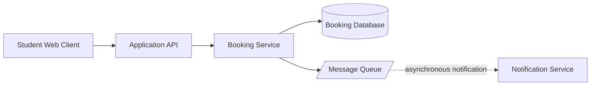

# Strutture componenti e connettori (C&C)

## Definizione

> 📄 Fonte: [[01-IntroductionOnSoftwareArchitecture.pdf#page=25]], [[01-IntroductionOnSoftwareArchitecture.pdf#page=33]]

Le strutture C&C descrivono **come gli elementi interagiscono tra loro a runtime** per svolgere le funzioni del sistema.

- **Componenti** (*components*): le **unità principali di computazione**. Possono essere servizi, peer, client, server, filtri o altri tipi di elementi runtime.
- **Connettori** (*connectors*): i **veicoli di comunicazione** tra componenti, come *call-return*, operatori di sincronizzazione tra processi, *pipe* o altro.

A runtime i moduli sono stati **compilati in forme eseguibili** (i componenti); i connettori indicano esplicitamente **come i componenti interagiscono**, con stili diversi: *call/return*, *request/response*, *pub/sub*… ([[01-IntroductionOnSoftwareArchitecture.pdf#page=33]]).

> 🔑 Definizione chiave: le strutture C&C mostrano una **vista runtime** del sistema e sono **ortogonali** alle strutture di modulo ([[01-IntroductionOnSoftwareArchitecture.pdf#page=33]]); per i dettagli sull'ortogonalità → [[strutture-e-viste]] § Relazioni tra strutture.

🧩 Il connettore è un elemento architetturale **di prima classe**, non una semplice freccia: sincrono o asincrono, affidabile o no, cifrato o no sono proprietà del connettore che cambiano prestazioni, disponibilità e sicurezza.

## Domande a cui rispondono

> 📄 Fonte: [[01-IntroductionOnSoftwareArchitecture.pdf#page=27]]

- Quali sono i principali componenti in esecuzione e come interagiscono a runtime?
- Quali sono i principali **archivi di dati condivisi**?
- Quali parti del sistema sono **replicate**?
- Come **progrediscono i dati** nel sistema?
- Quali parti possono essere eseguite **in parallelo**?
- La struttura del sistema può **cambiare durante l'esecuzione**? Se sì, come?

> 🔑 Definizione chiave: le viste C&C sono cruciali per studiare le **proprietà runtime** del sistema: **prestazioni, sicurezza, disponibilità** e altre ([[01-IntroductionOnSoftwareArchitecture.pdf#page=27]]).

### Domande per attributo di qualità (Exam Booking System)

> 📄 Fonte: [[01-IntroductionOnSoftwareArchitecture.pdf#page=30]], [[01-IntroductionOnSoftwareArchitecture.pdf#page=31]]

| Attributo | Domande da porre alla vista C&C |
|---|---|
| **Prestazioni** | Quante comunicazioni servono per completare una prenotazione? Quali chiamate sono sincrone? Dove può formarsi una coda? Quale componente può diventare un collo di bottiglia? |
| **Disponibilità e resilienza** | Cosa succede se il Notification Service non risponde? La coda conserva i messaggi durante un guasto? Cosa succede se il database non è disponibile? Ci sono componenti critici non replicati? |
| **Sicurezza** | Quali dati passano sui connettori? Quali comunicazioni vanno cifrate? Quale componente autentica lo studente? Chi può accedere al database o pubblicare eventi? |
| **Scalabilità** | Quali componenti si possono replicare? Le istanze condividono stato? Il database regge un volume maggiore di richieste? La coda permette di distribuire il lavoro su più consumatori? |

## Esempi espansi

### Esempio generico di vista C&C

> 📄 Fonte: [[01-IntroductionOnSoftwareArchitecture.pdf#page=26]]

![[lez01-intro-p26-esempio-cc-view.png]]
*Figura di [[01-IntroductionOnSoftwareArchitecture.pdf#page=26]]: più istanze di «Client Teller 1» (ovali sovrapposti) collegate da un connettore **publish-subscribe** (barra orizzontale in alto) e da un connettore **client-server request/reply con failover automatico** (triangolo tratteggiato) verso due server, «Account Server—Main» e «Account Server—Backup». Entrambi accedono (linea continua = *database access*) all'«Account Database», al quale accede anche un'applicazione di database «Administrative». I quadratini neri sono le **interfacce** (porte) dei componenti.*

🧩 Si leggono direttamente le risposte ad alcune domande di [[01-IntroductionOnSoftwareArchitecture.pdf#page=27]]: il dato condiviso è l'Account Database; è replicato il server (main + backup, con failover sul connettore); i client sono molte istanze in parallelo.

### Vista runtime dell'Exam Booking System

> 📄 Fonte: [[01-IntroductionOnSoftwareArchitecture.pdf#page=28]], [[01-IntroductionOnSoftwareArchitecture.pdf#page=29]]

![[lez01-intro-p28-runtime-view-exam-booking.png]]
*Figura di [[01-IntroductionOnSoftwareArchitecture.pdf#page=28]], «Runtime view of an exam booking»: i componenti cooperano per elaborare una richiesta. Student Web Client → Application API → Booking Service; il Booking Service scrive nel Booking Database e nella Message Queue; la coda consegna al Notification Service (**notifica asincrona**). Il **Booking Service** è un componente runtime che **contiene i moduli Booking ed Eligibility Checking**. Nota: la notifica asincrona riduce la latenza della prenotazione ma richiede una gestione esplicita dei guasti.*

*🧩 Ricostruzione Mermaid di [[01-IntroductionOnSoftwareArchitecture.pdf#page=28]].*

**Flusso di una singola richiesta** ([[01-IntroductionOnSoftwareArchitecture.pdf#page=29]]):
1. lo studente invia la prenotazione;
2. il Booking Service verifica i vincoli;
3. il sistema registra la prenotazione;
4. la conferma viene messa in coda;
5. il Notification Service invia l'email.

> ⚖️ Trade-off: la notifica **asincrona** migliora **tempo di risposta e resilienza**, ma introduce **consistenza finale** (*eventual consistency*) e aumenta la **complessità della gestione degli errori** ([[01-IntroductionOnSoftwareArchitecture.pdf#page=29]]).

> 🧩 Elaborazione mia — perché:
> - *Tempo di risposta*: lo studente attende solo i passi 1–4; l'invio dell'email (lento, dipende da un server esterno) esce dal percorso critico.
> - *Resilienza*: se il Notification Service è giù, le prenotazioni continuano; i messaggi aspettano in coda.
> - *Consistenza finale*: per un intervallo la prenotazione è registrata ma l'email non è ancora partita; lo stato «prenotato e notificato» si raggiunge solo dopo.
> - *Gestione errori*: bisogna decidere cosa fare se il messaggio si perde o arriva due volte (vedi la tattica asincrona in [[tattiche-architetturali]]).

### Client-server di un sistema bancario ATM (anni '90)

> 📄 Fonte: [[01-IntroductionOnSoftwareArchitecture.pdf#page=34]]

![[lez01-intro-p34-cc-atm-client-server.png]]
*Figura di [[01-IntroductionOnSoftwareArchitecture.pdf#page=34]]: tre server (Bank transaction authorizer, ATM monitoring server, ATM reconfiguration server — processi «FTX server daemon») collegati a tre client (ATM main process e Reconfigure and update process — processi «ATM OS/2 client», e Monitoring station program — «Windows application»). Ogni linea è un **connettore socket TCP** con porte client e server.*

- **Tre tipi di componenti**: processi server, processi client ATM, componenti applicativi Windows.
- I **connettori** erano istanze di un connettore **socket TCP**.
- **Oggi** si usano altri tipi di connettori, basati su **HTTP**.

→ [[client-server]]

### Struttura a servizi

> 📄 Fonte: [[01-IntroductionOnSoftwareArchitecture.pdf#page=35]]

Le unità sono **servizi** che interoperano tramite **scambio di messaggi** (*message passing*). La struttura a servizi aiuta a ingegnerizzare un sistema fatto di componenti che possono essere **sviluppati indipendentemente** l'uno dall'altro.

![[lez01-intro-p35-service-structure.png]]
*Figura di [[01-IntroductionOnSoftwareArchitecture.pdf#page=35]]: tre tipi di client (utenti con app mobile, altro dispositivo, browser) passano da un **API Gateway**; dietro, cinque servizi colorati, ognuno con i propri moduli e il **proprio database**. I servizi si chiamano con *remote invocation* e *asynchronous communication*. A destra i **servizi infrastrutturali comuni**: message broker, monitoring, configuration service, service discovery.* → [[microservices]]

## Perché importa

È la vista su cui si valutano gli attributi **runtime** (prestazioni, disponibilità, sicurezza, scalabilità) — la valutazione delle prestazioni si fa «principalmente sulle viste C&C» ([[01-IntroductionOnSoftwareArchitecture-2 parte.pdf#page=15]]). Le tattiche di prestazioni, disponibilità e sicurezza dell'esempio guida sono disegnate come viste C&C ([[01-IntroductionOnSoftwareArchitecture-2 parte.pdf#page=24]], [[01-IntroductionOnSoftwareArchitecture-2 parte.pdf#page=26]], [[01-IntroductionOnSoftwareArchitecture-2 parte.pdf#page=28]]).

> 🎯 Esame: componente vs connettore, esempi di connettori, domande C&C per attributo, il trade-off della notifica asincrona.

## Connessioni

- [[strutture-di-modulo]]: vista statica, ortogonale.
- [[strutture-di-allocazione]]: i componenti (processi) sono gli elementi software allocati sui nodi.
- [[tattiche-architetturali]]: replicazione, cache, code asincrone sono modifiche della vista C&C.
- [[client-server]], [[microservices]]: stili descritti in termini di componenti e connettori.

## Fonti

- [[introduzione-architettura-software]] — [[01-IntroductionOnSoftwareArchitecture.pdf#page=24]]–[[01-IntroductionOnSoftwareArchitecture.pdf#page=35]]

_Aggiornato: 2026-09-26 — ingest lezione 1_
