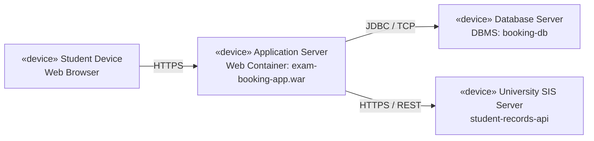

# Strutture di allocazione

## Definizione

> 📄 Fonte: [[01-IntroductionOnSoftwareArchitecture.pdf#page=38]]

Le strutture di allocazione stabiliscono la **corrispondenza tra le strutture software** e le **strutture non software** del sistema: la sua **organizzazione**, o i suoi ambienti di **sviluppo, test ed esecuzione**.

Tre domande possibili, ognuna con la sua corrispondenza:

| Domanda | Stile di allocazione ([[01-IntroductionOnSoftwareArchitecture.pdf#page=43]]) |
|---|---|
| Su quali **nodi di esecuzione** gira ogni elemento software? | **Deployment** |
| In quali **directory o file** è memorizzato ogni elemento durante sviluppo, test o build? | **Install** (e, 🧩, l'implementazione) |
| Quale **team di sviluppo** è responsabile di ogni elemento? | **Work assignment** |

![[lez01-intro-p38-allocation-structures.png]]
*Figura di [[01-IntroductionOnSoftwareArchitecture.pdf#page=38]]: al centro gli «elementi software dalle viste di modulo o C&C», collegati con frecce a tre ambienti non software: la **piattaforma di calcolo** (server — deployment style), l'**ambiente di produzione** (file system — install style) e l'**organizzazione dello sviluppo** (persone attorno a un tavolo — work assignment style).*

## A cosa servono le viste di deployment

> 📄 Fonte: [[01-IntroductionOnSoftwareArchitecture.pdf#page=43]]

- Analizzare **prestazioni, disponibilità, affidabilità e sicurezza**.
- I **tester** le usano per capire le dipendenze runtime; gli **integratori** per **pianificare l'integrazione** e i test di integrazione.
- Supportare la **stima dei costi** quando si valutano opzioni di acquisto dell'hardware.

## Struttura di deployment

> 📄 Fonte: [[01-IntroductionOnSoftwareArchitecture.pdf#page=44]]

Mostra **come il software è assegnato** agli elementi hardware di **elaborazione e comunicazione**.
- **Elementi**: elementi software (di solito un **processo** di una struttura C&C), **entità hardware** (processori) e **percorsi di comunicazione**.
- **Relazioni**: **«allocated-to»** o **«deploy»**, che mostrano su quali unità fisiche risiedono gli elementi software, e **«migrates-to»** se l'allocazione è **dinamica**.

![[lez01-intro-p44-deployment-structure.png]]
*Figura di [[01-IntroductionOnSoftwareArchitecture.pdf#page=44]] (UML): nodi «Internet user PC», «Win desktop» Admin user PC, «Win server» Application server con un «execution environment» WebSphere, «linux server» Database server; percorsi di comunicazione etichettati «internet» e «intranet» con molteplicità (\* a 1). Evidenziati in rosso gli artifact `app-client.jar` (deploy sull'Admin user PC) e `EnterpriseWebApp.ear` (deploy nell'ambiente WebSphere).*

## Esempi espansi — deployment dell'Exam Booking System

> 📄 Fonte: [[01-IntroductionOnSoftwareArchitecture.pdf#page=39]], [[01-IntroductionOnSoftwareArchitecture.pdf#page=40]], [[01-IntroductionOnSoftwareArchitecture.pdf#page=41]]

### Configurazione iniziale

![[lez01-intro-p39-deployment-iniziale.png]]
*Figura di [[01-IntroductionOnSoftwareArchitecture.pdf#page=39]], «UML Deployment View: initial configuration» — un solo nodo applicativo regge un carico limitato. `«device» Student Device` (artifact Web Browser) → HTTPS → `«device» Application Server` con `«executionEnvironment» Web Container` e artifact `exam-booking-app.war`; → JDBC/TCP → `«device» Database Server` con `«executionEnvironment» DBMS` e artifact `booking-db`; → HTTPS/REST → `«device» University SIS Server` con artifact `student-records-api`. Nota: l'artifact applicativo è installato **una sola volta**; lo **Student Information System** (SIS) possiede i dati accademici.*

*🧩 Ricostruzione Mermaid di [[01-IntroductionOnSoftwareArchitecture.pdf#page=39]].*

### Configurazione scalabile per i picchi di iscrizione

![[lez01-intro-p40-deployment-scalabile.png]]
*Figura di [[01-IntroductionOnSoftwareArchitecture.pdf#page=40]]: le istanze applicative sono **replicate dietro un load balancer**. Student Device → HTTPS → `«device» Load Balancer` (artifact `routing-config`) → HTTPS → Application Server 1 e Application Server 2 (ognuno con Web Container ed `exam-booking-app.war`). Entrambi parlano con il Database Server (JDBC/TCP), con un nuovo `«device» Message Broker` (artifact `notification-queue`, protocollo **AMQP**) e con lo University SIS Server (HTTPS/REST). Nota: la replicazione elimina l'application server come **single point of failure**; l'infrastruttura condivisa va comunque protetta.*

### Cosa si ragiona con la vista di deployment

> 📄 Fonte: [[01-IntroductionOnSoftwareArchitecture.pdf#page=41]]

Replicare l'application server migliora **disponibilità e scalabilità**. Elimina anche **ogni** collo di bottiglia? **No.** Toglie i limiti di capacità e disponibilità **solo nel livello applicativo**. Database, load balancer, session store, message broker e servizi esterni possono restare **colli di bottiglia** o **single point of failure**.

> 🔑 Definizione chiave: la qualità dell'intero sistema dipende dal **percorso completo seguito da una richiesta**. Il sistema è **limitato dal componente meno scalabile** e può essere reso **indisponibile dal componente critico meno protetto** ([[01-IntroductionOnSoftwareArchitecture.pdf#page=41]]).

> 🧩 Elaborazione mia: nella figura di p. 40 il percorso di una prenotazione tocca Load Balancer → Application Server (replicato) → Database Server (singolo) e Message Broker (singolo). Load Balancer, Database e Broker sono ancora in una sola copia: basta il guasto di uno solo di essi per fermare le prenotazioni. È la stessa conclusione di [[01-IntroductionOnSoftwareArchitecture-2 parte.pdf#page=15]] (DB a 30 transazioni/s) → [[valutazione-attributi-di-qualita]].

## Install view

> 📄 Fonte: [[01-IntroductionOnSoftwareArchitecture.pdf#page=45]], [[01-IntroductionOnSoftwareArchitecture.pdf#page=46]]

Descrive come il sistema installato è organizzato come **struttura di file e cartelle** e come gli elementi software corrispondono a quella struttura.
- **Due tipi di elementi**: un **componente C&C** e un **configuration item** (file o directory).
- **Due tipi di relazioni**: **allocated-to** (un componente è allocato a un configuration item) e **containment** (un configuration item è contenuto in un altro).

![[lez01-intro-p45-install-view-informale.png]]
*Figura di [[01-IntroductionOnSoftwareArchitecture.pdf#page=45]], notazione informale: l'archivio `DukesBankApp.ear` contiene `account-ejb.jar` (AccountControllerEJB, AccountEJB), `customer-ejb.jar` (CustomerControllerEJB, CustomerEJB), `tx-ejb.jar` (TxControllerEJB, TxEJB) e `web-client.war` (Dispatcher servlet, JSP, WebMessages.properties, file .tld, file gif e html, struts.jar). A parte `app-client.jar` (BankAdmin, AdminMessages.properties). Legenda: JAR file, File, Web component, EJB, Java application.*

In **UML** ([[01-IntroductionOnSoftwareArchitecture.pdf#page=46]]):
- lo stereotipo **«artifact»** denota un **file di qualsiasi tipo**;
- lo stereotipo **«manifest»** indica che un componente, una classe o un altro artifact è **dentro** un dato artifact.

![[lez01-intro-p46-install-view-uml.png]]
*Figura di [[01-IntroductionOnSoftwareArchitecture.pdf#page=46]]: lo stesso contenuto di p. 45 in UML. `«artifact» DukesBankApp.ear` è legato da «manifest» agli artifact jar/war; ogni jar è legato da «manifest» ai componenti che contiene («sessionbean», «entitybean», «servlet», «JSP»). Una nota «Shorthand for all JSP files» raggruppa le pagine JSP.* → [[uml]]

## Work assignment

Citato come terzo stile di allocazione ([[01-IntroductionOnSoftwareArchitecture.pdf#page=38]], [[01-IntroductionOnSoftwareArchitecture.pdf#page=43]]); le slide non ne danno un esempio. TODO: da espandere quando verrà trattato. Il legame con l'organizzazione dei team è in [[importanza-architettura-software]] §3.6.

## Perché importa

È la vista che collega l'architettura a **hardware, costi, integrazione e team**. Nell'esempio guida mostra che la replicazione di un livello non basta: bisogna guardare **tutto il percorso** della richiesta. Nel progetto di corso il deployment si farà con container Docker ([[00_IntroduzioneAlCorso_SAD.pdf#page=25]] → [[progetto-di-corso]]).

> 🎯 Esame: i tre stili di allocazione con la domanda di ciascuno; elementi e relazioni della deployment structure; la conclusione «il sistema è limitato dal componente meno scalabile».

## Connessioni

- [[strutture-componenti-e-connettori]]: fornisce i processi da allocare.
- [[tattiche-architetturali]]: la replicazione di risorse (prestazioni, disponibilità) si vede in questa vista.
- [[valutazione-attributi-di-qualita]]: le viste di deployment e concorrenza completano la valutazione delle prestazioni.
- [[uml]]: stereotipi «device», «executionEnvironment», «artifact», «manifest», «deploy».

## Fonti

- [[introduzione-architettura-software]] — [[01-IntroductionOnSoftwareArchitecture.pdf#page=37]]–[[01-IntroductionOnSoftwareArchitecture.pdf#page=46]]

_Aggiornato: 2026-09-26 — ingest lezione 1_
