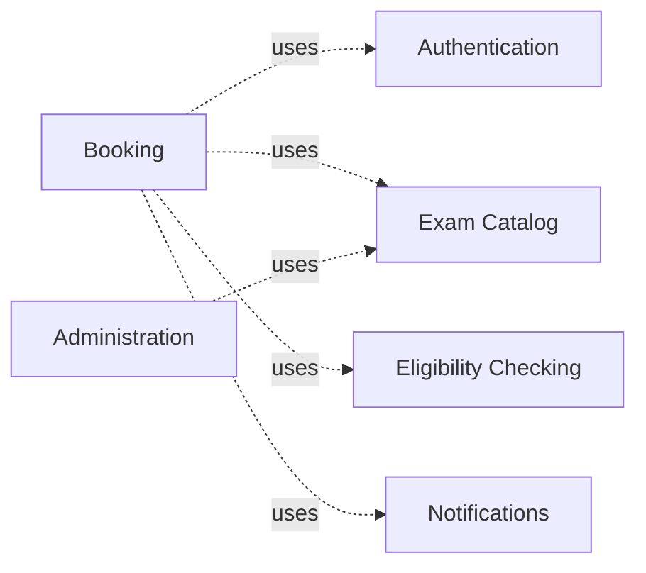
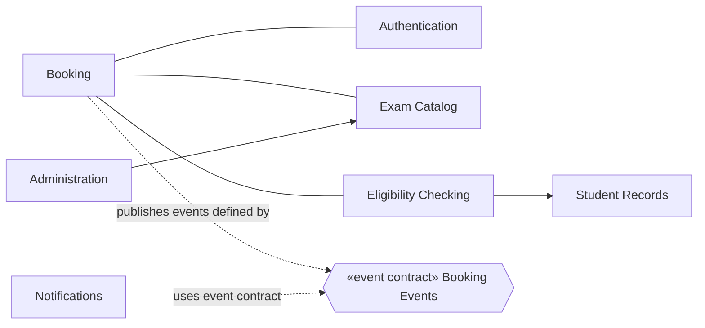

# Strutture di modulo

## Definizione

> 📄 Fonte: [[01-IntroductionOnSoftwareArchitecture.pdf#page=9]]

Le strutture di modulo **partizionano il sistema in unità di implementazione**, chiamate **moduli**.
- I moduli sono insiemi di **unità di codice o di dati** da costruire o riusare.
- A ogni modulo sono assegnate **responsabilità funzionali**.
- Un modulo può essere una **classe**, un **package**, uno **strato** (*layer*) o un'altra unità di implementazione.
- Le relazioni tra moduli sono: **uses** (usa), **generalizzazione** e **«is part of»** (è parte di).

> 🔑 Definizione chiave: i moduli rappresentano un modo **statico** di considerare il sistema.

🧩 «Statico» significa che la vista descrive il codice com'è scritto e organizzato, non cosa succede quando gira; per il runtime servono le [[strutture-componenti-e-connettori]].

### Notazione UML

> 📄 Fonte: [[01-IntroductionOnSoftwareArchitecture.pdf#page=10]]

![[lez01-intro-p10-uml-moduli-relazioni.png]]
*Figura di [[01-IntroductionOnSoftwareArchitecture.pdf#page=10]]. **A sinistra, moduli in UML**: package (`System.IO.Log`), classe (`SaveFileDialog`), classe con compartimenti per attributi e operazioni (`SaveFileDialog` con `FileName`, `Filter`, `ShowDialog()`, `OnFileOk(…)`), classe astratta (`CommonDialog`, nome in corsivo), classe con interfaccia fornita mostrata a «lecca-lecca» (`UIElement` con `IAnimatable`), interfaccia non a lecca-lecca (`«interface» IAnimatable`). **A destra, relazioni in UML**: *is-part-of* (package `com.sun.ebank.web.taglib` annidato in `com.sun.ebank.web`, con classi `Dispatcher` e `ContextListener`), *depends-on* (freccia tratteggiata «use» da `Dispatcher` a `BeanManager`), due forme di *is-a* — ereditarietà tra classi (`CheckingAccount` e `SavingsAccount` specializzano `Account`) e realizzazione di interfaccia (`AdminAccountView` realizza `«interface» Observer`).* → [[uml]]

## Domande a cui rispondono

> 📄 Fonte: [[01-IntroductionOnSoftwareArchitecture.pdf#page=11]]

- Qual è la **responsabilità funzionale** primaria assegnata a ogni modulo?
- Quali altri elementi software un modulo è **autorizzato a usare**?
- Quali altri software **usa effettivamente** e da quali **dipende**?
- Quali moduli sono legati ad altri da relazioni di **generalizzazione o specializzazione** (ereditarietà)?

Le strutture di modulo servono anche a valutare l'**impatto** sul sistema quando cambiano le responsabilità assegnate ai moduli.

> 🔑 Definizione chiave: le strutture di modulo sono lo **strumento principale per ragionare sulla modificabilità** (*modifiability*) di un sistema ([[01-IntroductionOnSoftwareArchitecture.pdf#page=11]]).

🧩 La distinzione «autorizzato a usare» vs «usa effettivamente» è la differenza tra architettura **prescritta** (le regole di dipendenza decise dall'architetto) e architettura **realizzata** (le dipendenze presenti nel codice). Quando divergono, il codice viola l'architettura (→ [[importanza-architettura-software]] §3.5, vincoli sull'implementazione).

## Esempi espansi — la vista dei moduli dell'Exam Booking System

> 📄 Fonte: [[01-IntroductionOnSoftwareArchitecture.pdf#page=14]], [[01-IntroductionOnSoftwareArchitecture.pdf#page=15]], [[01-IntroductionOnSoftwareArchitecture.pdf#page=16]]

![[lez01-intro-p14-vista-moduli-exam-booking.png]]
*Figura di [[01-IntroductionOnSoftwareArchitecture.pdf#page=14]]: sei moduli; **le frecce rappresentano la relazione uses**. Booking (evidenziato al centro) usa Authentication, Exam Catalog, Eligibility Checking e Notifications; Administration usa Exam Catalog. Nota: «una modifica a una regola di ammissione dovrebbe interessare principalmente Eligibility Checking, non Booking».*

*🧩 Ricostruzione Mermaid della figura di [[01-IntroductionOnSoftwareArchitecture.pdf#page=14]].*

La slide [[01-IntroductionOnSoftwareArchitecture.pdf#page=15]] usa questa vista per **ragionare sulla modificabilità** con tre domande:

| Domanda | Risposta della slide | Spiegazione |
|---|---|---|
| Se cambia la regola sui **prerequisiti**, quali moduli vanno modificati? | Un'**assegnazione corretta delle responsabilità** a moduli separati **localizza la modifica** e riduce il rischio di effetti indiretti. | 🧩 La regola sta solo in Eligibility Checking; Booking lo usa tramite interfaccia e non conosce la regola, quindi non cambia. È la tattica *localize changes* ([[tattiche-architetturali]]). |
| Booking può **dipendere direttamente** da Notification? | Considerare meccanismi di **invocazione indiretta** (es. **pubblicazione di eventi**) riduce l'accoppiamento diretto tra moduli e semplifica **modificabilità e disponibilità**, anche se **aggiunge complessità**. | 🧩 Con la dipendenza diretta, un cambiamento nell'interfaccia di Notifications o un suo guasto si propaga a Booking. Con gli eventi Booking non sa chi riceve la notifica. |
| Come evitare che **ogni modulo interroghi direttamente il database degli studenti**? | Introdurre un **modulo che espone API** per l'accesso ai dati degli studenti riduce le dipendenze eccessive e semplifica le future modifiche ai dati. | 🧩 È la tattica *hide information*: il formato dei dati diventa un segreto di un solo modulo (Student Records, [[01-IntroductionOnSoftwareArchitecture-2 parte.pdf#page=29]]). |

La slide successiva mostra la vista **dopo** aver applicato la seconda e la terza idea:

![[lez01-intro-p16-moduli-event-based.png]]
*Figura di [[01-IntroductionOnSoftwareArchitecture.pdf#page=16]], «Module structure with event-based notification»: Booking e Notifications condividono un **contratto di eventi** ma **non dipendono direttamente** l'uno dall'altro. Booking «pubblica eventi definiti da» `«event contract» Booking Events`; Notifications «usa il contratto di eventi». Compare il nuovo modulo **Student Records**, usato da Eligibility Checking. Nota: la consegna asincrona tramite message broker si vede nella vista componenti e connettori.*

*🧩 Ricostruzione Mermaid di [[01-IntroductionOnSoftwareArchitecture.pdf#page=16]]. Nella figura originale le linee tra Booking e Authentication, Exam Catalog, Eligibility Checking non hanno punta di freccia.*

> 💡 Connessione: il contratto di eventi è un'**interfaccia condivisa** di cui dipendono entrambi i moduli; la dipendenza non sparisce, si sposta da un modulo concreto a un contratto stabile. A runtime l'evento passa per una coda ([[strutture-componenti-e-connettori]], [[01-IntroductionOnSoftwareArchitecture.pdf#page=28]]).

## Esempi di strutture di modulo utili

> 📄 Fonte: [[01-IntroductionOnSoftwareArchitecture.pdf#page=17]]–[[01-IntroductionOnSoftwareArchitecture.pdf#page=23]]

| Struttura | Elementi | Relazione | A cosa serve |
|---|---|---|---|
| **Decomposizione** | moduli e sottomoduli | *is part of* | punto di partenza del progetto; organizzazione del progetto, della documentazione, dei piani di integrazione e test |
| **Uses** | moduli | *uses* | quali moduli servono in un incremento; stima del *social debt* |
| **Layer** | strati | *allowed to use* | portabilità |
| **Class** (generalizzazione) | classi | *inherits-from*, *is-an-instance-of* | comportamenti simili e differenze parametrizzate |
| **Data model** | entità di dati | relazioni tra entità | struttura statica dell'informazione |

### Decomposizione

> 📄 Fonte: [[01-IntroductionOnSoftwareArchitecture.pdf#page=18]], [[01-IntroductionOnSoftwareArchitecture.pdf#page=19]]

Mostra come i moduli sono **scomposti ricorsivamente** in moduli più piccoli finché non sono abbastanza piccoli da essere **facilmente compresi**. I moduli di questa struttura sono un **punto di partenza comune** per il progetto. Spesso è la base dell'**organizzazione del progetto di sviluppo**: struttura della documentazione, piani di integrazione e di test.

![[lez01-intro-p18-decomposition-structure.png]]
*Figura di [[01-IntroductionOnSoftwareArchitecture.pdf#page=18]]: package UML annidati. Il sistema ATIA-M contiene «Windows apps» (a sua volta con «Common code for thick clients», «TDDT Windows app», «UTMC Windows app»), «ATIA server-side web modules» e «ATIA server-side Java modules».*

![[lez01-intro-p19-uml-decomposition-exam-booking.png]]
*Figura di [[01-IntroductionOnSoftwareArchitecture.pdf#page=19]]: decomposizione UML dell'Exam Booking System. I **package annidati rappresentano la relazione is-part-of**. `«package» Exam Booking System` contiene: `Student-facing Applications` (Web Application, Mobile Application), `Shared Client Code`, `Server-side Modules` (Booking Management, Eligibility Checking, Notifications). Nota: il contenimento mostra **solo la decomposizione**; le dipendenze tra moduli richiedono una **vista uses separata**.*

### Uses

> 📄 Fonte: [[01-IntroductionOnSoftwareArchitecture.pdf#page=20]]

I moduli sono legati dalla relazione **uses**: un modulo **usa** un altro se la **correttezza** del primo richiede la **presenza e il corretto funzionamento** del secondo. Può servire a valutare il **social debt**, cioè la quantità di comunicazione necessaria tra i team.

![[lez01-intro-p20-uses-structure.png]]
*Figura di [[01-IntroductionOnSoftwareArchitecture.pdf#page=20]]: package (estore.webapp, web::estore, web::shared, web::accessControl, estore.core, admin.client, admin.core, util, dao) legati da frecce tratteggiate «use». Sono evidenziati i moduli che **devono essere presenti in un incremento se è presente admin.client**: admin.client, admin.core, util, dao.*

> 🧩 Elaborazione mia: per costruire l'incremento si segue la chiusura transitiva di *uses* a partire da admin.client (admin.client → admin.core → dao, util). Per il social debt: se due moduli legati da *uses* sono di team diversi, i team devono coordinarsi su interfaccia e comportamento; più archi tra team, più comunicazione.

### Layer

> 📄 Fonte: [[01-IntroductionOnSoftwareArchitecture.pdf#page=21]]

I moduli sono chiamati **strati** (*layers*). Uno strato è una **«macchina virtuale» astratta** che fornisce un **insieme coeso di servizi** attraverso un'**interfaccia gestita**. Nei sistemi **strettamente stratificati** uno strato può usare **un solo altro strato**. Questa struttura dà al sistema **portabilità**: la capacità di cambiare la macchina virtuale sottostante.

![[lez01-intro-p21-layer-structure-unix.png]]
*Figura di [[01-IntroductionOnSoftwareArchitecture.pdf#page=21]]: struttura a strati di **Unix System V**. Dall'alto: User programs, Libraries (livello utente); System call interface, File subsystem, Process control subsystem (IPC, scheduler, memory mgmt), Buffering mechanism, Character device drivers, Block I/O device drivers, Hardware control (livello kernel). La legenda distingue strati user-level e kernel-level; le frecce significano «allowed to use».*

🧩 Unix non è strettamente stratificato: gli User programs possono usare sia le Libraries sia direttamente la System call interface. → [[layered]]

### Class

> 📄 Fonte: [[01-IntroductionOnSoftwareArchitecture.pdf#page=22]]

I moduli sono **classi**, legate da relazioni **«inherits-from»** o **«is-an-instance-of»**. Supporta il ragionamento su **collezioni di comportamenti o capacità simili** e sulle loro **differenze parametrizzate**. È la struttura tipica di un progetto **orientato agli oggetti**.

![[lez01-intro-p22-class-structure.png]]
*Figura di [[01-IntroductionOnSoftwareArchitecture.pdf#page=22]]: struttura di generalizzazione presa da uno strumento per esperti di architettura (notazione UML). `Fact` (attributi `id: int`, `type: String`) eredita da `java.util.Observable`; otto classi `…VO` (ScenarioVO, FunctionVO, ScenarioRespVO, FunctionRespVO, RelationshipVO, QuestionToUserVO, ResponsibilityVO, ParameterVO) ereditano da `Fact`.*

### Data model

> 📄 Fonte: [[01-IntroductionOnSoftwareArchitecture.pdf#page=23]]

Il modello dei dati descrive la **struttura statica dell'informazione** in termini di **entità di dati** e loro **relazioni**.

![[lez01-intro-p23-data-model.png]]
*Figura di [[01-IntroductionOnSoftwareArchitecture.pdf#page=23]]: tre entità — `PurchaseOrder` (PK poId; FK clientId, shippingInfoId, billingInfoId, creditCardId; totalPrice), `OrderItem` (PK/FK poId, itemId; qty, unit, price), `CatalogItem` (PK itemId; name, description, listPrice, status) — con tipi di colonna (INTEGER, NUMERIC(10,2), CHAR, VARCHAR, TEXT). Le linee con notazione «crow's foot» dicono che a un PurchaseOrder corrispondono 0 o più OrderItem e che ogni OrderItem è legato a esattamente un CatalogItem. La legenda spiega PK (primary key), FK (foreign key), I (index) e il grassetto per le colonne obbligatorie.*

## Perché importa

È la vista con cui si ragiona sulla **modificabilità**: la [[valutazione-attributi-di-qualita]] della modificabilità (analisi d'impatto) si fa proprio sulle viste dei moduli ([[01-IntroductionOnSoftwareArchitecture-2 parte.pdf#page=17]]). La decomposizione è anche la base per dividere il lavoro tra i team ([[importanza-architettura-software]] §3.6), cosa che nel progetto di corso si fa davvero ([[progetto-di-corso]]).

> 🎯 Esame: definizione di modulo e delle tre relazioni; le cinque strutture di modulo con la loro utilità; ragionamento di modificabilità sull'Exam Booking System.

## Connessioni

- [[strutture-componenti-e-connettori]]: vista runtime, ortogonale a questa.
- [[strutture-di-allocazione]]: la *work assignment* assegna moduli ai team.
- [[tattiche-architetturali]]: le tattiche di modificabilità agiscono sulle strutture di modulo.
- [[layered]]: lo stile che nasce dalla struttura a strati.
- [[uml]]: notazione usata nelle figure.

## Fonti

- [[introduzione-architettura-software]] — [[01-IntroductionOnSoftwareArchitecture.pdf#page=8]]–[[01-IntroductionOnSoftwareArchitecture.pdf#page=23]]

_Aggiornato: 2026-09-26 — ingest lezione 1_
