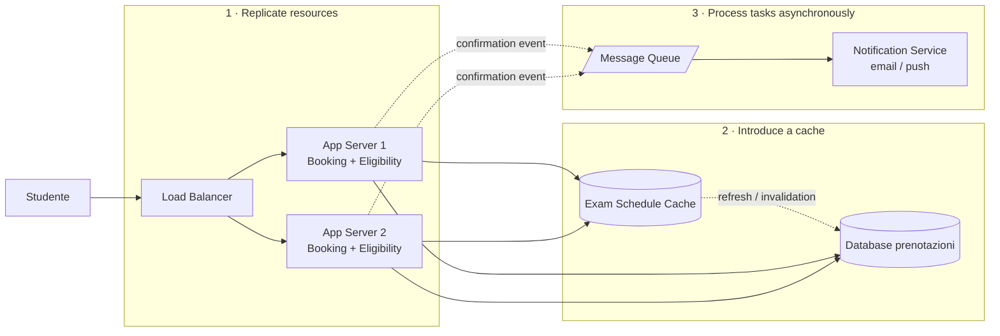
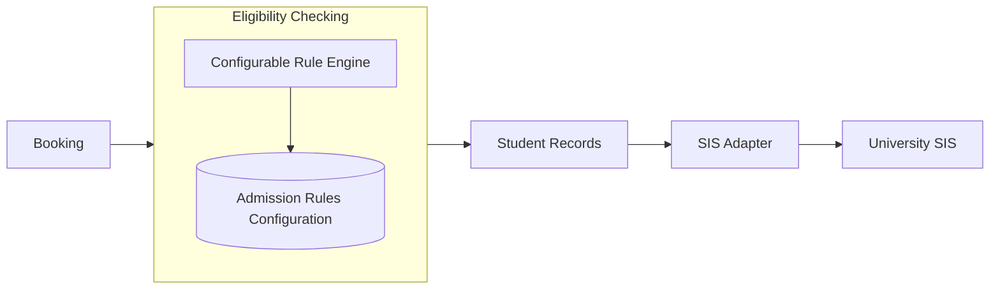

# Tattiche architetturali

## Definizione

> 📄 Fonte: [[01-IntroductionOnSoftwareArchitecture-2 parte.pdf#page=21]] (slide 72)

> 🔑 Definizione chiave: una **tattica** (*tactic*) è una **decisione di progetto** che influenza il raggiungimento della **risposta** di un attributo di qualità.

Esempi della slide: *Schedule Resources* è una tattica di **prestazioni**; *Use an Intermediary* è una tattica di **modificabilità**.

🧩 «Influenza la risposta» va letto con lo schema degli [[scenari-di-qualita]]: la tattica agisce sulla parte ⑤ (risposta) per migliorare la ⑥ (misura). Una tattica riguarda **un solo** attributo; un **pattern** ne combina diverse ([[pattern-architetturali]]).

È la risposta alla seconda domanda su architettura e qualità: come **ottenere** le qualità con mezzi architetturali ([[01-IntroductionOnSoftwareArchitecture-2 parte.pdf#page=7]], [[01-IntroductionOnSoftwareArchitecture-2 parte.pdf#page=20]]).

## Catalogo delle tattiche viste a lezione

| Attributo | Tattica | Applicazione all'[[exam-booking-system]] | Fonte |
|---|---|---|---|
| Prestazioni | Replicate resources | più application server dietro un load balancer | [[01-IntroductionOnSoftwareArchitecture-2 parte.pdf#page=23]] |
| Prestazioni | Introduce a cache | cache del calendario esami | [[01-IntroductionOnSoftwareArchitecture-2 parte.pdf#page=23]] |
| Prestazioni | Process tasks asynchronously | conferma delegata a una coda | [[01-IntroductionOnSoftwareArchitecture-2 parte.pdf#page=23]] |
| Prestazioni | Schedule resources | (solo citata come esempio) | [[01-IntroductionOnSoftwareArchitecture-2 parte.pdf#page=21]] |
| Disponibilità | Detecting failures | health check periodici del load balancer | [[01-IntroductionOnSoftwareArchitecture-2 parte.pdf#page=25]] |
| Disponibilità | Redirecting requests | istanza guasta tolta dal pool | [[01-IntroductionOnSoftwareArchitecture-2 parte.pdf#page=25]] |
| Disponibilità | Introducing redundancy | repliche di server, DB, broker | [[01-IntroductionOnSoftwareArchitecture-2 parte.pdf#page=25]] |
| Sicurezza | Authenticate users | sistema di autenticazione dell'università | [[01-IntroductionOnSoftwareArchitecture-2 parte.pdf#page=27]] |
| Sicurezza | Authorize operations | controlli basati sui ruoli (RBAC) | [[01-IntroductionOnSoftwareArchitecture-2 parte.pdf#page=27]] |
| Sicurezza | Protect data during transmission | TLS | [[01-IntroductionOnSoftwareArchitecture-2 parte.pdf#page=27]] |
| Sicurezza | Log relevant events | audit log protetto | [[01-IntroductionOnSoftwareArchitecture-2 parte.pdf#page=27]] |
| Modificabilità | Localize changes | regole di ammissione in Eligibility Checking | [[01-IntroductionOnSoftwareArchitecture-2 parte.pdf#page=29]] |
| Modificabilità | Hide information | dati degli studenti tramite Student Records | [[01-IntroductionOnSoftwareArchitecture-2 parte.pdf#page=29]] |
| Modificabilità | Use an intermediary | SIS isolato da un adapter | [[01-IntroductionOnSoftwareArchitecture-2 parte.pdf#page=29]] |
| Modificabilità | Defer binding | regole configurabili senza modificare l'applicazione | [[01-IntroductionOnSoftwareArchitecture-2 parte.pdf#page=29]] |

> 💡 Connessione: le Lez. 2 e 3 riprendono disponibilità e modificabilità con il **catalogo completo** di Bass, Clements, Kazman: [[tattiche-availability]] (detect / recover / prevent, pattern di ridondanza, circuit breaker) e [[tattiche-modifiability]] (increase cohesion / reduce coupling / defer binding). Corrispondenze con le tattiche di questa pagina: *detecting failures* → ping/echo e monitor; *redirecting requests* + *introducing redundancy* → redundant spare e active/passive redundancy; *localize changes* → increase cohesion (redistribute responsibilities); *hide information* → encapsulation; *use an intermediary* e *defer binding* hanno lo stesso nome.

## Tattiche di prestazioni

> 📄 Fonte: [[01-IntroductionOnSoftwareArchitecture-2 parte.pdf#page=23]] (slide 74), [[01-IntroductionOnSoftwareArchitecture-2 parte.pdf#page=24]] (slide 75)

| Tattica | Cosa si fa | Effetto | Trade-off |
|---|---|---|---|
| **Replicare le risorse** | più istanze dell'application server; richieste distribuite da un **load balancer** | aumenta il **numero di richieste servite contemporaneamente** | richiede **gestione delle sessioni**, **sincronizzazione** e controllo dell'**accesso concorrente ai dati** |
| **Introdurre una cache** (per il calendario degli esami) | i dati letti spesso sono tenuti in una cache | riduce **latenza** e **carico sul database** | i dati in cache possono essere **non aggiornati** |
| **Elaborare in modo asincrono** | si **registra subito** la prenotazione e si **delega a una coda** l'invio della conferma: Booking → Message Queue → Notification | riduce il **tempo di risposta percepito** dallo studente | le notifiche possono arrivare **in ritardo**; bisogna gestire messaggi **persi o duplicati** |

![[lez01b-qa-p24-tattiche-performance.png]]
*Figura di [[01-IntroductionOnSoftwareArchitecture-2 parte.pdf#page=24]], «Performance Tactics (C&C view)»: lo studente che prenota un esame arriva al **Load Balancer**, che distribuisce su **Application Server 1** e **2** (entrambi «Booking + Eligibility») — prima tattica, *replicate resources*. Gli application server leggono dalla **Exam Schedule Cache**, che si aggiorna con *refresh/invalidation* dal **database condiviso delle prenotazioni** — seconda tattica, *introduce a cache*. Entrambi gli application server inviano un *confirmation event* alla **Message Queue**, che alimenta il **Notification Service (email/push)** — terza tattica, *asynchronous tasks*.*

*🧩 Ricostruzione Mermaid di [[01-IntroductionOnSoftwareArchitecture-2 parte.pdf#page=24]].*

> 💡 Connessione: le tre tattiche rispondono al problema calcolato in [[valutazione-attributi-di-qualita]] (5.000 richieste/min contro un DB da 30 transazioni/s). La replicazione **da sola** non basta; cache (meno letture sul DB) e asincronia (meno lavoro nel percorso critico) agiscono proprio sul collo di bottiglia. 🧩

## Tattiche di disponibilità

> 📄 Fonte: [[01-IntroductionOnSoftwareArchitecture-2 parte.pdf#page=25]] (slide 76), [[01-IntroductionOnSoftwareArchitecture-2 parte.pdf#page=26]] (slide 77)

- **Rilevare i guasti** (*detecting failures*): il load balancer esegue **health check periodici** sulle istanze.
- **Reindirizzare le richieste** (*redirecting requests*): quando un'istanza non risponde, il load balancer la **toglie temporaneamente dal pool** e instrada il traffico sulle altre.
- **Introdurre ridondanza** (*introducing redundancy*): replicare application server, database o message broker.
- … (la slide lascia l'elenco aperto)

![[lez01b-qa-p26-availability-prima-dopo-guasto.png]]
*Figura di [[01-IntroductionOnSoftwareArchitecture-2 parte.pdf#page=26]], «due configurazioni prima e dopo il guasto di un server». **BEFORE**: Student → Load Balancer → *requests* e *periodic health check* verso Application Server 1 (UP) e Application Server 2 (UP); i server usano un Primary Database replicato su uno Standby Database e un Message Broker 1 replicato su Message Broker 2. **AFTER**: l'health check verso Application Server 1 fallisce (FAILED), il server viene *removed temporarily from the pool* e le richieste sono *redirected* verso Application Server 2 (UP), che continua a usare il Primary Database replicato sullo Standby.*

🧩 Le tre tattiche lavorano insieme e corrispondono alle risposte dello scenario generale di disponibilità ([[scenari-di-qualita]]): l'health check **rileva** il guasto; il reindirizzamento e la ridondanza **impediscono che il guasto diventi un malfunzionamento** visibile allo studente. La ridondanza estesa a DB e broker affronta i single point of failure rimasti in [[01-IntroductionOnSoftwareArchitecture.pdf#page=41]].

## Tattiche di sicurezza

> 📄 Fonte: [[01-IntroductionOnSoftwareArchitecture-2 parte.pdf#page=27]] (slide 78), [[01-IntroductionOnSoftwareArchitecture-2 parte.pdf#page=28]] (slide 79)

| Tattica | Applicazione | Effetto | Trade-off |
|---|---|---|---|
| **Autenticare gli utenti** | verificare l'identità dello studente con il **sistema di autenticazione dell'università** | impedisce l'accesso **anonimo** alle funzioni di prenotazione | |
| **Autorizzare le operazioni** | controlli **basati sui ruoli**: gli studenti gestiscono solo le **proprie** prenotazioni; i docenti vedono gli iscritti **alle proprie** sessioni d'esame; gli amministratori configurano sessioni e regole | **limita le azioni** permesse a ogni utente | |
| **Proteggere i dati in transito** | **TLS** tra browser, application server e sistemi esterni | protegge **confidenzialità e integrità** dei dati trasmessi | |
| **Registrare gli eventi rilevanti** | registrare **chi** ha creato o cancellato una prenotazione e **quando** | permette **auditing** e rilevazione di **comportamenti anomali** | i log vanno **protetti**, perché possono contenere **dati personali** |

![[lez01b-qa-p28-tattiche-security.png]]
*Figura di [[01-IntroductionOnSoftwareArchitecture-2 parte.pdf#page=28]]: Student/Instructor/Administrator → **HTTPS/TLS** → Exam Booking Application Server. Dal server partono: ① *authenticate* verso lo **University Identity Provider**, che restituisce *identity + role*; il **Role-Based Access Control** lascia passare la *permitted operation* verso il Booking Database oppure produce *denied operation* → Access denied; *who, what, when* verso il **Protected Audit Log**; **TLS** verso gli External Systems. Tabella sotto la figura con i cinque punti numerati.*

| N. | Tattica | Dove ([[01-IntroductionOnSoftwareArchitecture-2 parte.pdf#page=28]]) |
|---|---|---|
| ① | Protect data during transmission | TLS (*Transport Layer Security*) tra browser e application server |
| ② | Authenticate users | l'applicazione **delega l'identificazione** al sistema di autenticazione dell'università |
| ③ | Authorize operations | **RBAC** (*Role Based Access Control*) verifica ruolo, risorsa e operazione richiesta |
| ④ | Log relevant events | gli eventi rilevanti vanno in un **audit log protetto** |
| ⑤ | Protect data during transmission | TLS anche per le comunicazioni con i sistemi esterni |

## Tattiche di modificabilità

> 📄 Fonte: [[01-IntroductionOnSoftwareArchitecture-2 parte.pdf#page=29]] (slide 80), [[01-IntroductionOnSoftwareArchitecture-2 parte.pdf#page=30]] (slide 81)

| Tattica | Dove | Effetto |
|---|---|---|
| **Localize changes** (localizzare le modifiche) | le regole di ammissione sono **raccolte in Eligibility Checking** | una modifica ai prerequisiti **non dovrebbe toccare Booking** |
| **Hide information** (nascondere l'informazione) | gli altri moduli accedono ai dati degli studenti **tramite Student Records** | formato, provenienza e modalità di accesso dei dati **restano nascosti** |
| **Use an intermediary** (usare un intermediario) | il **SIS Adapter** media l'accesso al sistema informativo dell'università | sostituire o modificare l'API del SIS coinvolge **principalmente l'adapter** |
| **Defer binding** (posticipare il binding) | le regole sono **caricate dalla configurazione a runtime** | alcune varianti si introducono **senza modificare e ricompilare** l'applicazione |

![[lez01b-qa-p30-tattiche-modifiability.png]]
*Figura di [[01-IntroductionOnSoftwareArchitecture-2 parte.pdf#page=30]]: Booking → Eligibility Checking (che contiene un **Configurable Rule Engine** e una **Admission Rules Configuration**) → Student Records → SIS Adapter → University SIS; sotto, la tabella Tattica / Dove / Effetto.*

*🧩 Ricostruzione Mermaid di [[01-IntroductionOnSoftwareArchitecture-2 parte.pdf#page=30]]: ogni freccia attraversa un confine che protegge chi sta a sinistra dai cambiamenti di chi sta a destra.*

🧩 Collegamento con i requisiti di [[01-IntroductionOnSoftwareArchitecture-2 parte.pdf#page=5]]: *localize changes* soddisfa il requisito di modificabilità («solo Eligibility Checking e i suoi test»); *use an intermediary* rende possibile il requisito di testabilità (testare Eligibility Checking senza il SIS di produzione, sostituendo l'adapter con un finto).

## Perché importa

Le tattiche sono il **vocabolario** della progettazione architetturale: il programma prevede tattiche per availability, modifiability, security e altre ([[00_IntroduzioneAlCorso_SAD.pdf#page=15]]) e la progettazione basata sul riuso di pattern, stili e tattiche ([[00_IntroduzioneAlCorso_SAD.pdf#page=16]]). Restringere il vocabolario a soluzioni collaudate come pattern e tattiche è una delle motivazioni dell'architettura ([[importanza-architettura-software]] §3.10).

> 🎯 Esame: definizione di tattica; distinguere tattica e pattern; per ogni attributo, le tattiche con effetto e trade-off sull'Exam Booking System.

## Connessioni

- [[pattern-architetturali]]: un pattern incorpora più tattiche.
- [[scenari-di-qualita]]: la tattica agisce sulla risposta dello scenario.
- [[valutazione-attributi-di-qualita]]: dice quando una tattica serve.
- [[applicazione-tattiche]]: esercizi svolti.
- [[layered]]: esempio di pattern come insieme di tattiche.

## Fonti

- [[attributi-di-qualita-e-importanza-architettura]] — [[01-IntroductionOnSoftwareArchitecture-2 parte.pdf#page=20]]–[[01-IntroductionOnSoftwareArchitecture-2 parte.pdf#page=30]]

_Aggiornato: 2026-09-26 — ingest lezione 1_
_Aggiornato: 2026-09-30 — rimandi ai cataloghi completi delle Lez. 2–3_
