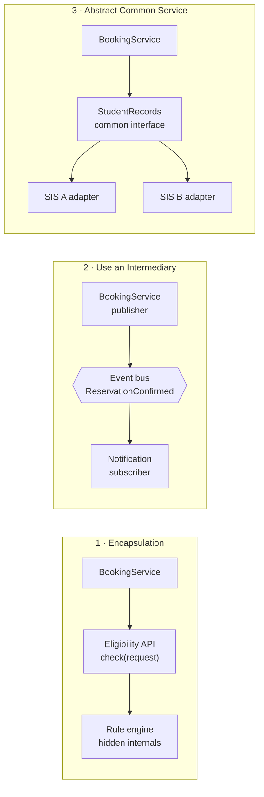

# Tattiche per la modifiability

## Definizione

> 📄 Fonte: [[03-Modifiability.pdf#page=18]]

Le tattiche di modificabilità servono a **ridurre costo e rischio delle modifiche** ([[modifiability]]). Sono organizzate in tre gruppi.

![[lez03-mo-p18-albero-tattiche-modifiability.png]]
*Figura di [[03-Modifiability.pdf#page=18]] (dal libro di Bass, Clements, Kazman).*

| Increase Cohesion | Reduce Coupling | Defer Binding |
|---|---|---|
| Split Module | Encapsulate | Component Replacement |
| Redistribute Responsibilities | Use an Intermediary | Compile-Time Parameterization (sulla slide: «Couple-Time») |
| | Abstract Common Services | Aspects |
| | Restrict Dependencies (sulla slide: «Ristrict») | Configuration-Time Binding |
| | | Resource Files |
| | | Discovery |
| | | Interpret Parameters |
| | | Shared Repositories |
| | | Polymorphism |

> 🧩 Elaborazione mia — i tre gruppi rispondono a tre domande diverse: **coesione** = cosa sta insieme dentro un modulo; **accoppiamento** = quanto un modulo dipende dagli altri; **binding** = in quale momento si fissa una scelta. I primi due riducono *quanti* moduli tocca una modifica; il terzo riduce *quanto costa* farla (config invece di codice).

## Aumentare la coesione (*Increase Cohesion*)

> 📄 Fonte: [[03-Modifiability.pdf#page=19]]

**Obiettivo:** raggruppare le responsabilità in modo che un cambiamento probabile tocchi **il minor numero possibile di moduli**.

| Tattica | Cosa fa | Esempio Booking |
|---|---|---|
| **Split module** | divide un modulo con responsabilità **non correlate** in moduli con scopi chiari e coesi | separare i controlli di ammissibilità dall'invio delle notifiche, se oggi stanno entrambi in BookingService |
| **Redistribute responsibilities** | **riunisce** responsabilità correlate quando sono **sparse** tra più moduli | se le regole di ammissibilità sono in parte nell'interfaccia utente, in parte in BookingService e in parte nel connettore del SIS, spostarle in un componente dedicato |

![[lez03-mo-p19-increase-cohesion.png]]
*Figura di [[03-Modifiability.pdf#page=19]]. **Sinistra (split module)**: BookingService con due responsabilità (Eligibility checks, Send notifications) → due moduli, EligibilityRules e NotificationService. **Destra (redistribute)**: tre moduli con pezzi di logica di ammissibilità (UI + eligibility check, BookingService + eligibility rule, SIS Adapter + eligibility check) → un solo modulo EligibilityRules con «tutta la logica di ammissibilità in un modulo»; UI, BookingService e SIS Adapter mantengono le altre responsabilità.*

> 💡 Connessione: è la stessa idea della tattica *localize changes* della Lez. 1 ([[tattiche-architetturali]]), dove le regole di ammissione sono consolidate in Eligibility Checking.

## Ridurre l'accoppiamento (*Reduce Coupling*)

> 📄 Fonte: [[03-Modifiability.pdf#page=20]], [[03-Modifiability.pdf#page=21]], [[03-Modifiability.pdf#page=22]]

> 🔑 Definizione chiave: l'**accoppiamento** (*coupling*) è il grado in cui un modulo dipende da un altro. Un accoppiamento forte può far **propagare** una modifica attraverso i moduli.

| Tattica | Cosa fa |
|---|---|
| **Encapsulation** | espone un'**interfaccia** e **nasconde l'implementazione** interna del modulo |
| **Use an Intermediary** | i componenti interagiscono tramite un **mediatore** senza conoscere l'identità l'uno dell'altro. Intermediari come un **bus publish–subscribe**, un **repository di dati condiviso** o la **service discovery dinamica** eliminano la necessità che una parte conosca l'identità dell'altra |
| **Abstract Common Service** | mette servizi simili dietro un'**interfaccia condivisa**, così le implementazioni cambiano indipendentemente, **purché l'interfaccia resti stabile** |
| **Restrict Dependencies** | limita i moduli con cui un modulo interagisce o da cui dipende: **restringendo la visibilità** (se gli sviluppatori non vedono un'interfaccia, non possono usarla) o **restringendo l'accesso** ai soli moduli autorizzati. Si vede nelle **architetture a strati** (uno strato usa solo quelli inferiori, a volte solo quello immediatamente sotto) e nell'uso di **wrapper** (le entità esterne vedono, e quindi dipendono da, solo il wrapper e non la funzionalità interna) |

![[lez03-mo-p21-reduce-coupling-tre-tattiche.png]]
*Figura di [[03-Modifiability.pdf#page=21]], «Reduce Coupling: Three Tactics». **1 Encapsulation** — dipendere da un'interfaccia, non dalle regole interne: BookingService → Eligibility API `check(request)` → Rule engine (internals nascosti). **2 Use an Intermediary** — nessun legame diretto publisher–subscriber: BookingService (publisher) → Event bus (evento `ReservationConfirmed`) → Notification (subscriber); il contratto dell'evento resta condiviso. **3 Abstract Common Service** — un contratto per fornitori alternativi: BookingService → StudentRecords (interfaccia comune) → SIS A adapter oppure SIS B adapter; per un dato deployment basta selezionare un adapter. Nota: ogni tattica riduce una dipendenza diversa; interfacce, eventi e contratti di servizio devono comunque restare stabili.*


*🧩 Ricostruzione Mermaid di [[03-Modifiability.pdf#page=21]].*

> 🧩 Elaborazione mia — cosa cambia senza toccare BookingService: con (1) le regole interne del rule engine; con (2) chi riceve le notifiche e quanti destinatari ci sono; con (3) quale SIS si usa. In tutti e tre i casi ciò che non può cambiare liberamente è il **contratto** (API, evento, interfaccia comune).

## Posticipare il binding (*Defer Binding*)

> 📄 Fonte: [[03-Modifiability.pdf#page=23]], [[03-Modifiability.pdf#page=24]], [[03-Modifiability.pdf#page=25]]

> 🔑 Definizione chiave: il **binding** è la **scelta** di un valore, di un componente o di un servizio. **Posticiparla** rende possibili alcune modifiche **senza modificare il codice sorgente**.

Se i binding sono definiti direttamente nel codice **a design time**, vanno cambiati a mano nel codice; altrimenti le modifiche si possono fare automaticamente. Quindi conviene definire i binding **il più tardi possibile** nel ciclo di vita ([[03-Modifiability.pdf#page=23]]).

Tattiche per momento di binding ([[03-Modifiability.pdf#page=24]]):
- **compile time o build time**: *component replacement* (in uno script di build o makefile), *compile-time parameterization*;
- **deploy o configuration time**: *configuration-time binding*, *resource files*;
- **runtime**: *discovery*, *interpret parameters*, *shared repositories*, *polymorphism*.

### Esempi

![[lez03-mo-p25-defer-binding-esempi.png]]
*Figura di [[03-Modifiability.pdf#page=25]]: tabella con momento di binding, tattica, tecnologia di esempio ed esempio Booking.*

| Momento | Tattica | Tecnologia d'esempio | Esempio Booking |
|---|---|---|---|
| build | component replacement | Maven build profiles | scegliere il connettore SIS per l'Università A o B quando si fa la build |
| compile/build | compile-time parameterization | generazione di sorgenti durante una build Maven | generare una classe con un valore fissato prima della compilazione; cambiarlo richiede di ricompilare |
| deployment/configurazione | configuration-time binding | configurazione esterna di Spring Boot | impostare l'endpoint del SIS con una variabile d'ambiente al deployment |
| deployment/configurazione | resource files | file esterno `application.yml` o `.properties` | impostare il numero massimo di prenotazioni in un file di configurazione |
| runtime | discovery | Spring Cloud `DiscoveryClient` e un service registry | trovare un'istanza SIS disponibile tramite il nome logico del servizio |
| runtime | interpret parameters | logica applicativa che legge i parametri della richiesta | scegliere una regola di ammissibilità secondo il tipo d'esame della richiesta |
| runtime | shared repositories | una tabella di database condivisa | leggere dal database le regole di prenotazione attive |
| runtime | polymorphism | interfacce Java e implementazioni alternative | scegliere un'implementazione di `EligibilityPolicy` per l'università o l'esame |

La tattica *Aspects* compare nell'albero di p. 18 ma non è spiegata (TODO se verrà trattata).

> 🧩 Elaborazione mia — esempio di codice per *resource files* e *polymorphism*, con i nomi della slide:
>
> ```yaml
> # application.yml — resource file: il limite si cambia senza ricompilare
> booking:
>   max-reservations: 5
>   sis-endpoint: ${SIS_ENDPOINT}   # configuration-time binding: variabile d'ambiente al deployment
> ```
>
> ```java
> // polymorphism: la regola si sceglie a runtime, Booking dipende solo dall'interfaccia
> public interface EligibilityPolicy {
>     boolean isEligible(Student student, Exam exam);
> }
> ```

> 💡 Connessione: *defer binding* compare già nella Lez. 1 (regole caricate da configurazione a runtime, [[tattiche-architetturali]]); qui è organizzato per **momento di binding**, che corrisponde alla domanda «quando si fa il cambiamento» di [[modifiability]] ([[03-Modifiability.pdf#page=6]]). *Discovery* realizza l'**indipendenza dalla posizione**.

## Perché importa

Le tattiche di modificabilità agiscono sulle **strutture di modulo** ([[strutture-di-modulo]]) e sono la base dei pattern di modificabilità ([[pattern-modifiability]]). All'orale si chiede di giustificare le scelte del progetto: molte decisioni (interfacce, eventi, configurazione esterna) sono queste tattiche.

> 🎯 Esame: i tre gruppi di tattiche con esempi; definizione di coupling; le quattro tattiche di reduce coupling; binding e momenti di binding con esempi.

## Connessioni

- [[modifiability]]: definizione e scenari.
- [[pattern-modifiability]]: pattern che combinano queste tattiche.
- [[tattiche-architetturali]]: le tattiche di modificabilità della Lez. 1 (localize changes, hide information, use an intermediary, defer binding).
- [[analisi-impatto-modifiche]]: misura l'effetto delle tattiche sulla vista dei moduli.

## Fonti

- [[quality-attributes-modifiability]] — [[03-Modifiability.pdf#page=18]]–[[03-Modifiability.pdf#page=25]]

_Aggiornato: 2026-09-30 — ingest 03-Modifiability.pdf_
