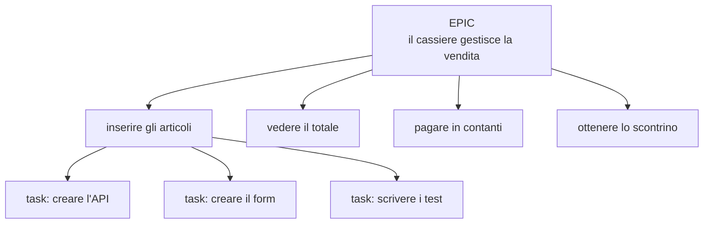

# User story

## Definizione

> 📄 Fonte: [[04_Agile_01.pdf#page=32]], [[04_Agile_01.pdf#page=33]]

> 🔑 Definizione chiave: una **user story** è un modo di rappresentare una **funzionalità o un requisito** che ha **valore** per un utente o un cliente del sistema.

Formato ([[04_Agile_01.pdf#page=32]]): **As a \<user>, I want \<capability>, so that \<benefit>** — «Come \<utente>, voglio \<capacità>, così che \<beneficio>».

Una user story comprende **tre aspetti** ([[04_Agile_01.pdf#page=33]]):
1. una **descrizione scritta** della storia, ad alto livello, semplice e breve;
2. una **conversazione** sulla storia, per capirne i dettagli;
3. un insieme di **test di accettazione** che stabiliscono quando la storia è completa.

> 🧩 Elaborazione mia: è la regola delle «3C» (*Card, Conversation, Confirmation*), qui chiamata con altri nomi. La descrizione scritta è volutamente incompleta: i dettagli emergono dalla conversazione e vengono fissati nei test di accettazione.

## Spiegazione

### Esempio: il cassiere

> 📄 Fonte: [[04_Agile_01.pdf#page=34]]

- **Descrizione:** un cassiere può inserire gli articoli acquistati dal cliente.
- **Discussione:** chiarisce i dettagli, ad esempio gli articoli si inseriscono con un **codice** e si possono inserire **più articoli della stessa categoria**.
- **Test di accettazione** che ne derivano: con un solo articolo; con più articoli distinti; con più articoli, di cui alcuni della stessa categoria; con un gran numero di articoli.

🧩 Ogni dettaglio emerso dalla conversazione diventa almeno un test: «più articoli della stessa categoria» → terzo test; «tanti articoli» è un caso limite che verifica anche le prestazioni.

### Card e template

> 📄 Fonte: [[04_Agile_01.pdf#page=35]], [[04_Agile_01.pdf#page=36]], [[04_Agile_01.pdf#page=37]]

- Di solito le user story si scrivono su **piccoli cartoncini** (es. Post-it).
- Il cartoncino dev'essere **piccolo** per **evitare troppi dettagli**.
- I **test di accettazione** si possono elencare **sul retro** del cartoncino.

Template ([[04_Agile_01.pdf#page=36]]): *As a \<type of user>, I want \<to perform some task> so that I can \<achieve some goal/benefit/value>.*

![[lez06-ag-p37-esempi-user-story.png]]
*Figura di [[04_Agile_01.pdf#page=37]]: sei Post-it in italiano. «Come cliente voglio cercare prodotti per nome così da trovare velocemente quello che mi interessa»; «Come cliente voglio aggiungere un prodotto al carrello così da acquistarlo più tardi»; «Come cliente registrato voglio salvare i prodotti nei preferiti così da ritrovarli facilmente in seguito»; «Come utente voglio reimpostare la mia password così da poter accedere nuovamente al sistema se l'ho dimenticata»; «Come amministratore voglio gestire gli utenti (creare, modificare, eliminare) così da mantenere aggiornato il sistema»; «Come cliente voglio pagare con PayPal così da completare il pagamento in modo sicuro e veloce». In ogni nota sono sottolineati il tipo di utente e l'oggetto.*

> 🧩 Elaborazione mia: le storie dell'amministratore («gestire gli utenti») e di PayPal sono troppo grandi: sono proprio quelle che le slide successive scompongono ([[valutare-user-stories-invest]]).

### Chi scrive le user story?

> 📄 Fonte: [[04_Agile_01.pdf#page=38]], [[04_Agile_01.pdf#page=39]]

Vero o falso: *«Le user story sono scritte solo dal product owner.»* **Falso.** Il **PO è responsabile solo di aggiungerle al backlog**, ma **chiunque può scriverle**; di solito sono **sviluppate e raffinate in modo collaborativo da tutto il team**.

### Dimensione

> 📄 Fonte: [[04_Agile_01.pdf#page=40]], [[04_Agile_01.pdf#page=41]], [[04_Agile_01.pdf#page=42]]

- È utile avere storie che un programmatore — o una **coppia di programmatori** — possa **implementare e verificare entro uno Sprint**: è la dimensione adatta alla pianificazione iterativa.
- Una storia si può sviluppare **in un giorno** o **in un'iterazione di due settimane**.

| Storia ([[04_Agile_01.pdf#page=41]]) | Giudizio | 🧩 Perché |
|---|---|---|
| Un cassiere può gestire una vendita per un cliente | **troppo grande** | contiene inserimento articoli, totale, pagamento, scontrino |
| Un cassiere può aggiungere a un ordine gli articoli comprati dal cliente | **giusta** | un solo comportamento, testabile, fattibile in uno sprint |
| Lo scontrino mostra l'indirizzo del negozio | **troppo piccola** | è un dettaglio (un criterio di accettazione o un task), non una funzionalità con valore autonomo |

**Dividere e combinare** ([[04_Agile_01.pdf#page=42]]):
- una storia troppo grande si chiama **Epic**; un'epic si divide in **più user story**;
- esempio: «il cassiere può gestire la vendita al cliente» **è un'epic**, che si divide in: il cassiere può inserire gli articoli acquistati; il cassiere può vedere il totale della vendita; il cliente può pagare in contanti; il cliente può ottenere lo scontrino;
- una user story si divide a sua volta in **task**: creare un'API, creare un form, scrivere i test…

*🧩 Ricostruzione Mermaid di [[04_Agile_01.pdf#page=42]]: tre livelli — epic, user story, task.*

![[lez06-ag-p41-dimensione-storie.png]]
![[lez06-ag-p42-epic-storie-task.png]]
*Figure di [[04_Agile_01.pdf#page=41]] e [[04_Agile_01.pdf#page=42]]: le tre storie d'esempio con il giudizio sulla dimensione, e la scomposizione epic → storie → task, trascritte sopra.*

### Le proprietà INVEST

> 📄 Fonte: [[04_Agile_01.pdf#page=43]], [[04_Agile_01.pdf#page=44]]

| Lettera | Proprietà | Significato |
|---|---|---|
| **I** | **Independent** (indipendente) | evitare dipendenze tra storie, per non avere problemi di stima, prioritizzazione e pianificazione |
| **N** | **Negotiable** (negoziabile) | i dettagli si negoziano durante la discussione, quindi la storia non dev'essere troppo dettagliata |
| **V** | **Valuable** (di valore) | di valore per gli utenti, a volte anche per gli acquirenti, non solo per gli sviluppatori |
| **E** | **Estimable** (stimabile) | il team deve poter stimare il lavoro necessario |
| **S** | **Small** (piccola) | sviluppabile in un tempo da **mezza giornata** a **al massimo due settimane** |
| **T** | **Testable** (verificabile; la slide 44 dice *Verifiable*) | scritta in modo da poter stabilire se è stata sviluppata e completata con successo |

> 🧩 Elaborazione mia — perché ogni proprietà conta:
> - senza **I** non si possono riordinare liberamente le storie nel backlog (se B dipende da A, A deve venire prima);
> - senza **N** la storia diventa una specifica fissa e sparisce la conversazione;
> - senza **V** si finisce a scrivere storie tecniche («creare il database») che il PO non sa prioritizzare;
> - senza **E** e **S** non si può pianificare lo sprint;
> - senza **T** non si sa quando la storia è finita (vedi criteri di accettazione).

Gli esercizi sulla valutazione INVEST (PayPal, gestione utenti) sono svolti in [[valutare-user-stories-invest]].

### Revisione e stima delle storie

> 📄 Fonte: [[04_Agile_01.pdf#page=46]], [[04_Agile_01.pdf#page=49]]

- **User stories review**: attività per verificare la qualità delle user story (o dei requisiti) già definite nel progetto. Sono scritte bene? Rispettano INVEST? Come si possono riscrivere?
- **Stima delle user story**: le stime sono **ipotesi basate sulle informazioni disponibili**. L'argomento è rimandato **alla lezione successiva**. TODO: da espandere.

## Quando una storia è completa

> 📄 Fonte: [[04_Agile_01.pdf#page=50]]

| | Criteri di accettazione (*acceptance criteria*) | Definizione di fatto (*Definition of Done*, DoD) |
|---|---|---|
| Cosa sono | aspetti dettagliati di un requisito ad alto livello, dal punto di vista di uno stakeholder | una **checklist** di cosa rende una storia «fatta» |
| Ambito | **unici per ogni user story** | **in generale, per tutte le user story** |
| Esempio | «il link ricevuto via email è valido 30 minuti» ([[04_Agile_01.pdf#page=52]]) | codice sviluppato, test unitari passati, code review completata, documentazione aggiornata, funzionalità demo-ready ([[04_Agile_01.pdf#page=30]]) |

Approfondimento sui criteri di accettazione e sul loro passaggio a test BDD → [[criteri-di-accettazione-e-bdd]].

> ❓ Salto non ricostruito: l'agenda ([[04_Agile_01.pdf#page=2]]) annuncia anche **Definition of Done**, **Iteration Demo** e **Information Radiator** come argomenti a sé, ma il PDF si chiude alla slide 60 con i test BDD: la DoD compare solo a p. 30 e p. 50, la demo a p. 26, l'information radiator mai. Probabilmente saranno nella prossima lezione.

## Perché importa

Le user story sono il modo in cui si scrivono i requisiti nel [[progetto-di-corso]] (la presentazione del corso cita «Requirements as User Stories» tra le pratiche Agile, [[00_IntroduzioneAlCorso_SAD.pdf#page=22]]). La qualità delle storie decide se lo sprint si può pianificare e se si sa quando una funzionalità è finita.

> 💡 Connessione: la user story descrive **cosa** vuole l'utente (requisito funzionale), ma non dice nulla su prestazioni, disponibilità, sicurezza. I requisiti di qualità della Lez. 1 si esprimono con gli **scenari di qualità** ([[scenari-di-qualita]]), che hanno una struttura simile (Given–When–Then) e una misura della risposta verificabile — come un criterio di accettazione.

> 🎯 Esame: definizione e tre aspetti; template; chi le scrive; dimensione, epic e task; INVEST; criteri di accettazione vs DoD.

## Connessioni

- [[cerimonie-e-artefatti-agile]]: le storie riempiono product e iteration backlog.
- [[criteri-di-accettazione-e-bdd]]: dai criteri ai test eseguibili.
- [[valutare-user-stories-invest]]: esercizi.

## Fonti

- [[agile-project-management]] — [[04_Agile_01.pdf#page=32]]–[[04_Agile_01.pdf#page=50]]

_Aggiornato: 2026-10-10 — ingest 04_Agile_01.pdf_
