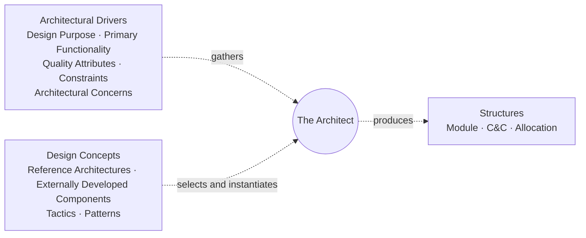

# Attribute-Driven Design (ADD)

## Cos'è

> 📄 Fonte: [[01-IntroductionOnSoftwareArchitecture.pdf#page=49]]

Metodo di progettazione architetturale **guidato dagli attributi di qualità**. La slide lo presenta con un solo diagramma, senza testo; il metodo non è ancora stato spiegato passo per passo. TODO: da espandere quando verrà trattato.

![[lez01-intro-p49-attribute-driven-design.png]]
*Figura di [[01-IntroductionOnSoftwareArchitecture.pdf#page=49]]: al centro **l'architetto** (con un fumetto «candidate design decisions»). A sinistra i **driver architetturali** (*Architectural Drivers*), che l'architetto **raccoglie** («gathers»): Design Purpose, Primary Functionality, Quality Attributes, Constraints, Architectural Concerns. In alto i **concetti di progetto** (*Design Concepts*), che l'architetto **seleziona e istanzia** («selects and instanciates»): Reference Architectures, Externally Developed Components, Tactics, Patterns. A destra le **strutture** che l'architetto **produce** («produces»): Module (Uses, Decomposition, Class/Generalization, Layered, …), Component-and-Connector (Client-Server, Concurrency, Process, Shared Data, …), Allocation (Work Assignment, Deployment, Implementation, …).*

*🧩 Ricostruzione Mermaid di [[01-IntroductionOnSoftwareArchitecture.pdf#page=49]].*

## Come si usa nel corso

🧩 Il diagramma riassume la lezione 1: gli **attributi di qualità** ([[attributi-di-qualita]]) sono tra i driver; **tattiche** e **pattern** ([[tattiche-architetturali]], [[pattern-architetturali]]) sono i concetti di progetto; le **strutture** prodotte sono le tre categorie di [[strutture-e-viste]]. Nella figura compaiono strutture non ancora trattate: *Concurrency*, *Process*, *Shared Data* (C&C) e *Implementation* (allocazione).

Nella Lez. 4 lo stesso diagramma ricompare ([[04-Architectural Patterns.pdf#page=7]]) tra i metodi di progettazione architetturale → [[progettazione-basata-sul-riuso]]. Tra i *design concepts* ora sono stati spiegati le **reference architectures** ([[dssa]]) e i **pattern** ([[state-logic-display]]).

## Link ai concetti correlati

[[buone-pratiche-architetturali]] · [[strutture-e-viste]] · [[attributi-di-qualita]]

## Fonti

- [[introduzione-architettura-software]] — [[01-IntroductionOnSoftwareArchitecture.pdf#page=49]]

_Aggiornato: 2026-09-26 — ingest lezione 1_
_Aggiornato: 2026-10-01 — ingest 04-Architectural Patterns.pdf_
