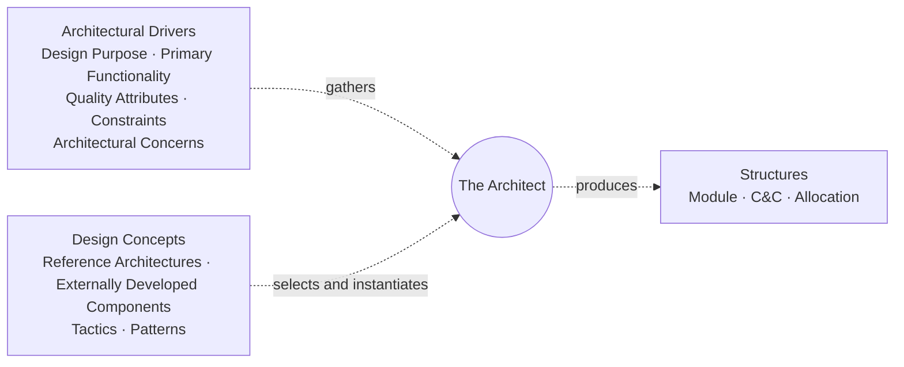

# Attribute-Driven Design (ADD)

## Cos'è

> 📄 Fonte: [[01-IntroductionOnSoftwareArchitecture.pdf#page=49]]

Metodo di progettazione architetturale **guidato dagli attributi di qualità**. La slide della Lez. 1 lo presenta con un solo diagramma, senza testo; il metodo è spiegato passo per passo nella Lezione 9 (sezioni seguenti, versione 3.0 di ADD).

![[lez01-intro-p49-attribute-driven-design.png]]
*Figura di [[01-IntroductionOnSoftwareArchitecture.pdf#page=49]]: al centro **l'architetto** (con un fumetto «candidate design decisions»). A sinistra i **driver architetturali** (*Architectural Drivers*), che l'architetto **raccoglie** («gathers»): Design Purpose, Primary Functionality, Quality Attributes, Constraints, Architectural Concerns. In alto i **concetti di progetto** (*Design Concepts*), che l'architetto **seleziona e istanzia** («selects and instanciates»): Reference Architectures, Externally Developed Components, Tactics, Patterns. A destra le **strutture** che l'architetto **produce** («produces»): Module (Uses, Decomposition, Class/Generalization, Layered, …), Component-and-Connector (Client-Server, Concurrency, Process, Shared Data, …), Allocation (Work Assignment, Deployment, Implementation, …).*

*🧩 Ricostruzione Mermaid di [[01-IntroductionOnSoftwareArchitecture.pdf#page=49]].*

## Come si usa nel corso

🧩 Il diagramma riassume la lezione 1: gli **attributi di qualità** ([[attributi-di-qualita]]) sono tra i driver; **tattiche** e **pattern** ([[tattiche-architetturali]], [[pattern-architetturali]]) sono i concetti di progetto; le **strutture** prodotte sono le tre categorie di [[strutture-e-viste]]. Nella figura compaiono strutture non ancora trattate: *Concurrency*, *Process*, *Shared Data* (C&C) e *Implementation* (allocazione).

Nella Lez. 4 lo stesso diagramma ricompare ([[3-Architectural Patterns-complete.pdf#page=7]]) tra i metodi di progettazione architetturale → [[progettazione-basata-sul-riuso]]. Tra i *design concepts* ora sono stati spiegati le **reference architectures** ([[dssa]]) e i **pattern** ([[state-logic-display]]).

## Il metodo ADD in sette passi (Lez. 9)

> 📄 Fonte: [[06-ADD-Designing a Software Architecture.pdf#page=9]]–[[06-ADD-Designing a Software Architecture.pdf#page=13]]

**Idea.** La progettazione avviene per **round**; ogni round può stare dentro un'iterazione di sviluppo (uno sprint). Dentro un round si svolgono **iterazioni di progettazione**: con una o più iterazioni si ottiene un'architettura adatta allo **scopo di progetto** del round. ADD dà una guida dettagliata ai compiti di ogni iterazione ([[06-ADD-Designing a Software Architecture.pdf#page=9]], [[06-ADD-Designing a Software Architecture.pdf#page=10]], [[06-ADD-Designing a Software Architecture.pdf#page=11]]).

**Prima di iniziare:** serve il **system context diagram**, che fissa l'ambito (cosa sta dentro e cosa fuori dal sistema) e le **entità esterne** con cui interagisce ([[06-ADD-Designing a Software Architecture.pdf#page=12]]).

![[lez09-add-p12-system-context-diagram.png]]
*Il sistema in progettazione (cerchio) con la workstation dell'utente, i servizi esterni e un database server; legenda: sistema in sviluppo, sistema esterno, flusso di dati ([[06-ADD-Designing a Software Architecture.pdf#page=12]]).*

![[lez09-add-p13-passi-e-artefatti-add.png]]
*Passi e artefatti ([[06-ADD-Designing a Software Architecture.pdf#page=13]]): in ingresso i driver (scopo, requisiti funzionali primari, scenari di qualità, vincoli, preoccupazioni); i sette passi in blu; in uscita il progetto architetturale (raffinato). Si itera; si parte dal round precedente o, in un sistema esistente (*brownfield*), dal sistema esistente.*

| Passo | Che cosa si fa | Pagine |
|---|---|---|
| **1. Rivedere gli ingressi** | verificare che i driver siano disponibili e corretti: scopo del round, requisiti funzionali primari (casi d'uso/user story), scenari primari di qualità, vincoli, preoccupazioni; entrano in un **backlog di progettazione** | [[06-ADD-Designing a Software Architecture.pdf#page=14]], [[06-ADD-Designing a Software Architecture.pdf#page=15]] |
| **2. Stabilire l'obiettivo dell'iterazione** | scegliere un sottoinsieme dei driver; il problema è diviso in sotto-problemi e si decide quale affrontare | [[06-ADD-Designing a Software Architecture.pdf#page=16]], [[06-ADD-Designing a Software Architecture.pdf#page=17]] |
| **3. Scegliere gli elementi da raffinare** | le decisioni si manifestano in strutture di elementi (moduli, componenti); raffinamento top-down o bottom-up | [[06-ADD-Designing a Software Architecture.pdf#page=18]], [[06-ADD-Designing a Software Architecture.pdf#page=19]] |
| **4. Scegliere i design concept** | tattiche, pattern, architetture di riferimento, componenti esterni; scelta con tabella pro/contro; eventuale prototipo | [[06-ADD-Designing a Software Architecture.pdf#page=20]]–[[06-ADD-Designing a Software Architecture.pdf#page=24]] |
| **5. Istanziare, assegnare responsabilità, definire interfacce** | decidere ad es. numero di strati e relazioni consentite; responsabilità degli elementi; interfacce esterne e interne | [[06-ADD-Designing a Software Architecture.pdf#page=25]]–[[06-ADD-Designing a Software Architecture.pdf#page=29]] |
| **6. Abbozzare le viste e registrare le decisioni** | schizzi (non documentazione completa), responsabilità, decisioni e rationale, tracciamento dell'avanzamento | [[06-ADD-Designing a Software Architecture.pdf#page=30]]–[[06-ADD-Designing a Software Architecture.pdf#page=38]] |
| **7. Analizzare e rivedere l'obiettivo** | revisione (meglio da altri), controllo dello scopo di progetto; si ripetono i passi 2–7 per ogni driver a partire da quelli a priorità più alta | [[06-ADD-Designing a Software Architecture.pdf#page=39]], [[06-ADD-Designing a Software Architecture.pdf#page=40]] |

Tre tipi di decisioni nei passi 3–5 ([[06-ADD-Designing a Software Architecture.pdf#page=18]]): scegliere le parti da scomporre; individuare le soluzioni esistenti che supportano la scomposizione; creare gli elementi dalla soluzione e stabilirne responsabilità e interfacce.

### Esempi espansi

**Passo 4: scegliere tra alternative** ([[06-ADD-Designing a Software Architecture.pdf#page=21]], [[06-ADD-Designing a Software Architecture.pdf#page=22]]). Si crea una tabella pro/contro/costo:

| Alternativa | Pro | Contro | Costo |
|---|---|---|---|
| Web application | molte piattaforme con un browser standard; caricamento veloce; deployment semplice | niente interazione «ricca» | basso |
| Rich internet application | interazione ricca; deployment e aggiornamento semplici | caricamento più lungo; serve un runtime nel browser | medio |
| Mobile application | interazione ricca | minore portabilità; limiti di schermo | alto |

![[lez09-add-p22-tabella-selezione-alternative.png]]
*La tabella originale ([[06-ADD-Designing a Software Architecture.pdf#page=22]]).*

🧩 La scelta dipende dai driver: se l'interazione ricca è un ASR conta più dei costi; se conta l'accessibilità, vince la web application.

**Prototipare o no?** ([[06-ADD-Designing a Software Architecture.pdf#page=23]], [[06-ADD-Designing a Software Architecture.pdf#page=24]]). Domande: la tecnologia è emergente o nuova per l'azienda? ci sono driver (in particolare qualità) a rischio con la tecnologia scelta? manca evidenza che aiuterà? ci sono opzioni di configurazione da capire? non è chiaro se si integra? Se la maggior parte delle risposte è «sì», conviene un **prototipo usa-e-getta** (*throwaway*).

**Passo 5: strutture e interfacce** ([[06-ADD-Designing a Software Architecture.pdf#page=26]]–[[06-ADD-Designing a Software Architecture.pdf#page=29]]). Strutture di *modulo* (elementi a tempo di sviluppo: file, moduli, classi), *C&C* (elementi dinamici a runtime: processi, thread), *allocazione* (elementi software e non software: file system, hardware, team). Le **interfacce** sono le proprietà visibili all'esterno, una specifica contrattuale: *esterne* (richieste e fornite verso altri sistemi; si capiscono con il system context diagram) e *interne* (tra gli elementi istanziati; si capiscono con un diagramma di sequenza).

![[lez09-add-p28-interfacce-esterne.png]]
*System context diagram del sistema FCAPS: workstation dell'utente, Time Server e database server come sistemi esterni ([[06-ADD-Designing a Software Architecture.pdf#page=28]]).*

![[lez09-add-p29-interfacce-interne.png]]
*Diagramma di sequenza con le chiamate tra TimeServerConnector, TimeServerConfigurationController, TimeServerDataMapper, Time Server e TopologyController ([[06-ADD-Designing a Software Architecture.pdf#page=29]]).*

**Passo 6: schizzi, decisioni, avanzamento** ([[06-ADD-Designing a Software Architecture.pdf#page=31]]–[[06-ADD-Designing a Software Architecture.pdf#page=38]]). Schizzi con simboli coerenti e legenda; responsabilità scritte subito; decisioni (scegliere un design concept, creare strutture, definire relazioni e interfacce, allocare risorse) con la **rationale** (evidenze, chi ha fatto cosa, perché scorciatoie e trade-off, ipotesi). L'avanzamento si traccia con backlog e kanban board.

![[lez09-add-p33-sketch-e-responsabilita.png]]
*Schizzo con Data Stream, Batch Layer, Speed Layer e Serving Layer e tabella elemento–responsabilità ([[06-ADD-Designing a Software Architecture.pdf#page=33]]).*

![[lez09-add-p38-kanban-board.png]]
*Kanban board di progettazione con colonne «Not Yet Addressed», «Partially Addressed», «Completely Addressed», «Discarded»; ogni scheda è un driver (QA, CT, CN, UC) con priorità High/Medium/Low ([[06-ADD-Designing a Software Architecture.pdf#page=38]]).*

**Passo 7** ([[06-ADD-Designing a Software Architecture.pdf#page=39]], [[06-ADD-Designing a Software Architecture.pdf#page=40]]): la revisione è meglio affidata a qualcuno con esperienza e prospettiva diverse; si valuta se bastano le iterazioni o servono altri round.

### Attributi di qualità e collocazione

> 🧩 Elaborazione mia

ADD non è uno stile ma un **processo**: rende sistematica la scelta di tattiche e pattern ([[tattiche-architetturali]], [[pattern-architetturali]]) guidata dagli ASR ([[requisiti-architetturalmente-significativi]]); la tracciabilità decisioni/rationale serve la comprensibilità e la difendibilità delle scelte (all'orale, [[progetto-di-corso]]).

## Link ai concetti correlati

[[buone-pratiche-architetturali]] · [[strutture-e-viste]] · [[attributi-di-qualita]] · [[requisiti-architetturalmente-significativi]] · [[scenari-di-qualita]]

## Fonti

- [[introduzione-architettura-software]] — [[01-IntroductionOnSoftwareArchitecture.pdf#page=49]]
- [[designing-a-software-architecture]] — [[06-ADD-Designing a Software Architecture.pdf#page=9]]–[[06-ADD-Designing a Software Architecture.pdf#page=41]]

_Aggiornato: 2026-09-26 — ingest lezione 1_
_Aggiornato: 2026-10-01 — ingest 3-Architectural Patterns-complete.pdf_
_Aggiornato: 2026-11-24 — ingest 06-ADD-Designing a Software Architecture.pdf (Lez. 9)_
