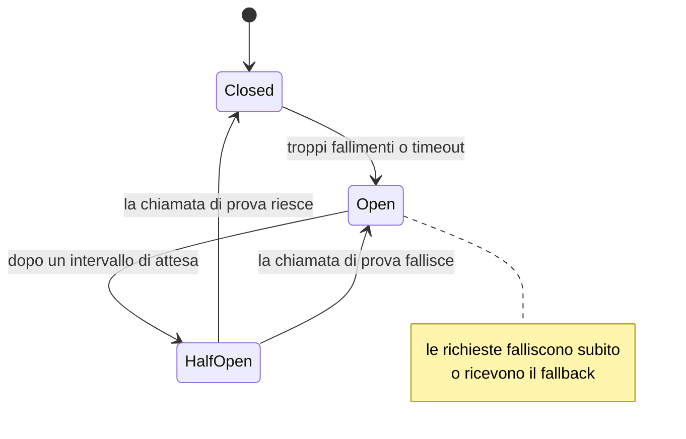

# Circuit Breaker

## Contesto e problema

> 📄 Fonte: [[02-Availability.pdf#page=19]]

Un servizio da cui si dipende non risponde. Continuare a chiamarlo consuma risorse (thread, connessioni in attesa) e può propagare il guasto agli altri servizi: **esaurimento delle risorse** e **guasti a cascata** (*cascading failures*).

## Soluzione

> 📄 Fonte: [[02-Availability.pdf#page=19]]

Il circuit breaker **impedisce chiamate ripetute a un servizio che non risponde**. Dopo un **numero definito di fallimenti o timeout** **apre il circuito**: le richieste successive **falliscono subito** oppure ricevono una **risposta di ripiego** (*fallback*). Così si evitano esaurimento delle risorse e guasti a cascata, e si lascia al servizio guasto **il tempo di riprendersi**.

In **Java Spring Boot** si può usare la libreria di tolleranza ai guasti **Resilience4j**, aggiungendo la dipendenza Maven e proteggendo la chiamata al servizio con l'API apposita:

```xml
<!-- 📄 dalla slide: dipendenza Maven per usare Resilience4j con Spring Cloud -->
<dependency>
    <groupId>org.springframework.cloud</groupId>
    <artifactId>spring-cloud-starter-circuitbreaker-resilience4j</artifactId>
</dependency>
```

## Diagramma

> 🧩 Elaborazione mia: la slide non ha figure. Gli stati sotto sono quelli classici del pattern; la slide nomina solo il circuito «aperto».


*🧩 Diagramma mio (stato **Half-Open** non presente nelle slide).*

> 📚 Fonte esterna: lo stato *half-open* (una chiamata di prova per capire se il servizio si è ripreso) è la descrizione standard del pattern, ad es. nella documentazione di Resilience4j (modulo CircuitBreaker). Non compare nelle slide.

## Attributi di qualità

| Attributo | Effetto | Perché | Fonte |
|---|---|---|---|
| Availability | + | evita i guasti a cascata e lascia tempo al servizio di riprendersi | [[02-Availability.pdf#page=19]] |
| Prestazioni (sotto guasto) | + | 🧩 le richieste falliscono subito invece di aspettare il timeout | [[02-Availability.pdf#page=19]] |
| Correttezza della risposta | − | 🧩 durante l'apertura l'utente riceve un errore o un fallback, cioè un servizio ridotto | 🧩 |

## Quando usarlo / quando no

🧩 Quando si chiama un servizio **remoto** che può essere lento o indisponibile (nell'esempio: lo University SIS). Non serve per chiamate locali dentro lo stesso processo.

## Varianti ed esempi

- Gruppo 1 della tabella di [[02-Availability.pdf#page=23]]: SIS lento o indisponibile → timeout, bounded retry, circuit breaker, fallback con Resilience4j TimeLimiter, Retry e CircuitBreaker; si confrontano latenza, tentativi e comportamento con e senza protezione.
- Gruppo 6: servizio secondario non disponibile → Resilience4j CircuitBreaker + fallback Spring + cache (Caffeine o Redis).

## Connessioni

- [[tattiche-availability]]: completa *retry* ed *exception handling*; realizza *graceful degradation* con il fallback.
- [[availability]]: nella catena fault → error → failure, il circuit breaker contiene l'errore.

## Fonti

- [[quality-attributes-availability]] — [[02-Availability.pdf#page=19]], [[02-Availability.pdf#page=23]]

_Aggiornato: 2026-09-30 — ingest 02-Availability.pdf_
