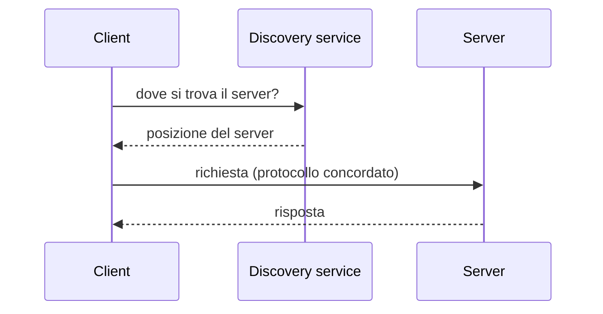

# Client-server

> Cenni nella Lez. 1; nella Lez. 3 è presentato come **pattern per la modificabilità**. Il programma lo colloca anche nello stile a livelli (*Stile a Livelli: Macchine Virtuali e Client-Server*, [[Programma Syllabus]]) — la trattazione come stile è ancora da fare (TODO).

## Contesto e problema

🧩 Molti utenti (client) devono usare servizi o dati centralizzati (server), e client e server devono poter evolvere separatamente.

## Soluzione

> 📄 Fonte: [[03-Modifiability.pdf#page=28]], [[01-IntroductionOnSoftwareArchitecture.pdf#page=34]]

Il pattern client-server consiste in un **server** che fornisce servizi **simultaneamente a più client distribuiti** ([[03-Modifiability.pdf#page=28]]). L'interazione segue la sequenza **scoperta → interazione**:
- **Discovery**: la comunicazione è avviata da un client, che usa un **servizio di discovery** per determinare la posizione del server; il server risponde al client con un **protocollo concordato**.
- **Interaction**: il client invia richieste al server; il server le elabora e risponde.

Componenti e connettori (vista C&C, [[01-IntroductionOnSoftwareArchitecture.pdf#page=34]]):
- **componenti**: client e server;
- **connettori**: di tipo **request/reply**. Nel sistema ATM degli anni '90 erano istanze di un connettore **socket TCP**; **oggi** si usano connettori basati su **HTTP**.

## Diagramma

![[lez03-mo-p28-client-server.png]]
*Figura di [[03-Modifiability.pdf#page=28]] (in alto a destra): due client (un computer, un telefono/PC) collegati tramite **Internet** a un **server**.*

![[lez01-intro-p34-cc-atm-client-server.png]]
*Figura di [[01-IntroductionOnSoftwareArchitecture.pdf#page=34]]: architettura client-server di un sistema bancario ATM (dettagli in [[strutture-componenti-e-connettori]]).*

Vista client-server con un server S1 e dieci client C1…C10: [[01-IntroductionOnSoftwareArchitecture.pdf#page=36]] (→ [[strutture-e-viste]] § Relazioni tra strutture).

*🧩 Diagramma mio della sequenza discovery → interazione di [[03-Modifiability.pdf#page=28]].*

## Attributi di qualità

> 📄 Fonte: [[03-Modifiability.pdf#page=29]]

| Attributo | Effetto | Perché | Fonte |
|---|---|---|---|
| Modificabilità (accoppiamento) | + | la connessione tra server e client è stabilita **dinamicamente**; il server **non conosce a priori** i suoi client: **basso accoppiamento** server–client; **nessun accoppiamento tra client** | [[03-Modifiability.pdf#page=29]] |
| Evoluzione indipendente | + | client e server possono **evolvere indipendentemente** | [[03-Modifiability.pdf#page=29]] |
| Scalabilità | + | il numero di client scala facilmente, limitato solo dalla capacità del server; anche la funzionalità del server può scalare se la capacità viene superata | [[03-Modifiability.pdf#page=29]] |
| Riuso | + | servizi comuni **condivisi** tra più client | [[03-Modifiability.pdf#page=29]] |
| Separazione dell'interfaccia utente | + | l'interazione con l'utente è **isolata nel client** | [[03-Modifiability.pdf#page=29]] |
| Prestazioni | − | i messaggi possono essere **ritardati dalla congestione di rete**: prestazioni degradate o almeno **imprevedibili** | [[03-Modifiability.pdf#page=29]] |
| Sicurezza e integrità | − | per client che comunicano su una rete condivisa con altre applicazioni servono **misure speciali** per la sicurezza (soprattutto **confidenzialità**) e per l'**integrità** | [[03-Modifiability.pdf#page=29]] |
| Analisi delle prestazioni | (vista) | la vista client-server permette **analisi delle prestazioni**, **previsione dei colli di bottiglia** e gestione del **traffico di rete** | [[01-IntroductionOnSoftwareArchitecture.pdf#page=36]] |

## Quando usarlo / quando no

🧩 Da usare quando molti client condividono gli stessi servizi e dati; attenzione quando la rete è inaffidabile o condivisa (prestazioni imprevedibili, sicurezza) — le tattiche di sicurezza della Lez. 1 (TLS) rispondono proprio al secondo trade-off ([[tattiche-architetturali]]).

## Varianti ed esempi

- Sistema bancario ATM ([[01-IntroductionOnSoftwareArchitecture.pdf#page=34]]).
- L'[[exam-booking-system]] è una web application client-server (browser → application server) ([[01-IntroductionOnSoftwareArchitecture.pdf#page=39]]).
- Il [[progetto-di-corso]] suggerisce «Web App with C/S style» ([[00_IntroduzioneAlCorso_SAD.pdf#page=25]]).

### Come architettura 2-tier (Lez. 4)

> 📄 Fonte: [[3-Architectural Patterns-complete.pdf#page=30]], [[3-Architectural Patterns-complete.pdf#page=31]], [[3-Architectural Patterns-complete.pdf#page=32]]

La Lez. 4 presenta il client/server come **architettura two-tier con fat client**: presentazione e parte della logica applicativa sul client, che invoca direttamente il server di risorse o database tramite un'**API remota** (contratto esplicito che nasconde l'implementazione del server). Segue una tabella di benefici e limiti su otto attributi — tra i limiti: il server condiviso resta un potenziale single point of failure e cambiare le regole di business può richiedere di aggiornare ogni client. Dettagli e confronto con 1-tier e 3-tier → [[architetture-multi-tier]].

## Connessioni

- [[pattern-modifiability]]: gli altri pattern per la modificabilità.
- [[tattiche-modifiability]]: *discovery* (defer binding a runtime) e *encapsulation*.
- [[layered]]: il programma tratta il client-server come variante dello stile a livelli.

## Fonti

- [[quality-attributes-modifiability]], [[introduzione-architettura-software]], [[presentazione-corso]]

_Aggiornato: 2026-09-30 — ingest 03-Modifiability.pdf (pattern client-server, benefici e trade-off)_
_Aggiornato: 2026-10-01 — ingest 3-Architectural Patterns-complete.pdf_
