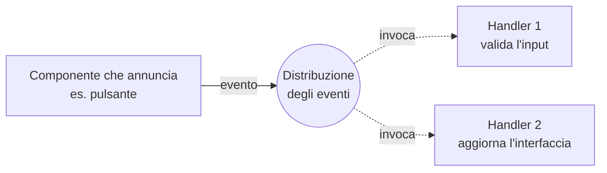

# Implicit invocation

## Contesto e problema

> 📄 Fonte: [[05_Architectural_Styles_Complete.pdf#page=89]], [[05_Architectural_Styles_Complete.pdf#page=92]]

Si vogliono componenti **disaccoppiati**: che chi produce un'informazione non debba chiamare esplicitamente chi la usa. Il disaccoppiamento si ottiene con un intermediario → [[disaccoppiamento-dei-componenti]].

## Soluzione

> 📄 Fonte: [[05_Architectural_Styles_Complete.pdf#page=92]]

- I componenti **annunciano eventi** invece di chiamare i componenti che dovrebbero reagire.
- I componenti interessati **registrano handler** per particolari tipi di evento.
- Al verificarsi di un evento, il meccanismo di distribuzione **invoca o notifica** gli handler registrati.
- Chi annuncia non deve sapere chi risponderà. La gestione può essere sincrona o asincrona.
- Due forme: [[publish-subscribe]] ed [[event-based]].

## Diagramma

🧩 Schema ricostruito dalla descrizione di p. 92–93:

*Esempio di p. 93: il pulsante annuncia un click; gli handler registrati reagiscono. Aggiungere un handler non richiede di modificare il pulsante.*

## Attributi di qualità

| Attributo | Effetto | Perché | Fonte |
|---|---|---|---|
| Riuso dei componenti | + | i componenti non si conoscono, si possono riusare altrove | [[05_Architectural_Styles_Complete.pdf#page=94]] |
| Evolvibilità (sviluppo e runtime) | + | si aggiungono handler senza toccare chi annuncia | [[05_Architectural_Styles_Complete.pdf#page=93]], [[05_Architectural_Styles_Complete.pdf#page=94]] |
| Comprensibilità | − | struttura effettiva e flusso di controllo difficili da capire | [[05_Architectural_Styles_Complete.pdf#page=94]] |
| Prevedibilità | − | chi annuncia non sa quali componenti risponderanno né in che ordine | [[05_Architectural_Styles_Complete.pdf#page=94]] |

> ⚖️ Trade-off: più disaccoppiamento = meno controllo esplicito del flusso ([[05_Architectural_Styles_Complete.pdf#page=93]]).

## Quando usarlo / quando no

Quando l'evoluzione indipendente dei componenti conta più della leggibilità del flusso di controllo.

## Varianti ed esempi

- Pulsante che annuncia un click ([[05_Architectural_Styles_Complete.pdf#page=93]]); forme discusse: pub–sub ed event-based.

## Connessioni

- [[event-based]], [[publish-subscribe]]: le due forme.
- [[disaccoppiamento-dei-componenti]]: forme di disaccoppiamento.

## Fonti

- [[architectural-styles]]

_Aggiornato: 2026-11-24 — ingest 05_Architectural_Styles_Complete.pdf_
