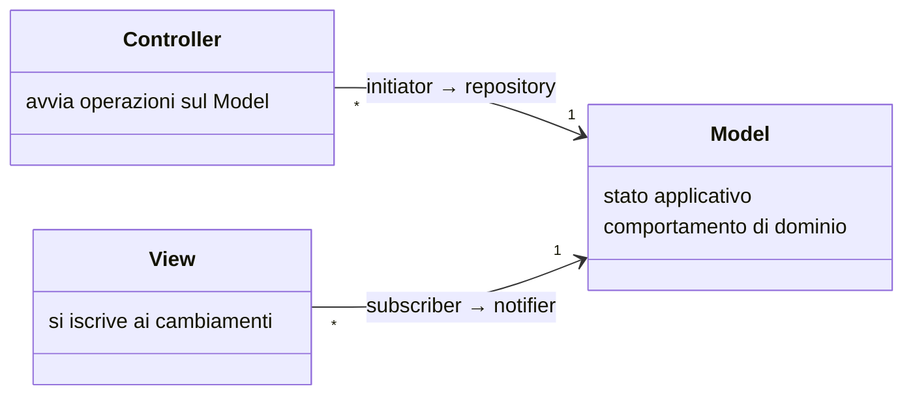
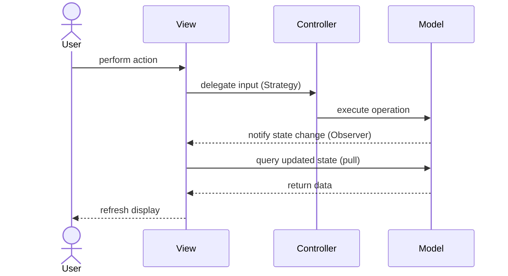

# Model–View–Controller (MVC)

## Contesto e problema

> 📄 Fonte: [[3-Architectural Patterns-complete.pdf#page=40]], [[3-Architectural Patterns-complete.pdf#page=41]]

- MVC è **un esempio classico di pattern architetturale**, introdotto con **Smalltalk** allo **Xerox PARC** alla fine degli anni '70. Si può considerare una **composizione di pattern che collaborano** (vedi Observer e Strategy sotto). Oggi è molto adottato nei framework per applicazioni web come **Spring MVC, ASP.NET Core MVC, Ruby on Rails, Apache Struts** ([[3-Architectural Patterns-complete.pdf#page=40]]).
- **Obiettivo principale:** separare la **logica di dominio** dalla **presentazione** e dall'**interazione con l'utente** ([[3-Architectural Patterns-complete.pdf#page=40]]).
- **Motivazione:** gli stessi dati applicativi possono servire **più presentazioni**. MVC nasce dall'esigenza di mostrare e manipolare gli stessi dati con **rappresentazioni grafiche diverse**. Lo stesso Model può sostenere più View **senza incorporare logica di presentazione** nei componenti che gestiscono i dati ([[3-Architectural Patterns-complete.pdf#page=41]]).

![[lez05-ap-p41-mvc-motivazione.png]]
*Figura di [[3-Architectural Patterns-complete.pdf#page=41]]: un unico **Model** («Numerical data», ellisse gialla) collegato a tre View: View 1 è un grafico a torta, View 2 un grafico ad aree, View 3 un istogramma 3D. Le frecce partono dal Model verso ogni View: gli stessi numeri, tre presentazioni.*

## Soluzione

> 📄 Fonte: [[3-Architectural Patterns-complete.pdf#page=42]], [[3-Architectural Patterns-complete.pdf#page=43]], [[3-Architectural Patterns-complete.pdf#page=45]]

MVC divide l'applicazione in **tre elementi che cooperano** ([[3-Architectural Patterns-complete.pdf#page=42]]):

| Elemento | Responsabilità |
|---|---|
| **Model** | gestisce **dati, stato e logica di dominio** dell'applicazione |
| **View** | **presenta** il Model all'utente |
| **Controller** | **interpreta l'input** dell'utente e coordina Model e View |

Separare la presentazione dallo stato **riduce l'impatto delle modifiche all'interfaccia** sul comportamento centrale. MVC è un pattern architetturale classico per le **applicazioni interattive**.

### Relazioni strutturali del MVC classico

> 📄 Fonte: [[3-Architectural Patterns-complete.pdf#page=43]]

- **Più Controller** possono operare sullo **stesso Model**, e **più View** possono presentare lo **stesso Model**.
- I **Controller avviano** le operazioni sul Model.
- Le **View si iscrivono** ai cambiamenti del Model e aggiornano la loro presentazione quando ricevono la notifica.
- Un solo Model può sostenere più Controller e più View.

![[lez05-ap-p43-mvc-relazioni-strutturali.png]]
*Figura di [[3-Architectural Patterns-complete.pdf#page=43]], «MVC Structural Relationships» (un Model può sostenere più Controller e più View): **Controller** (avvia operazioni sul Model) con ruolo *initiator*, molteplicità `*`, collegato al ruolo *repository* del **Model** (molteplicità 1). **View** (si iscrive ai cambiamenti del Model) con ruolo *subscriber*, molteplicità `*`, collegata al ruolo *notifier* del Model (1). Il Model ha lo stato applicativo e il comportamento di dominio ed è **indipendente da View e Controller concreti**. Note: Controller → Model: richiesta di un'operazione; Model → View iscritte: pubblicazione di una notifica di cambiamento **senza dipendere da una View concreta**.*


*🧩 Ricostruzione Mermaid di [[3-Architectural Patterns-complete.pdf#page=43]].*

### Responsabilità stabili, interazioni variabili

> 📄 Fonte: [[3-Architectural Patterns-complete.pdf#page=45]]

MVC fissa **tre responsabilità** (Model = stato applicativo e comportamento di dominio; View = presentazione dell'informazione; Controller = interpretazione delle azioni dell'utente) ma **non prescrive un unico flusso di interazione**. L'interazione dipende da: **tipo di applicazione**, **ambiente di esecuzione**, **modello di comunicazione**, **implementazione o framework** MVC.

> 🔑 Definizione chiave: in MVC **le responsabilità restano stabili, mentre le interazioni possono variare** ([[3-Architectural Patterns-complete.pdf#page=45]]). MVC è una **famiglia di varianti** ([[3-Architectural Patterns-complete.pdf#page=57]]).

## Diagramma — il MVC classico sull'Exam Booking System

> 📄 Fonte: [[3-Architectural Patterns-complete.pdf#page=44]], [[3-Architectural Patterns-complete.pdf#page=48]]

![[lez05-ap-p44-mvc-interazioni-classico.png]]
*Figura di [[3-Architectural Patterns-complete.pdf#page=44]], «Model–View–Controller: Module Interactions (Classic MVC)» — esempio guida: prenotare una sessione d'esame. ① lo **Student** seleziona una sessione sulla **View** (Exam Booking UI: mostra le sessioni, raccoglie l'input); ② la View passa al **Controller** (Booking Controller: interpreta le azioni, invoca le operazioni del Model) la richiesta `bookExam(sessionId)`; ③ il Controller chiama `createBooking(...)` sul **Model** (Exam Booking Domain: Exam Sessions, Bookings, Eligibility and Booking Rules; indipendente da View e Controller); ④ il Model emette un *change event* (notifica publish/subscribe, freccia tratteggiata) verso la View; ⑤ la View legge lo stato del Model (*Read Model state*); ⑥ la View mostra il risultato allo studente. Riquadro «Dependency principle»: **il Model pubblica un evento; non conosce la View concreta**. Nota: i framework web MVC possono usare una variante request/response.*

Animazione degli stessi sei passi (🧩, generata con `output/diagrammi/genera_animazioni_lez05.py`):

![[anim-mvc-classico.svg]]
*🧩 Animazione mia della figura di [[3-Architectural Patterns-complete.pdf#page=44]]: il pallino percorre i passi 1→6 in ordine e la didascalia sotto dice cosa succede; poi il ciclo riparte.*

## Quattro modelli di interazione

> 📄 Fonte: [[3-Architectural Patterns-complete.pdf#page=46]]–[[3-Architectural Patterns-complete.pdf#page=48]], [[3-Architectural Patterns-complete.pdf#page=53]]–[[3-Architectural Patterns-complete.pdf#page=57]]

### 1. MVC classico — la View «tira» il Model (*pull*)

> 📄 Fonte: [[3-Architectural Patterns-complete.pdf#page=46]]

La View inoltra le azioni dell'utente al Controller; il Controller le interpreta e **aggiorna il Model**; la View **interroga direttamente il Model** per avere i dati da mostrare. **La View tira i dati dal Model.** Si usa quando **la View sa da sola quando aggiornarsi**.

![[lez05-ap-p46-mvc-pull.png]]
*Figura di [[3-Architectural Patterns-complete.pdf#page=46]]: User → View → *user event* → Controller → *update* → Model; dalla View parte anche *query state* verso il Model, che risponde con *data*.*

### 2. MVC classico — interazione basata su Observer

> 📄 Fonte: [[3-Architectural Patterns-complete.pdf#page=47]], [[3-Architectural Patterns-complete.pdf#page=48]]

La View **si iscrive** ai cambiamenti del Model; il Controller aggiorna il Model; il Model **notifica** le View registrate; ogni View recupera lo stato aggiornato dal Model. **Notifica, poi pull** (*notify, then pull*). Qui entra in gioco il design pattern **Observer**: **Model = Subject, View = Observer**.

![[lez05-ap-p47-mvc-observer.png]]
*Figura di [[3-Architectural Patterns-complete.pdf#page=47]]: come la precedente, più una freccia *change notification* dal Model alla View; la View poi fa *query updated state*.*

Un'interazione completa del MVC classico ([[3-Architectural Patterns-complete.pdf#page=48]]): **View → Controller: Strategy**; **Model → View: Observer**; **View → Model: pull dello stato aggiornato**.

![[lez05-ap-p48-mvc-sequenza-completa.png]]
*Figura di [[3-Architectural Patterns-complete.pdf#page=48]], diagramma di sequenza: User *perform action* → View; View *delegate input* → Controller; Controller *execute operation* → Model; Model *notify state change* → View; View *query updated state* → Model; Model *return data* → View; View *refresh display* → User.*


*🧩 Ricostruzione Mermaid di [[3-Architectural Patterns-complete.pdf#page=48]].*

### 3. Web MVC lato server — il Controller fornisce i dati alla View

> 📄 Fonte: [[3-Architectural Patterns-complete.pdf#page=54]]

- Il browser invia una **richiesta HTTP** al Controller.
- Il Controller invoca il **Domain Model** o i servizi applicativi.
- Il Controller **prepara i dati** per la presentazione.
- Il Controller **sceglie una View** e le passa un **View Model**.
- La View **genera la risposta HTML**.
- **La View di norma riceve i dati dal Controller e non osserva direttamente il Domain Model.**

![[lez05-ap-p54-server-side-web-mvc.png]]
*Figura di [[3-Architectural Patterns-complete.pdf#page=54]] (logo Spring): Browser → *HTTP request* → Controller; Controller → *operation/query* → Domain Model → *result* → Controller; Controller → *View Model* → View → *HTML response* → Browser.*

Il framework Java che realizza questa variante è trattato in [[spring-mvc]].

### 4. Applicazione web lato client — UI reattiva

> 📄 Fonte: [[3-Architectural Patterns-complete.pdf#page=55]]

- Il server espone dati e operazioni tramite un'**API**.
- Il browser mantiene uno **stato locale lato client**.
- I componenti dell'interfaccia **reagiscono ai cambiamenti di quello stato**.
- La comunicazione con il server è **asincrona**.
- I framework possono usare architetture **ispirate a MVC** anziché MVC stretto; esempi: architetture a componenti, **MVVM, Flux, Redux** e reattive.
- **Il server restituisce dati; il client è responsabile di generare e aggiornare l'interfaccia.**

![[lez05-ap-p55-client-side-reactive.png]]
*Figura di [[3-Architectural Patterns-complete.pdf#page=55]]: Server → *JSON data* → Client State → *state change* → Client UI → *user event* → Client Logic → *HTTP API* → Server.*

> 💡 Connessione: è la separazione vista nel 4-tier ([[architetture-multi-tier]]) spinta all'estremo: il server non produce più HTML, ma solo dati — quindi la logica lato server è riusabile da qualunque client.

### Confronto

> 📄 Fonte: [[3-Architectural Patterns-complete.pdf#page=56]], [[3-Architectural Patterns-complete.pdf#page=57]]

| Variante | Chi fornisce i dati alla View? | Come si aggiorna la View? | Contesto tipico |
|---|---|---|---|
| MVC classico — Pull | la View interroga il Model | aggiornamento esplicito | GUI desktop |
| MVC classico — Observer | la View interroga il Model dopo la notifica | notifica di cambiamento del Model | GUI interattiva |
| Web MVC lato server | il Controller passa un View Model | nuovo ciclo richiesta–risposta HTTP | Spring MVC, ASP.NET MVC, Struts |
| UI reattiva lato client | lo stato del client riceve i dati dal server | aggiornamento reattivo dello stato | single-page application |

![[lez05-ap-p56-confronto-modelli-interazione.png]]
*Figura di [[3-Architectural Patterns-complete.pdf#page=56]]: la tabella originale, trascritta sopra.*

Riepilogo «MVC è una famiglia di varianti» ([[3-Architectural Patterns-complete.pdf#page=57]]):

| MVC classico | Web MVC lato server |
|---|---|
| interazione continua dentro l'applicazione | cicli richiesta–risposta HTTP |
| la View può osservare il Model | la View di norma non osserva il Domain Model |
| la View può interrogare il Model | il Controller fornisce i dati alla View |
| il Controller gestisce gli eventi dell'interfaccia | il Controller gestisce le richieste HTTP |
| la View è un componente persistente dell'interfaccia | la View viene generata per una risposta |

![[lez05-ap-p57-mvc-famiglia-varianti.png]]
*Figura di [[3-Architectural Patterns-complete.pdf#page=57]]: la tabella originale, trascritta sopra.*

## MVC e design pattern

### Observer

> 📄 Fonte: [[3-Architectural Patterns-complete.pdf#page=49]]

**Observer** gestisce l'interazione tra il Model e le sue View: le View si iscrivono al Model e vengono notificate quando il suo stato cambia. **Le View sono gli Observer, i Model sono i Subject.**

![[lez05-ap-p49-observer.png]]
*Figura di [[3-Architectural Patterns-complete.pdf#page=49]], «Observer Design Pattern» — definisce una dipendenza uno-a-molti così che gli observer siano notificati quando il subject cambia stato. `«interface» Subject` (`attach(observer)`, `detach(observer)`, `notify()`) aggrega `*` `«interface» Observer` (`update()`) tramite il ruolo *observers*. `ConcreteSubject` (`state`; `getState()`, `setState(value)`) realizza Subject; `ConcreteObserver` (`observerState`, `subject: Subject`; `update()`) realizza Observer e chiama `getState()` dopo `update()`. Mapping MVC: **Model = Subject, View = Observer**.*

> 🧩 Elaborazione mia — codice minimo in Java con i nomi della slide:
>
> ```java
> interface Observer { void update(); }
>
> class ExamBookingModel {                        // Subject
>     private final List<Observer> observers = new ArrayList<>();
>     private List<Booking> bookings = new ArrayList<>();
>     void attach(Observer o) { observers.add(o); }
>     void createBooking(Booking b) {             // chiamato dal Controller
>         bookings.add(b);
>         observers.forEach(Observer::update);    // notify: non conosce la View concreta
>     }
>     List<Booking> getBookings() { return bookings; }
> }
>
> class BookingListView implements Observer {     // Observer
>     private final ExamBookingModel model;
>     public void update() { render(model.getBookings()); }  // ...then pull
> }
> ```

### Strategy

> 📄 Fonte: [[3-Architectural Patterns-complete.pdf#page=50]], [[3-Architectural Patterns-complete.pdf#page=51]], [[3-Architectural Patterns-complete.pdf#page=52]]

**Strategy** permette di **cambiare il comportamento di interazione** associato a una View. La View **delega la gestione dell'input** a un Controller, e Controller diversi forniscono **strategie di interazione diverse**.

![[lez05-ap-p50-strategy.png]]
*Figura di [[3-Architectural Patterns-complete.pdf#page=50]], «Strategy Design Pattern» — incapsulare comportamenti intercambiabili dietro un'interfaccia comune. `«context» View` (`controller: Controller`; `setController(controller)`, `handleUserAction(action)`) *delega la gestione dell'input* a `«strategy interface» Controller` (`processAction(action)`), realizzata da `StudentBookingController` e `AdministratorController`. Interpretazione MVC: la View è il **Context**, il Controller è la **Strategy**; sostituirlo cambia il comportamento d'interazione.*

L'esempio con e senza Strategy (slide 55–56) è svolto passo per passo in [[implementare-mvc]] (caso 1).

## Front Controller nel Web MVC lato server

> 📄 Fonte: [[3-Architectural Patterns-complete.pdf#page=58]]

**Un unico punto d'ingresso** riceve **tutte le richieste HTTP** e smista ciascuna al **Controller applicativo** appropriato; il risultato serve a generare la risposta tramite una View.

![[lez05-ap-p58-front-controller.png]]
*Figura di [[3-Architectural Patterns-complete.pdf#page=58]]: dentro il «Servlet engine (e.g. Tomcat)», l'*incoming request* arriva al **Front controller**, che *delega la richiesta* al **Controller**; il Controller *gestisce la richiesta* e *crea il model*, che torna al Front controller; il Front controller *delega la generazione della risposta* al **View template** passandogli il model; il template *genera la risposta* e restituisce il controllo; il Front controller *restituisce la risposta*.*

In Spring MVC il Front Controller è il `DispatcherServlet` → [[spring-mvc]].

## Attributi di qualità

| Attributo | Effetto | Perché | Fonte |
|---|---|---|---|
| Modificabilità dell'interfaccia | + | separare presentazione e stato riduce l'impatto delle modifiche all'interfaccia sul comportamento centrale | [[3-Architectural Patterns-complete.pdf#page=42]] |
| Riuso del Model | + | lo stesso Model sostiene più View e più Controller senza logica di presentazione | [[3-Architectural Patterns-complete.pdf#page=41]], [[3-Architectural Patterns-complete.pdf#page=43]] |
| Modificabilità del comportamento d'interazione | + | con Strategy si cambia il Controller senza modificare la View | [[3-Architectural Patterns-complete.pdf#page=50]], [[3-Architectural Patterns-complete.pdf#page=51]] |
| Disaccoppiamento Model–View | + | il Model pubblica un evento senza conoscere la View concreta (Observer) | [[3-Architectural Patterns-complete.pdf#page=44]] |
| Semplicità | − | 🧩 tre elementi e più interazioni da coordinare anche per funzioni semplici | 🧩 |
| Prestazioni | − | 🧩 nella variante Observer, molte View e aggiornamenti frequenti moltiplicano notifiche e letture del Model | 🧩 |

> 💡 Connessione: l'annotazione a mano dello scenario di modificabilità della Lez. 3 diceva già che «MVC permette di avere un'alta modificabilità dell'interfaccia» ([[03-Modifiability.pdf#page=17]] → [[modifiability]]). Observer è la tattica *use an intermediary*/publish-subscribe applicata dentro il pattern ([[publish-subscribe]]); Strategy è *abstract common service* e *defer binding* con polimorfismo ([[tattiche-modifiability]]).

## Quando usarlo / quando no

🧩 Quando la stessa informazione va presentata in più modi o i modi di interagire cambiano spesso (applicazioni interattive, web app). Per un'applicazione con una sola schermata e una logica banale la separazione aggiunge struttura senza benefici.

## Varianti ed esempi

- Quattro modelli di interazione: pull, Observer, web lato server, UI reattiva lato client (sopra).
- Framework: Spring MVC, ASP.NET Core MVC, Ruby on Rails, Apache Struts ([[3-Architectural Patterns-complete.pdf#page=40]]) → [[spring-mvc]].
- Esempio guida: prenotazione di una sessione nell'[[exam-booking-system]] ([[3-Architectural Patterns-complete.pdf#page=44]]).

## Connessioni

- [[pattern-architetturali]]: MVC è uno dei tre pattern della lezione, con [[state-logic-display]] e [[sense-compute-control]].
- [[spring-mvc]]: realizzazione del Web MVC lato server con Front Controller.
- [[implementare-mvc]]: esercizi svolti (Strategy, Spring MVC, applicazione spese).
- [[layered]]: 🧩 MVC separa le responsabilità come gli strati, ma Model, View e Controller non sono strati ordinati: la View osserva il Model e il Controller li coordina entrambi.

## Fonti

- [[architectural-patterns-mvc-scc]] — [[3-Architectural Patterns-complete.pdf#page=39]]–[[3-Architectural Patterns-complete.pdf#page=58]]

_Aggiornato: 2026-10-06 — ingest 3-Architectural Patterns-complete.pdf (nuova lezione)_
