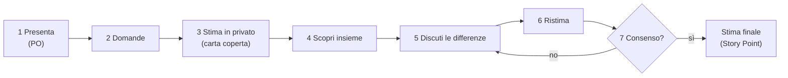

# Planning Poker

## Cos'è

> 📄 Fonte: [[04_Agile_02 (1).pdf#page=48]], [[04_Agile_02 (1).pdf#page=49]]

Il **Planning Poker** è la tecnica di stima di gruppo più usata per assegnare gli **Story Point** alle user story ([[stima-story-points-velocity-capacity]]). La slide di p. 49 (un'infografica in nove riquadri) la definisce «*una tecnica di stima agile basata su discussione e consenso*»: **tutti i membri del team stimano in modo indipendente, poi discutono** le stime per **arrivare a un consenso**.

![[lez07-ag2-p49-planning-poker.png]]
*Figura di [[04_Agile_02 (1).pdf#page=49]], infografica «Planning Poker — Estimate together, estimate better». Nove riquadri: copertina con carte colorate (1, 2, 5, 8, 13, ?); **What it is**; **Why use it**; **When to use it**; **The scale**; **How it works: the steps** (due riquadri); **Practical example**; **Useful tips**. Il contenuto è trascritto sotto.*

## Come si usa

**Quando:** durante il **Backlog Refinement**, **prima dello Sprint Planning**, per stimare user story o lavoro tecnico di dimensione paragonabile ([[04_Agile_02 (1).pdf#page=47]], p. 49 riquadro «When to use it»).

**Perché:** **coinvolgimento del team** (tutti partecipano attivamente); **stime più accurate** (la discussione migliora stime e allineamento); **fa emergere l'incertezza** (le differenze tra stime mettono in luce rischi e complessità nascosta); **consenso e impegno** (il team condivide e accetta la stima finale).

**La scala:** carte **1, 2, 3, 5, 8, 13, 21, ?**. È una scala di Fibonacci con valori che crescono in modo non lineare; rappresenta la **dimensione relativa, non il tempo**; il **«?»** significa «non lo so» o «troppo incerto» ([[stima-story-points-velocity-capacity]]).

**I sette passi** (riquadri «How it works»):

| # | Passo | Cosa succede |
|---|---|---|
| 1 | **Present** | il **Product Owner** presenta la user story o l'elemento da stimare |
| 2 | **Ask questions** | il team **chiarisce i dubbi** e raccoglie le informazioni necessarie |
| 3 | **Estimate privately** | **ogni persona sceglie segretamente** una carta |
| 4 | **Reveal** | **tutti scoprono la propria carta contemporaneamente** |
| 5 | **Discuss** | si discutono le **differenze** e **le ragioni** dietro le stime |
| 6 | **Re-estimate** | se serve, **ognuno sceglie una nuova carta in privato** |
| 7 | **Reach consensus** | si **ripete il processo fino al consenso** |

L'obiettivo è una **comprensione condivisa e una stima condivisa, non una media**.

*🧩 Ricostruzione dei sette passi di p. 49; il ritorno da «Consenso?» alla discussione traduce «repeat the process until consensus is reached».*

### Esempio pratico

> 📄 Fonte: [[04_Agile_02 (1).pdf#page=49]], riquadro «Practical example»

Storia: *«As a user, I want to recover my password so that I can access the system again.»* Quattro persone — **Anna, Luca, Marco, Sara** — scelgono segretamente le carte **3, 5, 3, 8**. Scoperte le carte, si apre la **discussione** («Why 8? Why 3? What risks do we see?»). Dopo la discussione si **ristima** e si arriva a **5**: «Consensus reached!».

> 🧩 Elaborazione mia — cosa insegna: la media delle quattro prime carte sarebbe $(3+5+3+8)/4 = 4{,}75$, che non è una carta della scala; ma il punto non è la media: **chi ha scelto 8** probabilmente conosce un rischio (es. invio email, scadenza del link) che gli altri non avevano considerato, e la discussione lo porta a tutti. Chi ha scelto 3 ha spiegato cosa semplifica. La stima finale **5** nasce da informazione condivisa, non da un calcolo. È il motivo per cui si scopre *insieme* (passo 4): se qualcuno parlasse per primo, gli altri si ancorerebbero.

**Consigli pratici** (riquadro «Useful tips»): stimare storie di **dimensione comparabile**; **evitare l'ancoraggio** sulle prime stime; **incoraggiare tutti a spiegare** le proprie stime; **usare la scala in modo coerente nel tempo**; accettare **«I don't know»** quando l'incertezza è alta. Chiusura: «Planning Poker builds shared understanding as well as estimates».

## Attributi di qualità

Non è uno stile né un pattern architetturale, quindi non si applica la tabella degli attributi di qualità; l'effetto è sulla **qualità del processo** (trasparenza e previsioni più affidabili, [[scrum]]).

## Connessioni

- [[stima-story-points-velocity-capacity]]: cosa si stima e perché con Fibonacci.
- [[product-backlog-e-sprint-backlog]]: il refinement in cui si stima («Ready» richiede la stima).
- [[user-stories]]: INVEST, E = Estimable.

## Fonti

- [[agile-scrum-framework]] — [[04_Agile_02 (1).pdf#page=48]], [[04_Agile_02 (1).pdf#page=49]]

_Aggiornato: 2026-10-22 — ingest 04_Agile_02 (1).pdf_
