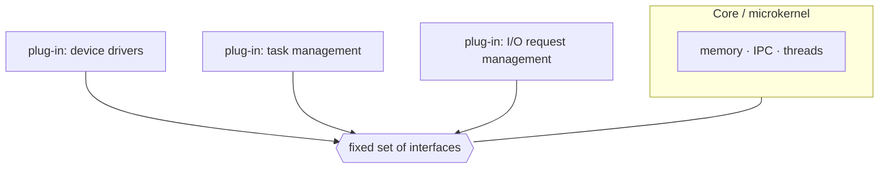

# Plug-in (pattern)

## Contesto e problema

> 📄 Fonte: [[03-Modifiability.pdf#page=30]]

🧩 Si vuole estendere un prodotto con funzionalità nuove, anche fornite da terzi, senza modificarne il nucleo.

## Soluzione

> 📄 Fonte: [[03-Modifiability.pdf#page=30]]

Due tipi di elementi:
- elementi che forniscono un **insieme di funzionalità di base** (il nucleo, *core*);
- **varianti specializzate** (i **plug-in**) che **aggiungono funzionalità** al nucleo tramite un **insieme fisso di interfacce**.

I due tipi sono di solito **legati tra loro a build time o più tardi**.

**Esempio della slide:** il nucleo può essere un **sistema operativo ridotto al minimo** (il **microkernel**, che fornisce gestione di memoria, IPC e thread); i plug-in forniscono la vera funzionalità del sistema operativo, come i **driver dei dispositivi**, la **gestione dei task** e la **gestione delle richieste di I/O**.

## Diagramma

La slide non ha figure.

*🧩 Diagramma mio dell'esempio di [[03-Modifiability.pdf#page=30]].*

## Attributi di qualità

| Attributo | Effetto | Perché | Fonte |
|---|---|---|---|
| Modificabilità / estendibilità | + | meccanismo **controllato** per estendere un prodotto base | [[03-Modifiability.pdf#page=30]] |
| Sviluppo indipendente | + | i plug-in possono essere sviluppati da **produttori diversi** ed **evolvere indipendentemente** dal microkernel | [[03-Modifiability.pdf#page=30]] |
| Sicurezza e privacy | − | possono essere introdotte **vulnerabilità di sicurezza** e **minacce alla privacy** | [[03-Modifiability.pdf#page=30]] |

🧩 Il rischio di sicurezza nasce dal fatto che codice di terzi gira dentro il prodotto con accesso alle sue interfacce.

## Quando usarlo / quando no

🧩 Quando le estensioni previste sono molte e seguono un'interfaccia stabile; non quando le estensioni richiedono di cambiare continuamente le interfacce del nucleo (l'«insieme fisso» smette di essere fisso).

## Varianti ed esempi

- Microkernel di un sistema operativo ([[03-Modifiability.pdf#page=30]]).
- Nell'Exam Booking System, il sistema che «carica un plug-in supportato» durante l'esecuzione ([[03-Modifiability.pdf#page=6]]).

## Connessioni

- [[pattern-modifiability]] · [[tattiche-modifiability]] (*defer binding*: il legame nucleo–plug-in avviene a build time o dopo; *abstract common service*: l'insieme fisso di interfacce).

## Fonti

- [[quality-attributes-modifiability]] — [[03-Modifiability.pdf#page=30]]

_Aggiornato: 2026-09-30 — ingest 03-Modifiability.pdf_
