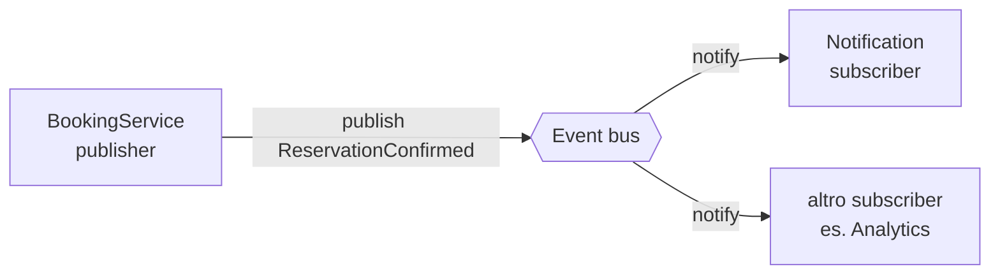

# Publish-Subscribe

> Presentato nella Lez. 3 come pattern per la modificabilità. Il programma lo tratterà anche come stile a invocazione implicita ([[Programma Syllabus]]) — TODO: da espandere.

## Contesto e problema

🧩 Un componente deve informare altri componenti di un fatto (es. prenotazione confermata) senza sapere chi sono né quanti sono, così che si possano aggiungere o togliere destinatari senza modificarlo.

## Soluzione

> 📄 Fonte: [[03-Modifiability.pdf#page=32]], [[03-Modifiability.pdf#page=33]]

Pattern architetturale in cui i componenti comunicano tramite **messaggi asincroni**, chiamati anche «**eventi**» o «**topic**». Tre tipi di elementi:
- **Publisher**: invia (pubblica) messaggi;
- **Subscriber**: si iscrive e poi riceve i messaggi;
- **Event Bus**: gestisce le iscrizioni e lo smistamento dei messaggi, come parte dell'infrastruttura di runtime.

I publisher **non conoscono i subscriber**; i subscriber conoscono **solo i tipi di messaggio**.

**Invocazione implicita** ([[03-Modifiability.pdf#page=33]]): il componente che pubblica **non invoca direttamente** nessun altro componente. A runtime, quando un messaggio è pubblicato, il bus **notifica tutti gli elementi** che si sono registrati per quell'evento o topic. La pubblicazione causa così un'invocazione implicita di (metodi in) altri componenti. Risultato: **accoppiamento debole** (*loose coupling*) tra publisher e subscriber.

## Diagramma

*🧩 Diagramma mio, costruito sull'esempio di [[03-Modifiability.pdf#page=21]] (event bus con l'evento `ReservationConfirmed`); il secondo subscriber è ipotetico e mostra che aggiungerlo non cambia il publisher.*

## Attributi di qualità

| Attributo | Effetto | Perché | Fonte |
|---|---|---|---|
| Modificabilità | + | publisher e subscriber sono **indipendenti**: aggiungere o cambiare un subscriber richiede solo di **registrarsi** a un evento, senza modifiche al publisher | [[03-Modifiability.pdf#page=33]] |
| Modificabilità del comportamento | + | il comportamento del sistema si cambia facilmente cambiando l'evento o il topic di un messaggio, e quindi quali subscriber lo ricevono | [[03-Modifiability.pdf#page=33]] |
| Prestazioni (latenza) | − | 🧩 il messaggio passa per il bus invece che per una chiamata diretta | [[03-Modifiability.pdf#page=33]] |
| Determinismo | − | **ordine non deterministico** in cui i metodi vengono invocati | [[03-Modifiability.pdf#page=33]] |
| Testabilità | − | cambiare quali componenti sono associati a quali eventi può avere un **ampio impatto** sul comportamento e sulla qualità del servizio | [[03-Modifiability.pdf#page=33]] |

## Quando usarlo / quando no

🧩 Utile quando i destinatari di un evento cambiano spesso o non sono noti a chi lo produce (notifiche, integrazione tra servizi). Da evitare quando serve una risposta immediata e un ordine garantito delle operazioni.

## Varianti ed esempi

- Notifica event-based nell'Exam Booking System: contratto di eventi tra Booking e Notifications ([[01-IntroductionOnSoftwareArchitecture.pdf#page=16]]) e coda asincrona nella vista runtime ([[01-IntroductionOnSoftwareArchitecture.pdf#page=28]]).
- Connettore publish-subscribe nella vista C&C della Lez. 1 ([[01-IntroductionOnSoftwareArchitecture.pdf#page=26]]).

## Connessioni

- [[pattern-modifiability]] · [[tattiche-modifiability]] (*use an intermediary*: il bus è l'intermediario).
- [[strutture-componenti-e-connettori]]: publish-subscribe come tipo di connettore.

## Fonti

- [[quality-attributes-modifiability]] — [[03-Modifiability.pdf#page=32]], [[03-Modifiability.pdf#page=33]]

_Aggiornato: 2026-09-30 — ingest 03-Modifiability.pdf_
