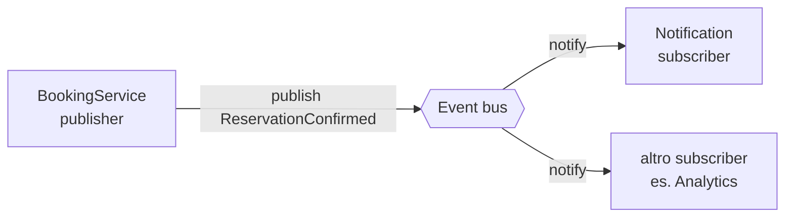

# Publish-Subscribe

> Presentato nella Lez. 3 come pattern per la modificabilità. È trattato anche come stile a invocazione implicita nella Lezione 8 (sezione «Trattazione completa dello stile»; [[Programma Syllabus]]).

## Contesto e problema

🧩 Un componente deve informare altri componenti di un fatto (es. prenotazione confermata) senza sapere chi sono né quanti sono, così che si possano aggiungere o togliere destinatari senza modificarlo.

## Soluzione

> 📄 Fonte: [[03-Modifiability.pdf#page=32]], [[03-Modifiability.pdf#page=33]]

Pattern architetturale in cui i componenti comunicano tramite **messaggi asincroni**, chiamati anche «**eventi**» o «**topic**». Tre tipi di elementi:
- **Publisher**: invia (pubblica) messaggi;
- **Subscriber**: si iscrive e poi riceve i messaggi;
- **Event Bus**: gestisce le iscrizioni e lo smistamento dei messaggi, come parte dell'infrastruttura di runtime.

I publisher **non conoscono i subscriber**; i subscriber conoscono **solo i tipi di messaggio**.

**Invocazione implicita** ([[03-Modifiability.pdf#page=33]]): il componente che pubblica **non invoca direttamente** nessun altro componente. A runtime, quando un messaggio è pubblicato, il bus **notifica tutti gli elementi** che si sono registrati per quell'evento o topic. La pubblicazione causa così un'invocazione implicita di (metodi in) altri componenti. Risultato: **accoppiamento debole** (*loose coupling*) tra publisher e subscriber.

## Diagramma

*🧩 Diagramma mio, costruito sull'esempio di [[03-Modifiability.pdf#page=21]] (event bus con l'evento `ReservationConfirmed`); il secondo subscriber è ipotetico e mostra che aggiungerlo non cambia il publisher.*

## Attributi di qualità

| Attributo | Effetto | Perché | Fonte |
|---|---|---|---|
| Modificabilità | + | publisher e subscriber sono **indipendenti**: aggiungere o cambiare un subscriber richiede solo di **registrarsi** a un evento, senza modifiche al publisher | [[03-Modifiability.pdf#page=33]] |
| Modificabilità del comportamento | + | il comportamento del sistema si cambia facilmente cambiando l'evento o il topic di un messaggio, e quindi quali subscriber lo ricevono | [[03-Modifiability.pdf#page=33]] |
| Prestazioni (latenza) | − | 🧩 il messaggio passa per il bus invece che per una chiamata diretta | [[03-Modifiability.pdf#page=33]] |
| Determinismo | − | **ordine non deterministico** in cui i metodi vengono invocati | [[03-Modifiability.pdf#page=33]] |
| Testabilità | − | cambiare quali componenti sono associati a quali eventi può avere un **ampio impatto** sul comportamento e sulla qualità del servizio | [[03-Modifiability.pdf#page=33]] |

## Quando usarlo / quando no

🧩 Utile quando i destinatari di un evento cambiano spesso o non sono noti a chi lo produce (notifiche, integrazione tra servizi). Da evitare quando serve una risposta immediata e un ordine garantito delle operazioni.

## Varianti ed esempi

- Notifica event-based nell'Exam Booking System: contratto di eventi tra Booking e Notifications ([[01-IntroductionOnSoftwareArchitecture.pdf#page=16]]) e coda asincrona nella vista runtime ([[01-IntroductionOnSoftwareArchitecture.pdf#page=28]]).
- Connettore publish-subscribe nella vista C&C della Lez. 1 ([[01-IntroductionOnSoftwareArchitecture.pdf#page=26]]).

## Trattazione completa dello stile (Lez. 8)

> 📄 Fonte: [[05_Architectural_Styles_Complete.pdf#page=95]]–[[05_Architectural_Styles_Complete.pdf#page=106]]

- **Meccanismo.** I *publisher* pubblicano messaggi senza indirizzare singoli destinatari; i *subscriber* esprimono interesse per topic, tipi di evento o contenuto; un meccanismo di distribuzione consegna i messaggi corrispondenti ([[05_Architectural_Styles_Complete.pdf#page=96]]).
- **Elementi.** Componenti: publisher, subscriber, proxy/broker opzionali. Connettori: chiamate di procedura in un programma locale, protocolli di rete tra host (le sottoscrizioni *content-based* richiedono matching e routing). Elementi dati: sottoscrizioni, notifiche, informazioni pubblicate. Topologia: subscriber collegati direttamente al publisher o tramite intermediari. Qualità: distribuzione uno-a-molti con accoppiamento limitato ([[05_Architectural_Styles_Complete.pdf#page=97]]).
- **In un singolo programma:** i subscriber si registrano presso il publisher e indicano la *callback*; il publisher mantiene i subscriber e notifica in modo sincrono o asincrono; i subscriber possono annullare ([[05_Architectural_Styles_Complete.pdf#page=98]]). **In rete:** protocolli di rete e proxy o broker ([[05_Architectural_Styles_Complete.pdf#page=99]]).

![[lez08-stili-p100-pubsub-broker.png]]
*Message broker ([[05_Architectural_Styles_Complete.pdf#page=100]]): i publisher inviano messaggi a un broker che li instrada su canali (topic); ogni canale consegna una copia a tutti i subscriber interessati.*

![[lez08-stili-p105-pubsub-lunar-lander.png]]
*Lunar Lander pub–sub ([[05_Architectural_Styles_Complete.pdf#page=105]]): i giocatori (Subscriber 1…n) si registrano presso il Game Server, che pubblica lo stato del gioco; una notifica può portare l'informazione aggiornata o spingere a un download esplicito successivo.*

![[lez08-stili-p106-mqtt.png]]
*MQTT ([[05_Architectural_Styles_Complete.pdf#page=106]]): un sensore (publisher) pubblica 24 °C sul topic *temperature* verso un MQTT Broker, che lo consegna ai client sottoscritti (mobile e backend). MQTT è uno standard OASIS per l'IoT: leggerissimo, per dispositivi con poco codice e poca banda.*

| Attributo | Effetto | Perché | Fonte |
|---|---|---|---|
| Estensibilità | + | nuovi subscriber senza cambiare il publisher | [[05_Architectural_Styles_Complete.pdf#page=102]] |
| Modificabilità | + | publisher e subscriber evolvono separatamente finché i contratti sono compatibili | [[05_Architectural_Styles_Complete.pdf#page=102]] |
| Interoperabilità | + | protocolli e formati condivisi tra piattaforme | [[05_Architectural_Styles_Complete.pdf#page=102]] |
| Reattività | + | consegna asincrona: il publisher non attende | [[05_Architectural_Styles_Complete.pdf#page=102]] |
| Garanzie di consegna | − | consegna, ordinamento, duplicati richiedono decisioni esplicite | [[05_Architectural_Styles_Complete.pdf#page=103]] |
| Prestazioni | − | subscriber lenti causano backlog; gli intermediari richiedono capacità, monitoraggio e recovery | [[05_Architectural_Styles_Complete.pdf#page=103]] |
| Modificabilità dei contratti | − | un cambio del contratto dei messaggi tocca più subscriber | [[05_Architectural_Styles_Complete.pdf#page=103]] |

Applicazioni tipiche: diffusione di notizie, interfacce grafiche, giochi multigiocatore, Internet of Things ([[05_Architectural_Styles_Complete.pdf#page=104]]). Per le tre forme di disaccoppiamento che questo stile realizza → [[disaccoppiamento-dei-componenti]]; per il suo rapporto con eventi e implicit invocation → [[event-based]], [[implicit-invocation]].

## Connessioni

- [[pattern-modifiability]] · [[tattiche-modifiability]] (*use an intermediary*: il bus è l'intermediario).
- [[strutture-componenti-e-connettori]]: publish-subscribe come tipo di connettore.

## Fonti

- [[quality-attributes-modifiability]] — [[03-Modifiability.pdf#page=32]], [[03-Modifiability.pdf#page=33]]

_Aggiornato: 2026-09-30 — ingest 03-Modifiability.pdf_
_Aggiornato: 2026-11-24 — ingest 05_Architectural_Styles_Complete.pdf (Lez. 8)_
