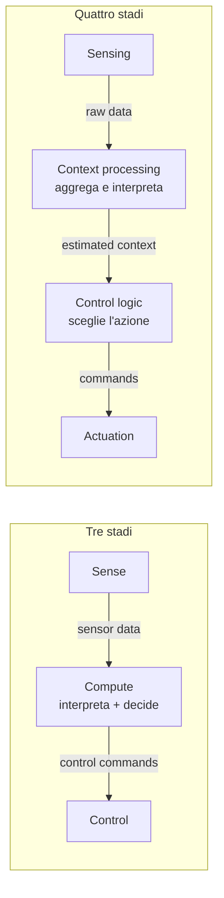

# Sense–Compute–Control

## Contesto e problema

> 📄 Fonte: [[3-Architectural Patterns-complete.pdf#page=84]], [[3-Architectural Patterns-complete.pdf#page=85]]

Il pattern Sense–Compute–Control sostiene le **applicazioni che interagiscono con un ambiente esterno e lo controllano**. È comune in domini come: **telecomunicazioni**, **domotica e automazione degli edifici**, **robotica**, **avionica**, **sistemi industriali ed embedded** ([[3-Architectural Patterns-complete.pdf#page=84]]).

Obiettivo: **strutturare le applicazioni di controllo embedded** ([[3-Architectural Patterns-complete.pdf#page=85]]).

## Soluzione

> 📄 Fonte: [[3-Architectural Patterns-complete.pdf#page=84]], [[3-Architectural Patterns-complete.pdf#page=85]]

L'interazione segue **tre fasi**:

| Fase | Chi | Cosa fa |
|---|---|---|
| **Sense** | sensori | **raccolgono dati** dall'ambiente esterno |
| **Compute** | componenti di elaborazione del contesto | **aggregano e interpretano** i dati dei sensori per determinare la **situazione corrente** |
| **Control** | componenti di controllo | **decidono quali azioni** eseguire e **inviano comandi agli attuatori** |

Il **ciclo di controllo** (*control loop*, [[3-Architectural Patterns-complete.pdf#page=85]]): leggere tutti i valori dei sensori → calcolare le uscite di controllo → inviare i comandi agli attuatori → ripetere.

## Diagramma

![[lez05-ap-p85-scc-architettura.png]]
*Figura di [[3-Architectural Patterns-complete.pdf#page=85]], «Sense–Compute–Control Architecture»: fascia **SENSE** con Sensor 1–4; le loro frecce convergono nel blocco **COMPUTE «Compute and Control»**; da qui partono frecce verso la fascia **CONTROL** con Actuator A, B, C. Riquadro «Control loop»: leggi tutti i valori dei sensori, calcola le uscite di controllo, invia i comandi agli attuatori, ripeti.*

![[anim-sense-compute-control.svg]]
*🧩 Animazione mia del ciclo nella variante a quattro stadi ([[3-Architectural Patterns-complete.pdf#page=88]]), con l'esempio antintrusione di [[3-Architectural Patterns-complete.pdf#page=86]]: l'ambiente produce un fenomeno → i sensori lo misurano → l'elaborazione del contesto stima la situazione → la logica di controllo decide → gli attuatori cambiano l'ambiente, e il ciclo riparte.*

> 🧩 Elaborazione mia — perché è un **ciclo chiuso**: gli attuatori modificano l'ambiente che i sensori misurano al giro successivo. Il sistema non esegue una richiesta e finisce (come in [[mvc]] o [[state-logic-display]]): gira continuamente finché il sistema è acceso.

## Esempi espansi

### Rilevamento di intrusioni in casa

> 📄 Fonte: [[3-Architectural Patterns-complete.pdf#page=86]]

Un'applicazione di sicurezza domestica che:
- **rileva** (*senses*) il movimento con sensori di movimento;
- **calcola** (*computes*) se i dati dei sensori indicano una possibile intrusione;
- **controlla** (*controls*) l'ambiente attivando un allarme o inviando una notifica.

![[lez05-ap-p86-scc-home-security.png]]
*Figura di [[3-Architectural Patterns-complete.pdf#page=86]]: External environment (stato fisico) → *physical phenomena* → Sensors (misure) → *raw sensor data* → Context processing (contesto stimato) → *interpreted context* → Control logic (decisione) → *control command* → Actuators (azione) → *changes the environment* torna all'ambiente.*

### Varianti a tre e a quattro stadi

> 📄 Fonte: [[3-Architectural Patterns-complete.pdf#page=87]], [[3-Architectural Patterns-complete.pdf#page=88]]

| | Variante a tre stadi | Variante a quattro stadi |
|---|---|---|
| Struttura | **Sense** acquisisce i dati; **Compute** unisce interpretazione del contesto e decisione; **Control** invia i comandi agli attuatori | **separa l'interpretazione del contesto dalle decisioni di controllo**: Sensing → Context Processing → Control Logic → Actuation |
| Proprietà | enfatizza il **ciclo di controllo** | i componenti di elaborazione del contesto possono servire **politiche di controllo diverse**; migliora **modificabilità e riuso** |
| Adatta a | logica di elaborazione e controllo **relativamente semplice** | sistemi **complessi, riusabili o distribuiti** |

![[lez05-ap-p88-scc-tre-quattro-stadi.png]]
*Figura di [[3-Architectural Patterns-complete.pdf#page=88]]. **Tre stadi**: Sense (raccoglie i dati dell'ambiente) → *sensor data* → Compute (interpreta i dati e decide) → *control commands* → Control (attiva azioni fisiche). **Quattro stadi**: Sensing (acquisisce dati grezzi) → *raw data* → Context Processing (aggrega e interpreta) → *estimated context* → Control Logic (sceglie un'azione) → *commands* → Actuation (esegue l'azione).*

*🧩 Ricostruzione Mermaid di [[3-Architectural Patterns-complete.pdf#page=88]].*

> 🧩 Elaborazione mia — perché quattro stadi migliorano la modificabilità: nella variante a tre stadi «capire cosa succede» e «decidere cosa fare» stanno nello stesso componente, quindi cambiare la politica (es. di notte allarme, di giorno solo notifica) tocca anche l'interpretazione dei sensori. Separandoli, la stessa stima del contesto («c'è una presenza in salotto») serve politiche diverse: è la tattica *split module* / *increase cohesion* della Lez. 3 ([[tattiche-modifiability]]).

### Variante a quattro stadi: controllo accessi e rilevamento intrusioni

> 📄 Fonte: [[3-Architectural Patterns-complete.pdf#page=89]]

![[lez05-ap-p89-scc-access-control.png]]
*Figura di [[3-Architectural Patterns-complete.pdf#page=89]]: quattro fasce separate da linee tratteggiate; legenda: bianco = tassonomia, grigio = architettura. **Entities (sources)**, in basso: Camera (*image*), Motion Detector (*detection*), Locker (*isLocked*), Authorization Database (*authorizedAccess*), Identifier (*userDetected*). **Context**: Scene Image (riceve Image), Presence (Boolean da Motion Detector), Intrusion (Boolean[location] da Presence + Boolean da Secure Building), Secure Building (Boolean da Locker), Authenticated Access (Boolean[location,user] da Authorization Database + Boolean[user] da Identifier). **Controllers**: Intrusion Manager (riceve Image[location] da Scene Image e Boolean[location] da Intrusion), Secure Manager (Boolean da Secure Building), Access Controller (User[location] da Authenticated Access). **Entities (actions)**, in alto: Screen (*Display*) e Alarm (*OnOff*) comandati dall'Intrusion Manager, Locker (*Lock*) dal Secure Manager, Door (*Lock*) dall'Access Controller.*

> 🧩 Elaborazione mia — lettura della figura: le quattro fasce sono i quattro stadi (sorgenti = sensing, context = context processing, controllers = control logic, entità-azione = actuation). Il contesto **Secure Building** è usato **sia** dal Secure Manager **sia**, tramite Intrusion, dall'Intrusion Manager: è proprio il riuso del contesto da parte di più politiche di controllo che la variante a quattro stadi rende possibile.

### Dal Sense–Compute–Control all'IoT

> 📄 Fonte: [[3-Architectural Patterns-complete.pdf#page=90]]

L'**IoT estende** il ciclo Sense–Compute–Control **distribuendo** rilevamento, calcolo e attuazione tra **dispositivi connessi, nodi edge e servizi cloud**.

| Tipo di controllo | Percorso | Cosa permette |
|---|---|---|
| **Locale** | sensori → logica di controllo locale sull'**edge** → attuatori | **risposte rapide** e funzionamento **anche senza connessione al cloud** |
| **Remoto/centrale** | sensori → edge → **cloud** → logica di controllo remota → edge → attuatori | decisioni basate su **dati aggregati**, **regole centralizzate** e **analisi più complesse** |

![[lez05-ap-p90-scc-iot.png]]
*Figura di [[3-Architectural Patterns-complete.pdf#page=90]], «IoT Architecture and the Sense–Compute–Control Loop»: Physical Environment *osservato dai* Sensors (Connected Devices, SENSE) → *telemetria ed eventi* → Edge/Gateway (filtraggio, aggregazione, decisioni locali; COMPUTE, con Local Control Logic) → IoT Platform/Cloud (memorizzazione, analytics, gestione dei dispositivi) → Applications (monitoraggio, regole, interfacce utente; Remote/Central Control Logic). I comandi tornano agli Actuators (CONTROL) per via locale (dall'edge) o remota (dal cloud); gli attuatori *cambiano l'ambiente*.*

> 💡 Connessione: è la riga «Cenni alle architetture di nuova generazione — IoT, edge–cloud» del programma ([[Programma Syllabus]]) e richiama l'architettura di riferimento IoT della lezione precedente ([[dssa]]).

### Lunar Lander

> 📄 Fonte: [[3-Architectural Patterns-complete.pdf#page=92]], [[3-Architectural Patterns-complete.pdf#page=93]], [[3-Architectural Patterns-complete.pdf#page=94]]

Svolto passo per passo, con una simulazione del ciclo di controllo, in [[applicare-sense-compute-control]] (caso 3).

### Sistemi di guida autonoma (ADS)

> 📄 Fonte: [[3-Architectural Patterns-complete.pdf#page=95]]

![[lez05-ap-p95-ads.png]]
*Figura di [[3-Architectural Patterns-complete.pdf#page=95]], «Fig. 1. The typical architecture of an ADS» (slide in italiano: «L'architettura dei sistemi ADS — Autonomous Driving Systems»): quattro blocchi in sequenza — **Sensing** (GPS/IMU, Camera, LiDAR, Radar) → **Perception** (Localization, Detection) → **Planning** (Prediction, Planning) → **Control** (Control algorithms, Control functions); una fascia gialla **End-to-End module** attraversa Perception, Planning e Control.*

> 🧩 Elaborazione mia: è un Sense–Compute–Control a quattro stadi in cui il «Compute» è diviso in **Perception** (interpretazione del contesto: dove sono io, cosa c'è intorno) e **Planning** (decisione). Il modulo *end-to-end* (tipicamente una rete neurale che va dai dati percepiti ai comandi) attraversa i confini tra gli stadi: guadagna in integrazione ma perde la separazione che rende modificabile e verificabile il sistema. La slide non commenta la figura.

## Attributi di qualità

> 📄 Fonte: [[3-Architectural Patterns-complete.pdf#page=91]], [[3-Architectural Patterns-complete.pdf#page=87]]

La slide pone la domanda — *che dire di modificabilità, testabilità, prestazioni, sicurezza, scalabilità…?* — e risponde: la **separazione** di rilevamento, elaborazione del contesto, controllo e attuazione **migliora modificabilità, testabilità e riuso**, ma le **implementazioni distribuite** (vedi IoT) introducono problemi di **latenza, disponibilità, safety e sicurezza**.

| Attributo | Effetto | Perché | Fonte |
|---|---|---|---|
| Modificabilità | + | stadi separati; nella variante a quattro stadi la politica di controllo cambia senza toccare l'interpretazione | [[3-Architectural Patterns-complete.pdf#page=87]], [[3-Architectural Patterns-complete.pdf#page=91]] |
| Testabilità | + | 🧩 ogni stadio si prova con dati simulati (es. sensori finti) | [[3-Architectural Patterns-complete.pdf#page=91]] |
| Riuso | + | lo stesso contesto serve più politiche di controllo | [[3-Architectural Patterns-complete.pdf#page=87]], [[3-Architectural Patterns-complete.pdf#page=91]] |
| Prestazioni (latenza) | − se distribuito | 🧩 ogni passaggio di rete allunga il ciclo; per questo il controllo locale sull'edge dà risposte rapide | [[3-Architectural Patterns-complete.pdf#page=90]], [[3-Architectural Patterns-complete.pdf#page=91]] |
| Disponibilità | − se distribuito | 🧩 il controllo remoto dipende dal cloud; il controllo locale funziona anche senza | [[3-Architectural Patterns-complete.pdf#page=90]], [[3-Architectural Patterns-complete.pdf#page=91]] |
| Safety e sicurezza | − se distribuito | 🧩 comandi agli attuatori che viaggiano in rete possono essere ritardati, persi o falsificati | [[3-Architectural Patterns-complete.pdf#page=91]] |

## Quando usarlo / quando no

🧩 Quando il software deve **controllare un ambiente fisico** in modo continuo (embedded, robotica, domotica, automotive). Non per applicazioni a richiesta–risposta guidate dall'utente, dove MVC o il three-tier sono più adatti.

## Varianti ed esempi

- Tre stadi e quattro stadi ([[3-Architectural Patterns-complete.pdf#page=87]]).
- Controllo locale vs remoto nell'IoT ([[3-Architectural Patterns-complete.pdf#page=90]]).
- Sicurezza domestica, controllo accessi, Lunar Lander, guida autonoma ([[3-Architectural Patterns-complete.pdf#page=86]], [[3-Architectural Patterns-complete.pdf#page=89]], [[3-Architectural Patterns-complete.pdf#page=94]], [[3-Architectural Patterns-complete.pdf#page=95]]).

## Connessioni

- [[pattern-architetturali]]: terzo pattern della lezione, con [[state-logic-display]] e [[mvc]].
- [[applicare-sense-compute-control]]: esercizi svolti.
- [[availability]]: il controllo locale sull'edge è un modo di continuare a funzionare quando il cloud non risponde (fault tolerance).

## Fonti

- [[architectural-patterns-mvc-scc]] — [[3-Architectural Patterns-complete.pdf#page=83]]–[[3-Architectural Patterns-complete.pdf#page=95]]

_Aggiornato: 2026-10-06 — ingest 3-Architectural Patterns-complete.pdf (nuova lezione)_
