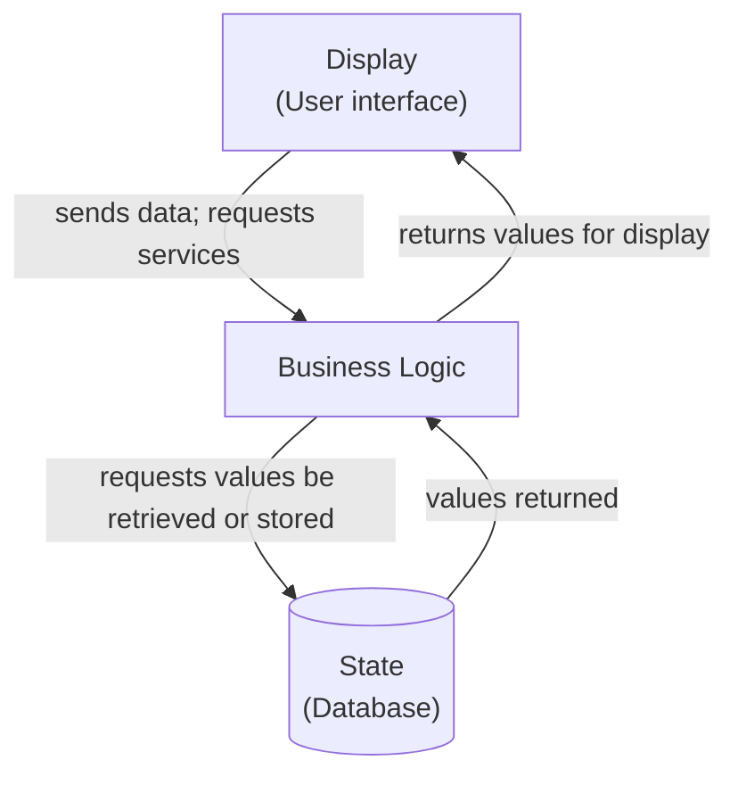

# State-Logic-Display (three-tiered pattern)

## Contesto e problema

> 📄 Fonte: [[3-Architectural Patterns-complete.pdf#page=25]]

🧩 Applicazioni in cui un'interfaccia utente deve mostrare e modificare dati persistenti secondo regole di business: la slide cita applicazioni aziendali, giochi multigiocatore e applicazioni web.

## Soluzione

> 📄 Fonte: [[3-Architectural Patterns-complete.pdf#page=24]], [[3-Architectural Patterns-complete.pdf#page=25]]

È un tipo particolare di **architettura multi-tier** ([[architetture-multi-tier]]): il sistema è diviso in tre tier, unità installabili ed eseguibili separatamente che comunicano tramite interfacce esplicite.

**Three-tier architecture**: client, application server e database server ([[3-Architectural Patterns-complete.pdf#page=25]]).

| Tier | Responsabilità | Interazione con i vicini |
|---|---|---|
| **Display** (interfaccia utente) | mostra i dati e raccoglie le richieste | invia dati e richiede servizi alla logica; riceve i valori da mostrare |
| **Logic** («Business Logic») | regole del dominio | chiede di recuperare o memorizzare valori nello stato; riceve i valori restituiti |
| **State** (database) | dati persistenti | restituisce i valori richiesti |

Esempi di logica di business: sistema assicurativo, logica di gioco, sistema di calcolo delle tasse… ([[3-Architectural Patterns-complete.pdf#page=25]]).

## Diagramma

![[lez04-ap-p25-state-logic-display.png]]
*Figura di [[3-Architectural Patterns-complete.pdf#page=25]] (da Taylor, Medvidovic, Dashofy, © 2008 Wiley): tre riquadri impilati — **Display** (User interface), **«Business Logic»**, **State** (Database). Tra Display e Business Logic: «Sends data; Requests services» verso il basso, «Returns values for display» verso l'alto. Tra Business Logic e State: «Requests values be retrieved or stored» verso il basso, «Values returned» verso l'alto.*

*🧩 Ricostruzione Mermaid di [[3-Architectural Patterns-complete.pdf#page=25]].*

## Attributi di qualità

> 📄 Fonte: [[3-Architectural Patterns-complete.pdf#page=34]] (tabella del three-tier)

| Attributo | Effetto | Perché | Fonte |
|---|---|---|---|
| Modificabilità | + | le modifiche si localizzano in uno strato | [[3-Architectural Patterns-complete.pdf#page=34]] |
| Testabilità | + | strati testabili separatamente con mock o stub | [[3-Architectural Patterns-complete.pdf#page=34]] |
| Riusabilità | + | servizi di business e persistenza riusabili da interfacce diverse | [[3-Architectural Patterns-complete.pdf#page=34]] |
| Scalabilità | + / − | si replicano i singoli tier; ma il tier dei dati condiviso può restare collo di bottiglia | [[3-Architectural Patterns-complete.pdf#page=34]] |
| Prestazioni | − | attraversare più strati introduce overhead (mitigabile con caching) | [[3-Architectural Patterns-complete.pdf#page=34]] |

Tabella completa e confronto con 1-tier e 2-tier → [[architetture-multi-tier]].

## Quando usarlo / quando no

🧩 Adatto quando la stessa logica e gli stessi dati servono più interfacce o molti utenti (app web, giochi multigiocatore); poco adatto se un solo utente lavora in locale e la latenza di rete è inaccettabile.

## Varianti ed esempi

- Applicazioni aziendali, giochi multigiocatore, applicazioni web ([[3-Architectural Patterns-complete.pdf#page=25]]).
- 🧩 L'[[exam-booking-system]] della Lez. 1 è un three-tier: browser (display), Booking Service (logic), Booking Database (state) ([[01-IntroductionOnSoftwareArchitecture.pdf#page=28]]).
- Varianti n-tier: 4-tier per applicazioni web e load-balanced cluster ([[architetture-multi-tier]]).

## Connessioni

- [[pattern-architetturali]]: è il primo dei pattern elencati dalla lezione (con MVC e Sense-Compute-Control, non ancora spiegati).
- [[architetture-multi-tier]]: famiglia a cui appartiene.
- [[layered]]: stessa separazione in tre responsabilità, ma come strati logici anziché tier fisici.

## Fonti

- [[approcci-riuso-progettazione-architettura]] — [[3-Architectural Patterns-complete.pdf#page=23]]–[[3-Architectural Patterns-complete.pdf#page=25]]

_Aggiornato: 2026-10-01 — ingest 3-Architectural Patterns-complete.pdf_
