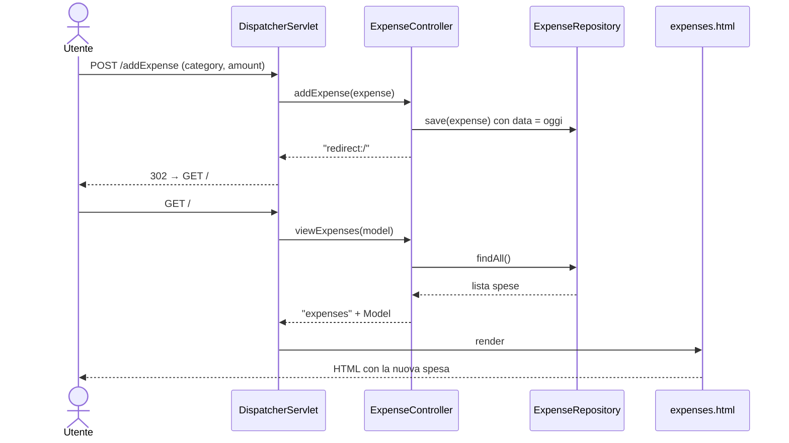

# Implementare il pattern MVC

## Metodo

> 📄 Fonte: [[3-Architectural Patterns-complete.pdf#page=42]], [[3-Architectural Patterns-complete.pdf#page=45]], [[3-Architectural Patterns-complete.pdf#page=68]]

1. **Assegna le tre responsabilità**: Model = dati, stato, regole di dominio; View = presentazione; Controller = interpretazione dell'input e coordinamento.
2. **Scegli il modello di interazione** secondo il contesto: GUI desktop (pull o Observer), web lato server (il Controller passa i dati alla View), web lato client (API + stato locale).
3. Nel MVC classico: **View → Controller con Strategy**, **Model → View con Observer**.
4. In **Spring MVC**: Controller = classe `@Controller`; operazione = metodo `@GetMapping`/`@PostMapping`; dati = attributi del `Model`; vista = nome logico risolto dal `ViewResolver` in un template Thymeleaf; il punto d'ingresso è il `DispatcherServlet`.
5. **Controlla le dipendenze**: il Model non deve conoscere la View né il Controller; il Controller non deve generare HTML.

## Concetti usati

[[mvc]] · [[spring-mvc]] · [[tattiche-modifiability]] (Strategy = polimorfismo e *abstract common service*)

## Casi svolti

### Caso 1 — Dalla View con `if` alla View con Strategy

**Traccia:** [[3-Architectural Patterns-complete.pdf#page=51]], [[3-Architectural Patterns-complete.pdf#page=52]].

**Prima** — View senza Strategy ([[3-Architectural Patterns-complete.pdf#page=51]]): *ogni nuovo comportamento di interazione richiede di modificare la View.*

```java
// 📄 dalla slide 55
void onExamSelected(ExamSession exam) {
    if (mode == BROWSE) {
        showDetails(exam);
    } else if (mode == BOOKING) {
        bookingService.book(exam);
    } else if (mode == ADMINISTRATION) {
        openEditForm(exam);
    }
}
```

**Dopo** — con il design pattern Strategy ([[3-Architectural Patterns-complete.pdf#page=52]]):

```java
// 📄 dalla slide 56
interface Controller {
    void processAction(UserAction action);
}
class BrowseController implements Controller {
    public void processAction(UserAction action) { /* Show exam details */ }
}
class BookingController implements Controller {
    public void processAction(UserAction action) { /* Request an exam booking */ }
}
class AdministrationController implements Controller {
    public void processAction(UserAction action) { /* Modify the exam session */ }
}

class ExamCalendarView {
    private Controller controller;          // la View conosce solo l'interfaccia Controller
    void onUserAction(UserAction action) {
        controller.processAction(action);
    }
}

public static void main(String[] args) {    // il main decide quali controller associare alla View
    ExamService examService = new ExamService();
    Controller controller = new BookingController(examService);
    Controller cancellationController = new CancellationController(examService);
    ExamCalendarView view = new ExamCalendarView();
    view.setController(controller);
    view.show();
    // After an event…
    view.setController(cancellationController);
    view.show();
}
```

![[lez05-ap-p52-strategy-codice.png]]
*Figura di [[3-Architectural Patterns-complete.pdf#page=52]]: il codice sopra, con due note — «la view conosce solo l'interfaccia del controller» e «il main decide quali controller saranno associati alla view» (frecce rosse verso le due chiamate `setController`).*

**Svolgimento (🧩):**

| | Senza Strategy | Con Strategy |
|---|---|---|
| Aggiungere un comportamento (es. annullare una prenotazione) | modificare `onExamSelected` nella View, aggiungere un ramo `if` e ritestare tutta la View | scrivere una nuova classe `CancellationController` e collegarla con `setController`; la View non cambia |
| Dipendenze della View | conosce `bookingService`, i moduli di dettaglio e di modifica | conosce solo l'interfaccia `Controller` |
| Quando si sceglie il comportamento | al momento della chiamata, con la variabile `mode` | quando si associa il controller (anche a runtime, «after an event») |

Collegamento con la Lez. 3: è la tattica *defer binding* con **polimorfismo** (si sceglie l'implementazione a runtime) e *abstract common service* (più implementazioni dietro un'interfaccia stabile) ([[03-Modifiability.pdf#page=20]], [[03-Modifiability.pdf#page=25]] → [[tattiche-modifiability]]). Nota: `CancellationController` compare nel `main` ma la sua classe non è nella slide.

### Caso 2 — Il requisito ShowExamSessions in Spring MVC

**Traccia:** [[3-Architectural Patterns-complete.pdf#page=65]]–[[3-Architectural Patterns-complete.pdf#page=67]]. Codice e diagramma di sequenza in [[spring-mvc]] § Flusso di elaborazione.

**Svolgimento (🧩) — chi fa cosa nella richiesta `GET /exam-sessions`:**

| Passo | Componente | Ruolo MVC / pattern |
|---|---|---|
| 1 | `DispatcherServlet` riceve la richiesta | Front Controller |
| 2 | `HandlerMapping` trova `ExamSessionController.listAvailableSessions` grazie a `@GetMapping("/exam-sessions")` | mappatura delle richieste |
| 3 | il Controller chiama `service.findAvailableSessions()` | Controller che invoca il Model (servizi di dominio) |
| 4 | il Controller mette `examSessions` nel `Model` e restituisce `"exam-sessions"` | Controller che prepara i dati (View Model) e sceglie la vista |
| 5 | `ViewResolver` trova `templates/exam-sessions.html` | selezione della vista |
| 6 | Thymeleaf genera l'HTML con `th:each` | View |
| 7 | il `DispatcherServlet` restituisce la risposta HTTP | Front Controller |

È la variante **3 — Web MVC lato server**: la View **non osserva** il Model di dominio, riceve i dati dal Controller ([[3-Architectural Patterns-complete.pdf#page=54]]).

### Caso 3 — Applicazione per la gestione delle spese personali

**Traccia:** [[3-Architectural Patterns-complete.pdf#page=72]]–[[3-Architectural Patterns-complete.pdf#page=82]] (slide in italiano).

**Le responsabilità** ([[3-Architectural Patterns-complete.pdf#page=73]]):
- **Model**: gestisce i dati delle spese (importo, data, categoria); le salva e le recupera da un database.
- **View**: mostra la lista delle spese e permette di aggiungerne di nuove con un'interfaccia.
- **Controller**: quando l'utente inserisce una nuova spesa, riceve l'input, lo **valida**, invia i dati al modello per salvarli e aggiorna la vista per mostrare la nuova spesa.

**Model — `Expense.java`** ([[3-Architectural Patterns-complete.pdf#page=74]]): entità JPA con `id` generato, `category`, `amount`, `date`, costruttori e getter/setter.

```java
// 📄 dalla slide 78 (getter/setter omessi qui per brevità)
@Entity
public class Expense {
    @Id
    @GeneratedValue(strategy = GenerationType.IDENTITY)
    private Long id;
    private String category;
    private double amount;
    private LocalDate date;
    public Expense() {}
    public Expense(String category, double amount, LocalDate date) { ... }
}
```

**Repository — `ExpenseRepository.java`** ([[3-Architectural Patterns-complete.pdf#page=75]]): per interagire con il database (qui **H2**).

```java
// 📄 dalla slide 79: l'interfaccia basta, l'implementazione la genera Spring Data JPA
@Repository
public interface ExpenseRepository extends JpaRepository<Expense, Long> {
}
```

**Controller — `ExpenseController.java`** ([[3-Architectural Patterns-complete.pdf#page=76]], [[3-Architectural Patterns-complete.pdf#page=77]]):

```java
// 📄 dalle slide 80-81
@Controller
public class ExpenseController {
    @Autowired
    private ExpenseRepository expenseRepository;     // iniettato dal container IoC

    @GetMapping("/")
    public String viewExpenses(Model model) {
        List<Expense> expenses = expenseRepository.findAll();
        model.addAttribute("expenses", expenses);    // dati per la tabella
        model.addAttribute("expense", new Expense()); // oggetto vuoto per il form
        return "expenses";                           // nome logico → templates/expenses.html
    }

    @PostMapping("/addExpense")
    public String addExpense(@ModelAttribute("expense") Expense expense) {
        expense.setDate(LocalDate.now());            // imposta la data corrente
        expenseRepository.save(expense);
        return "redirect:/";                         // torna alla lista (pattern Post/Redirect/Get)
    }
}
```

**View — `expenses.html`** con **Thymeleaf** come motore di template ([[3-Architectural Patterns-complete.pdf#page=78]], [[3-Architectural Patterns-complete.pdf#page=79]]): una tabella con `th:each="expense : ${expenses}"` (colonne ID, Categoria, Importo, Data) e un form `th:action="@{/addExpense}" th:object="${expense}" method="post"` con i campi `*{category}` e `*{amount}` e il pulsante «Aggiungi Spesa».

![[lez05-ap-p80-view-generata.png]]
*Figura di [[3-Architectural Patterns-complete.pdf#page=80]], «Una possibile View generata»: titolo «Lista Spese», tabella con tre righe (1 Trasporti 35.50 2026-10-02; 2 Alimentari 62.90 2026-10-04; 3 Libri 28.00 2026-10-05) e sotto il form «Aggiungi una nuova spesa» con i campi Categoria e Importo e il pulsante «Aggiungi Spesa».*

**Configurazione del database — `application.properties`** ([[3-Architectural Patterns-complete.pdf#page=81]]):

```properties
# 📄 dalla slide 85 — database H2 in memoria
spring.datasource.url=jdbc:h2:mem:testdb
spring.datasource.driverClassName=org.h2.Driver
spring.datasource.username=sa
spring.datasource.password=password
spring.jpa.hibernate.ddl-auto=update
spring.h2.console.enabled=true
```

**Main — `ExpenseManagerApplication.java`** ([[3-Architectural Patterns-complete.pdf#page=82]]): classe con `@SpringBootApplication` e `SpringApplication.run(...)`. Si esegue da terminale o da un IDE (IntelliJ, Eclipse) e si apre `http://localhost:8080/`.

**Svolgimento (🧩) — il ciclo di vita di «aggiungi spesa»:**


*🧩 Diagramma mio, costruito sul codice delle slide 80–81.*

**Osservazioni (🧩):**
- La traccia dice che il Controller **valida** l'input, ma il codice delle slide non contiene validazione (ad esempio importo positivo). In Spring si farebbe con annotazioni di validazione sull'entità e `@Valid` nel metodo.
- Il Controller usa **direttamente il repository**: per un'applicazione così piccola va bene; con regole di business vere conviene un **servizio** in mezzo (come `ExamSessionService` del caso 2), per non mettere logica di dominio nel Controller.
- `spring.datasource.password=password` è una configurazione **di esempio**: in un progetto reale le credenziali si passano con variabili d'ambiente (*configuration-time binding*, [[tattiche-modifiability]]).

## Trappole

- Mettere la generazione dell'HTML nel Controller: in Spring MVC il Controller restituisce un **nome logico** di vista e i dati.
- Confondere il **Model di MVC** (dominio) con l'oggetto `Model` di Spring (contenitore dei dati per la vista).
- Credere che nel web MVC lato server la View osservi il Model: è il MVC classico a usare Observer.
- Far dipendere la View da controller concreti: la View conosce solo l'interfaccia.

_Aggiornato: 2026-10-06 — ingest 3-Architectural Patterns-complete.pdf_
