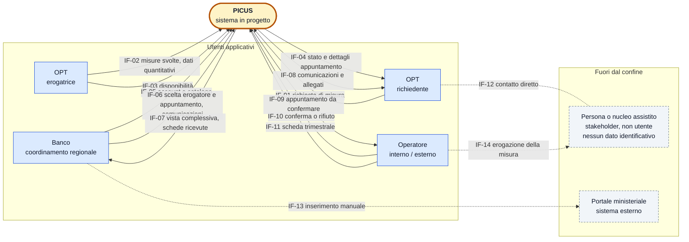

# A2 — Stakeholder e contesto (attività S1-01)

Questa pagina contiene il **materiale per scrivere da zero il capitolo A2** del documento «Documentazione SAD 2026» (Word del gruppo *Pinguini alla Fragola*) e per chiudere l'issue **S1-01**. La struttura segue l'issue: obiettivo → fonti → attività → output → criteri di completamento.

Sigle delle fonti, le stesse del Word (D2 «Fonti e riferimenti»):
- **F01** = [[00-Presentazione Progetto Picus.pdf]] (presentazione della docente)
- **F02** = [[01-PICUS_richieste_informali_del_committente (1).pdf]] (desiderata del committente)
- **F03** = [[AGENTS]] (scelte del team)

| Marcatore | Significato |
|---|---|
| 📄 | contenuto presente nelle fonti, con riferimento |
| 🧩 | elaborazione mia: da discutere nel team, **non** è un requisito né una conferma del committente |

> 🧩 **Come usarla.** La parte 1 spiega cosa chiede l'issue. Le parti 2–7 sono il contenuto di A2: tabelle, diagramma, ipotesi e domande da riscrivere con le vostre parole nel Word. La parte 8 verifica i criteri di completamento. Lo stato di revisione («revisionato da un altro membro») si può registrare solo quando succede davvero: nella parte 8 quel criterio resta **da fare**.

---

## 1. Cosa chiede l'issue S1-01

> 📄 F01: [[00-Presentazione Progetto Picus.pdf#page=18]] (attività 1) · 📄 F02 §2–3

| Voce dell'issue | Contenuto | Dove lo trovi qui |
|---|---|---|
| **Obiettivo** | comprendere il contesto operativo di PICUS, identificare gli stakeholder e rappresentare i confini del sistema | parti 2–5 |
| **Fonti** | presentazione PICUS, attività 1 (slide 18); desiderata, sezioni 2 e 3 | parte 2 |
| **Attività** | identificare Banco, OPT, operatori e persone assistite | parte 3 |
| | descrivere obiettivi, responsabilità e informazioni utilizzate | parte 3 |
| | distinguere gli stakeholder dagli utenti dell'applicazione | parte 4 |
| | individuare gli eventuali sistemi esterni e le interazioni previste | parti 5–6 |
| | realizzare il Context Diagram | parte 7 |
| | registrare ipotesi e domande ancora aperte | parte 8 |
| **Output** | analisi degli stakeholder · Context Diagram · riferimenti alle fonti e alle domande aperte | parti 3–8 |
| **Criteri di completamento** | sette caselle | parte 9 |

🧩 Cosa significano i termini:
- **Stakeholder**: chiunque abbia un interesse nel sistema o ne subisca gli effetti, anche senza usarlo. Le persone assistite sono stakeholder.
- **Utente applicativo**: chi **usa** l'applicazione, con un account e permessi propri.
- **Sistema esterno**: un altro sistema con cui PICUS scambia informazioni, fuori dal suo confine.
- **Context Diagram**: il sistema disegnato come una **scatola unica**, senza struttura interna, circondata da attori e sistemi esterni. Le frecce sono i **flussi di informazione** tra scatola e ambiente. Serve a fissare il **confine** tra ciò che si costruisce e ciò che resta fuori.

---

## 2. Il contesto in sintesi

> 📄 F02 §2: [[01-PICUS_richieste_informali_del_committente (1).pdf#page=1]] · F01: [[00-Presentazione Progetto Picus.pdf#page=15]]

- PICUS è un programma di aiuti che, oltre alla **distribuzione di beni**, offre **misure di accompagnamento**.
- Il **Banco** gestisce il centro operativo regionale e coordina **circa 200 OPT** in **circa 200 comuni**.
- Le misure sono erogate da **operatori interni al Centro PICUS**, da **professionisti esterni** sul territorio o da **OPT** con propri operatori o volontari.
- Il Banco riceve le richieste delle OPT, **individua un erogatore, ne verifica la disponibilità e coordina l'appuntamento**.
- **I contatti con la persona o il nucleo assistito restano all'OPT richiedente.**
- Oggi tutto passa da telefono, messaggi, documenti e schede separate: nessuno strumento integrato (F02 §4).

📄 Vincoli da preservare (F02 §1, [[01-PICUS_richieste_informali_del_committente (1).pdf#page=1]]): **tutela dei dati**, **separazione dei ruoli**, **assenza di dati identificativi delle persone assistite**, **ruolo di coordinamento del Banco**.

---

## 3. Analisi degli stakeholder

> 📄 F02 §3 ([[01-PICUS_richieste_informali_del_committente (1).pdf#page=1]], [[01-PICUS_richieste_informali_del_committente (1).pdf#page=2]]), §5, §6, §7 · F01 [[00-Presentazione Progetto Picus.pdf#page=18]]

### 3.1 Stakeholder principali

| ID | Stakeholder | Obiettivi | Responsabilità | Informazioni che usa o produce | Fonte |
|---|---|---|---|---|---|
| **SH-01** | **Banco** | coordinare in modo ordinato richieste, erogatori e appuntamenti; avere una visione aggiornata; rendicontare | riceve le richieste; individua e contatta gli erogatori; verifica la disponibilità; organizza gli appuntamenti; **crea e revoca gli account delle OPT**; gestisce **account e cataloghi**; invia **comunicazioni**; inserisce i dati nel portale ministeriale | **usa**: richieste, anagrafica OPT, catalogo, misure svolte dalle OPT, disponibilità, appuntamenti, schede trimestrali. **produce**: assegnazioni, appuntamenti, comunicazioni | F02 §2, §3, §5.1–5.5 |
| **SH-02** | **OPT richiedente** | ottenere una misura di accompagnamento per una persona o un nucleo | invia la richiesta; **mantiene i contatti con l'assistito** e gli comunica le informazioni ricevute dal Banco | **produce**: richieste (misura, persona o nucleo, **senza dati identificativi**). **usa**: stato e dettagli dell'appuntamento, comunicazioni del Banco. Vede **solo le proprie** informazioni e richieste; accede soprattutto da **smartphone** | F02 §2, §3, §5.3, §7 |
| **SH-03** | **OPT erogatrice** | rendersi disponibile a erogare misure che svolge davvero | dichiara le misure effettivamente svolte; verifica e comunica la propria disponibilità; se scelta, eroga con i propri operatori o volontari; registra **dati quantitativi** senza dati personali | **produce**: misure svolte, disponibilità, dati quantitativi. **usa**: richieste di altre OPT inoltrate dal Banco | F02 §3, §5.2, §5.3 |
| **SH-04** | **Operatore** | erogare le misure e adempiere agli obblighi di monitoraggio | eroga le attività (anche **più misure**); **conferma gli appuntamenti**; **compila e invia al Banco una scheda trimestrale** | **produce**: conferma o rifiuto dell'appuntamento; scheda trimestrale (**dati personali e amministrativi propri** + conteggi aggregati). **usa**: appuntamenti assegnati. Accesso personale **ipotizzato dalla fonte**, limitato alla propria scheda e alle informazioni necessarie | F02 §3, §5.3, §5.5, §6, app. B |
| **SH-05** | **Persona o nucleo assistito** | ricevere la misura di cui ha bisogno | nessuna verso il sistema; è il destinatario finale. Il contatto passa sempre dall'OPT | **non produce né usa** informazioni in PICUS. Dei destinatari esistono **solo conteggi aggregati** | F02 §1, §3, §5.2, §6 |

### 3.2 Altri stakeholder e interlocutori dell'analisi

| ID | Stakeholder | Perché conta | Fonte |
|---|---|---|---|
| **SH-06** | **Committente** | origine dei desiderata. Ogni requisito nuovo o riformulato va **discusso con lui prima di entrare nella baseline** | F02 §1, §9 |
| **SH-07** | **Responsabile privacy** | con lui vanno definiti **tempi e regole di conservazione** dei dati. È un interlocutore dell'analisi, non un ruolo applicativo già definito | F02 §7, §5.1 |
| **SH-08** | **Ente destinatario della rendicontazione** (titolare del portale ministeriale) | riceve i dati trimestrali che il Banco inserisce nel portale. Ha interesse alla **coerenza e completezza** della scheda | F02 §5.5 |

> 🧩 Dove mi allontano dalla bozza del Word. La bozza elenca «Responsabili privacy **e rendicontazione**» come interlocutori. F02 nomina esplicitamente solo il **responsabile privacy** (§7). Obblighi di rendicontazione compaiono in §5.1 e §5.5, ma **nessun referente è indicato**. Qui lo tratto quindi come domanda aperta (Q-11, parte 8) e non come stakeholder certo. SH-08 è una mia deduzione dalla presenza del portale ministeriale: ha un proprietario, ma F02 non lo dice.

### 3.3 Ruoli diversi, stesso soggetto

> 🧩 **OPT richiedente** e **OPT erogatrice** sono **due capacità della stessa organizzazione**, non due organizzazioni: F02 §3 dice che l'OPT può «inviare richieste o rendersi disponibile come erogatrice». Le ho tenute su righe separate perché hanno obiettivi, informazioni e rischi diversi (una richiede, l'altra eroga). Se il modello degli account darà **un solo account per OPT** (ipotesi di F02 §5.1), le due righe corrisponderanno a **funzioni** di quell'account.

Chi può essere **erogatore** (📄 F02 §2, §3, §6):

| Tipo di erogatore | Chi è | Interagisce con PICUS? | Domanda aperta |
|---|---|---|---|
| Operatore interno al Centro PICUS | dipendente del Banco | sì, come SH-04 | — |
| Professionista esterno | psicologo, avvocato, medico, ecc. sul territorio | probabilmente come SH-04 | quale accesso ha? (Q-09) |
| OPT erogatrice | l'organizzazione, con propri operatori o volontari | come SH-03; e i suoi operatori? | operatori e volontari dell'OPT hanno account personale? (Q-09) |

---

## 4. Stakeholder, utenti applicativi e sistemi esterni

> 📄 F02 §3 e §5; F03 §9 «distinguere stakeholder reali da utenti dell'applicazione»

| Soggetto | Stakeholder? | Utente applicativo? | Sistema esterno? | Motivo |
|---|---|---|---|---|
| Banco | sì | **sì** (visibilità complessiva) | no | usa PICUS per coordinare (F02 §3) |
| OPT (richiedente / erogatrice) | sì | **sì**, solo i propri dati | no | accede da smartphone, invia richieste (F02 §3) |
| Operatore | sì | **sì (ipotesi della fonte)**, accesso personale limitato | no | conferma appuntamenti, compila la scheda (F02 §3) |
| Persona o nucleo assistito | **sì** | **no** | no | «non sono utenti»; nessun dato identificativo (F02 §3) |
| Committente | sì | no | no | interlocutore dell'analisi (F02 §1, §9) |
| Responsabile privacy | sì | no | no | interlocutore (F02 §7) |
| Ente destinatario della rendicontazione | sì | no | no | riceve i dati dal portale |
| **Portale ministeriale** | — | no | **sì** | destinazione della rendicontazione; inserimento **manuale** del Banco, integrazione diretta **non richiesta** (F02 §5.5) |

🧩 Regola pratica: ogni **utente** è uno stakeholder, ma **non vale il contrario**. Il confine del sistema si traccia sugli utenti e sui sistemi esterni. Gli stakeholder non utenti influenzano i requisiti senza apparire come attori che premono pulsanti.

---

## 5. Confini del sistema

| **Dentro PICUS** (si progetta e si costruisce) | **Fuori da PICUS** (influenza, ma non si costruisce) |
|---|---|
| gestione di account, ruoli e autorizzazioni | contatto tra OPT e persona assistita (telefono, di persona) |
| catalogo delle misure, configurabile dal Banco | **portale ministeriale** e inserimento manuale del Banco |
| dichiarazione delle misure svolte e dati quantitativi aggregati | anagrafica ufficiale e dati identificativi degli assistiti (**non entrano mai**) |
| richieste, ricerca dell'erogatore, appuntamenti e loro stati | erogazione concreta della misura (colloquio, visita, lezione) |
| comunicazioni dal Banco alle OPT, con allegati | eventuali piattaforme di videochiamata terze (🧩 ipotesi IP-03) |
| scheda trimestrale dell'operatore | processo di conservazione dei dati definito dal responsabile privacy |

> 📄 Vincoli espliciti di F02 che fissano il confine: assistiti senza account né dati identificativi (§1, §3); scheda trimestrale **distinta** dal flusso delle richieste (§5.5); integrazione ministeriale **non richiesta** (§5.5); audit completo e biometria **non richiesti** (§5.1, §7; F03 §8).

---

## 6. Interazioni previste

Ogni riga è un **flusso di informazione** tra un attore e PICUS (o tra attori, fuori da PICUS). Gli ID `IF-xx` sono quelli del diagramma.

### 6.1 Flussi applicativi (attraversano il confine)

| ID | Da → A | Informazione | Fonte |
|---|---|---|---|
| IF-01 | OPT richiedente → PICUS | **richiesta** di una misura del catalogo, per persona o nucleo, **senza dati identificativi** | F02 §5.3 |
| IF-02 | OPT erogatrice → PICUS | **misure effettivamente svolte** e **dati quantitativi** (senza dati personali) | F02 §5.2 |
| IF-03 | OPT erogatrice → PICUS | **disponibilità** a erogare, in risposta alla verifica del Banco | F02 §5.3 |
| IF-04 | PICUS → OPT richiedente | **stato della richiesta** e **dettagli dell'appuntamento**: in presenza data, luogo, orario e referente; a distanza data, orario e collegamento alla videochiamata | F02 §5.3 |
| IF-05 | Banco → PICUS | **gestione di account** (creazione e revoca per le OPT, accessi degli operatori) e **catalogo** | F02 §5.1, §5.2 |
| IF-06 | Banco → PICUS | **individuazione e contatto degli erogatori**, verifica di disponibilità, **organizzazione dell'appuntamento**; emissione di comunicazioni | F02 §3, §5.3, §5.4 |
| IF-07 | PICUS → Banco | **vista complessiva** di richieste, disponibilità, stato degli appuntamenti, schede trimestrali ricevute, dati di monitoraggio per la rendicontazione | F02 §3, §4, §5.5 |
| IF-08 | PICUS → OPT | **comunicazioni** del Banco (convocazioni, avvisi, promemoria di scadenza), anche con **allegati** | F02 §5.4 |
| IF-09 | PICUS → Operatore | **appuntamento da confermare** assegnato dal Banco (🧩 implicito: F02 dice solo che l'operatore «dovrebbe poter confermare») | F02 §5.3 |
| IF-10 | Operatore → PICUS | **conferma** (o **rifiuto**) dell'appuntamento | F02 §5.3 |
| IF-11 | Operatore → PICUS | **scheda trimestrale**: dati personali e amministrativi dell'operatore + conteggi aggregati (App. B) | F02 §5.5, app. B |

### 6.2 Flussi fuori dal sistema (non applicativi)

| ID | Da → A | Informazione | Perché è fuori | Fonte |
|---|---|---|---|---|
| IF-12 | OPT ↔ persona o nucleo assistito | informazioni sull'appuntamento, contatto, bisogno | il contatto con l'assistito **resta all'OPT**; PICUS non registra dati identificativi | F02 §2, §5.3 |
| IF-13 | Banco → Portale ministeriale | dati di rendicontazione (da schede trimestrali) | inserimento **manuale**; nessuna integrazione diretta richiesta | F02 §5.5 |
| IF-14 | Operatore (esecutore) → persona assistita | erogazione della misura, in presenza o a distanza | l'erogazione è il fine del processo, non una funzione di PICUS | F02 §2, §5.3 |

> 🧩 IF-12 e IF-14 vanno disegnati tratteggiati nel Context Diagram: servono a mostrare che l'assistito è **vicino** al sistema (le informazioni sul suo appuntamento passano da PICUS all'OPT) ma resta **fuori** dal confine. IF-13 va tratteggiato per distinguere il **passaggio manuale** dalle interazioni applicative (richiesto dal Word: «Separare il passaggio manuale al portale ministeriale dalle interazioni applicative»).

---

## 7. Context Diagram CTX-01

> 🧩 Elaborazione mia, da ridisegnare in Visual Paradigm (il Word chiede sorgente VP e un'esportazione leggibile). Linee **continue** = interazioni applicative; **tratteggiate** = contatti o passaggi **fuori dal sistema**.

*🧩 Context Diagram CTX-01. Al centro PICUS, scatola unica. A sinistra i quattro utenti applicativi: **Banco**, **OPT** (nelle due funzioni di richiedente ed erogatrice, che è la stessa organizzazione) e **Operatore**. A destra, fuori dal confine, la **persona assistita** (stakeholder senza accesso) e il **portale ministeriale** (sistema esterno). Le frecce continue sono flussi applicativi IF-01…IF-11 ([[01-PICUS_richieste_informali_del_committente (1).pdf#page=2]]); le tratteggiate sono IF-12, IF-13 e IF-14, che non attraversano PICUS.*

![[ctx-01-context-diagram.png]]
*🧩 Versione grafica usata nel file Word (sorgente [[ctx-01-context-diagram.svg]]): stesso contenuto del diagramma Mermaid sopra, con i flussi IF-12…IF-14 disegnati in corridoi esterni tratteggiati.*

**Come leggerlo:**
1. **IF-01 → IF-04**: l'OPT richiedente invia la richiesta e riceve in cambio stato e dettagli dell'appuntamento. Non c'è nessuna freccia tra PICUS e l'assistito: l'OPT inoltra le informazioni con **IF-12**, fuori dal sistema.
2. **IF-05, IF-06, IF-07**: il Banco è l'unico attore con **vista complessiva**; amministra e coordina.
3. **IF-09, IF-10, IF-11**: l'operatore ha un'interazione **distinta** con PICUS (conferma e scheda), e la scheda trimestrale non è legata a una richiesta.
4. **IF-13**: l'unico collegamento verso un sistema esterno è **manuale**, quindi tratteggiato.

**Checklist per Visual Paradigm** (dal Word: «Metadati di ogni diagramma»):
- [ ] nome `CTX-01`, **versione**, **data**, autore del contributo e **revisore effettivo**;
- [ ] salvare la **sorgente VP** e un'**esportazione leggibile** (PNG o PDF), con il percorso nel capitolo A2;
- [ ] stesso nome e stessa definizione di ogni attore nel **glossario A1**;
- [ ] ogni freccia con l'ID `IF-xx` della tabella 6.

---

## 8. Ipotesi e domande aperte

Le ipotesi seguono il formato del registro IP del Word (assunzione, stato, riesame). **Non** sono fatti delle fonti.

### 8.1 Ipotesi

| ID | Assunzione | Base nella fonte | Riesame | Impatto se errata |
|---|---|---|---|---|
| **IP-01** | Il **Banco** è un unico ruolo applicativo con visione complessiva. | F02 §3 non distingue sotto-ruoli | quando si definiscono le user story di amministrazione | servono ruoli distinti (es. chi amministra il catalogo vs chi coordina): cambiano account e autorizzazioni |
| **IP-02** | **OPT richiedente** e **OPT erogatrice** sono funzioni della **stessa organizzazione**, con lo stesso account. | F02 §3; F02 §5.1 «prima ipotesi: un account per OPT» | alla risposta di **Q-01** | account separati o più utenti per OPT: cambia il modello di sicurezza |
| **IP-03** | La **videochiamata** si fa su una piattaforma **esterna**; PICUS memorizza e comunica solo il **collegamento**. | F02 §5.3: per le prestazioni a distanza servono «data, orario e link» | alla risposta di **Q-10** | se PICUS dovesse generare il collegamento, nasce un sistema esterno nel CTX e un'integrazione |
| **IP-04** | **Notifiche** (email, push) non sono nel baseline del CTX-01: restano proposte da valutare. | F02 §5.4, §8: «si possono proporre» | quando si valuta la proposta di notifiche (Q-08) | compare un sistema esterno di notifica |
| **IP-05** | L'**operatore** ha un accesso **personale**, limitato alla propria scheda e agli appuntamenti assegnati. | F02 §3: «il committente immagina» | alla risposta di **Q-01** e **Q-09** | un operatore di OPT potrebbe agire tramite l'account OPT |

### 8.2 Domande aperte

> Q-01, Q-05 e Q-08 sono nell'elenco candidato del Word (A6). Q-09…Q-11 sono **nuove**, nate dall'analisi degli stakeholder: da aggiungere ad A6.

| ID | Domanda | Perché serve e fonte | Storie coinvolte | Ipotesi provvisoria |
|---|---|---|---|---|
| **Q-01** | Per una OPT basta un **account condiviso** o servono **utenti nominativi**? | responsabilità, continuità quando cambia il referente; F02 §5.1, §8 | account e ruoli | IP-02 |
| **Q-05** | Quali regole per **credenziali, revoca e dati** dopo la cessazione di una OPT? | accessi e conservazione, con il responsabile privacy (SH-07); F02 §5.1, §7 | account, privacy | nessuna policy inventata |
| **Q-08** | Quali **notifiche o riepiloghi** riducono davvero i solleciti? | non ampliare il perimetro per implicito; F02 §5.4, §8 | comunicazioni | IP-04 |
| **Q-09** | **Professionisti esterni** e **operatori o volontari delle OPT** hanno un account personale, o agiscono tramite altri? | definisce gli utenti reali e la tabella di §3.3; F02 §3, §5.1 | account, appuntamenti | IP-05 |
| **Q-10** | Per le prestazioni a distanza, chi **fornisce il collegamento** alla videochiamata? | decide se esiste un sistema esterno aggiuntivo; F02 §5.3 | appuntamenti | IP-03 |
| **Q-11** | Chi è il **referente di rendicontazione** da coinvolgere per validare la scheda trimestrale e gli esiti verso il portale? E chi è il **«referente»** di un incontro in presenza? | F02 nomina un «referente» (§5.3) e obblighi di rendicontazione (§5.1, §5.5) senza dire chi sono | monitoraggio, appuntamenti | nessuna |

> Non riaprire come dubbi i vincoli espliciti (come richiede il Word in A6): **assistiti senza account né identificativi**, **scheda trimestrale distinta dalle richieste**, **integrazione ministeriale non richiesta** (F02 §1, §3, §5.5).

---

## 9. Verifica dei criteri di completamento dell'issue

| # | Criterio dell'issue | Esito | Dove |
|---|---|---|---|
| 1 | Gli stakeholder principali sono descritti con **obiettivi e responsabilità** | ✅ soddisfatto nel testo: SH-01…SH-05 con obiettivi, responsabilità e informazioni | § 3.1 |
| 2 | Il diagramma **distingue chiaramente sistema e soggetti esterni** | ✅ nel testo: PICUS è una scatola unica, utenti applicativi a sinistra, soggetti fuori dal confine tratteggiati | § 5, § 7 |
| 3 | Le persone assistite sono **stakeholder**, senza prevedere un **loro accesso** | ✅ SH-05: stakeholder, non utente, nessun flusso applicativo | § 3.1, § 4 |
| 4 | Sono preservati il **coordinamento del Banco** e il **ruolo dell'OPT** nei contatti con gli assistiti | ✅ SH-01 coordina; IF-12 contatto OPT↔assistito fuori sistema | § 3.1, § 6.2, § 7 |
| 5 | Sono **esplicitati i vincoli sui dati identificativi** degli assistiti | ✅ nei flussi IF-01 e IF-12, nel confine e nel vincolo di § 2 | § 2, § 5, § 6 |
| 6 | **Ipotesi e dubbi** sono distinti dalle informazioni presenti nelle fonti | ✅ marcatori 📄/🧩; ipotesi in IP-01…05, domande in Q-01…11 | § 8 |
| 7 | **Analisi e diagramma sono stati revisionati da un altro membro** | ⬜ **da fare**: non si può attestare finché non avviene. Registrare nel Word revisore, data e punti verificati | § 7 (checklist) |

> ⚠️ I segni ✅ valgono per **come è scritto il testo di questa pagina**. Prima di spuntare le caselle nell'issue, riportate il contenuto nel Word, ridisegnate CTX-01 in Visual Paradigm e fate la revisione di un altro membro.

---

## 10. Cosa cambia rispetto alla bozza del Word

| Punto | Bozza (v0.2) | Questa versione |
|---|---|---|
| Informazioni usate | assenti | colonna dedicata per ogni stakeholder (§ 3.1) |
| Stakeholder vs utenti | un'unica colonna «Interazione o confine» | tabella separata con tre colonne: stakeholder, utente, sistema esterno (§ 4) |
| Confini | accennati | tabella dentro/fuori (§ 5) |
| Interazioni | assenti | 14 flussi con ID e fonte (§ 6) |
| Context Diagram | solo descrizione («da produrre») | diagramma completo CTX-01 con IF-xx (§ 7) |
| Rendicontazione | «responsabili privacy e rendicontazione» | solo il responsabile privacy è nella fonte; il referente di rendicontazione è Q-11 |
| Ipotesi e domande | non collegate ad A2 | IP-01…05 e Q-09…Q-11, collegati ai flussi |

---

## Fonti e collegamenti

- 📄 [[00-Presentazione Progetto Picus.pdf#page=18]] — attività 1 «Analizzare contesto e stakeholder»; [[00-Presentazione Progetto Picus.pdf#page=27]] — deliverable (Context Diagram).
- 📄 [[01-PICUS_richieste_informali_del_committente (1).pdf#page=1]]–[[01-PICUS_richieste_informali_del_committente (1).pdf#page=3]] — §1–§5; [[01-PICUS_richieste_informali_del_committente (1).pdf#page=4]] — §6–§7; [[01-PICUS_richieste_informali_del_committente (1).pdf#page=5]] — §8–§9.
- 📘 [[AGENTS]] §8–§9 — regole di dominio e distinzione stakeholder/utenti.
- **File Word scaricabile e modificabile:** [[A2-stakeholder-e-contesto.docx]] (stesso contenuto, in formato adatto al documento del gruppo; generato da [[genera_docx_a2.py]]; il diagramma da [[genera_context_diagram_a2.py]]).
- Guida generale al progetto: [[guida-progetto-picus]] (attività 1 in § 5.2).

_Aggiornato: 2026-10-18 — prima stesura di A2 per l'issue S1-01_
