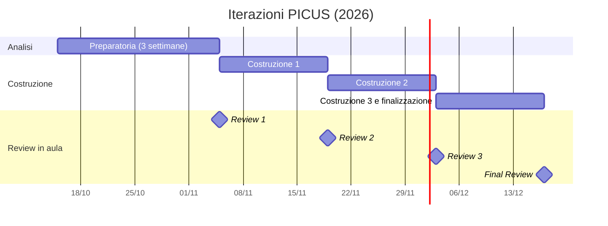
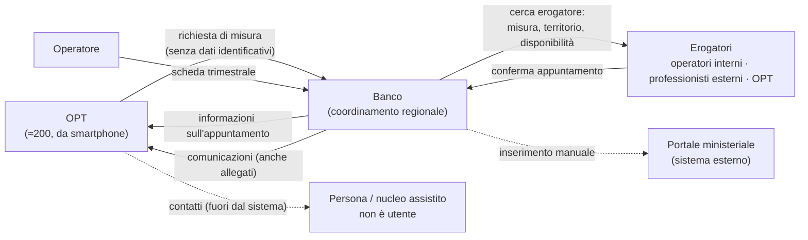
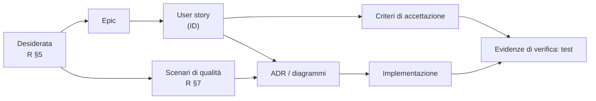

# Guida al progetto d'esame PICUS

Questa pagina riorganizza **tutto** il contenuto dei tre documenti del progetto, per studiarlo e orientarsi negli avanzamenti. Qui non si implementa nulla: il codice vive nel repository del team.

| Simbolo | Da dove viene |
|---|---|
| 📄 **P** | [[00-Presentazione Progetto Picus.pdf]] — presentazione della docente (piano, attività, deliverable) |
| 📄 **R** | [[01-PICUS_richieste_informali_del_committente (1).pdf]] — desiderata del committente |
| 📘 **A** | [[AGENTS]] — istruzioni scritte dal team (decisioni tecniche, regole di lavoro, anche per gli assistenti AI) |
| 🧩 | spiegazione o proposta mia, per aiutare lo studio: **non** è un requisito né una decisione del team |

In fondo alla pagina c'è la **tabella di copertura**: ogni pagina e ogni sezione dei tre documenti con il punto della guida in cui è riportata.

---

## 1. In una frase: cosa dobbiamo fare

> 📄 P: [[00-Presentazione Progetto Picus.pdf#page=1]], [[00-Presentazione Progetto Picus.pdf#page=3]]

Il progetto d'esame è l'**analisi, la progettazione e la realizzazione incrementale** del sistema **PICUS — Programma Integrativo Contro Urgenze Sociali**, partendo dai **desiderata informali** del committente.

- Il lavoro segue il **framework Scrum**, in **iterazioni di due settimane**.
- **Ogni gruppo lavora come un team Scrum**: gestisce le attività con un **Product Backlog** e, **all'inizio di ogni iterazione**, sceglie gli elementi da sviluppare.

🧩 In parole semplici: dovete capire un processo oggi gestito a telefonate e schede, trasformarlo in requisiti verificabili (user story, criteri di accettazione, scenari di qualità), progettare un'architettura e costruire il sistema un pezzo alla volta, mostrando a ogni review cosa funziona.

Outline della presentazione ([[00-Presentazione Progetto Picus.pdf#page=2]]): modalità di sviluppo, piano delle iterazioni, presentazione del problema, prima iterazione, attività della prima iterazione, deliverable, review dell'iterazione.

---

## 2. Calendario e iterazioni

> 📄 P: [[00-Presentazione Progetto Picus.pdf#page=11]], [[00-Presentazione Progetto Picus.pdf#page=12]] · 📘 A §10

| Periodo | Iterazione | Obiettivi principali | Review e conclusione |
|---|---|---|---|
| **15/10/2026 – 05/11/2026** | **Preparatoria** (durata eccezionale: **3 settimane**) | analisi del dominio, requisiti, scenari di qualità, Product Backlog e proposta di MVP | **05/11/2026** — review dell'iterazione preparatoria e avvio della prima iterazione di costruzione |
| **05/11/2026 – 19/11/2026** | **Costruzione 1** (2 settimane) | baseline architetturale, decisioni architetturali iniziali e walking skeleton | **19/11/2026** — review della Costruzione 1 e avvio della seconda |
| **19/11/2026 – 03/12/2026** | **Costruzione 2** (2 settimane) | realizzazione del primo flusso funzionale significativo | **03/12/2026** — review della Costruzione 2 e avvio della terza |
| **03/12/2026 – 17/12/2026** | **Costruzione 3 e finalizzazione** (2 settimane) | nuovi incrementi, verifica dell'architettura, consolidamento e preparazione dell'esame | **17/12/2026** — review della terza iterazione (**Final Review**) e conclusione del progetto |

![[prog-picus-p12-piano-iterazioni.png]]
*Figura di [[00-Presentazione Progetto Picus.pdf#page=12]], «Piano delle iterazioni del progetto PICUS — sviluppo incrementale secondo Scrum, con Review in aula al termine di ogni iterazione». Linea del tempo: Start (avvio progetto 15/10/2026) → Review 1 (05/11) → Review 2 (19/11) → Review 3 (03/12) → Final Review (17/12). Sotto, quattro riquadri: **Iterazione preparatoria** (15 ottobre – 5 novembre, durata eccezionale 3 settimane: analisi del dominio e stakeholder; processo as-is e proposta to-be; epic, user story e criteri di accettazione; scenari di qualità e domande aperte; Product Backlog e proposta di MVP); **Costruzione 1** (5–19 novembre: driver architetturali; baseline architetturale; decisioni architetturali iniziali; walking skeleton end-to-end; primo incremento dimostrabile); **Costruzione 2** (19 novembre – 3 dicembre: primo flusso funzionale significativo; implementazione delle user story; verifica dei criteri di accettazione; test e aggiornamento del backlog; evoluzione dell'architettura); **Costruzione 3** (3–17 dicembre: nuovi incrementi funzionali; verifica degli scenari di qualità; consolidamento dell'architettura; completamento e documentazione; preparazione della prova d'esame). Nota in basso: **ogni review in aula** = presentazione del lavoro svolto, dimostrazione dell'incremento e raccolta del feedback; **il Product Backlog viene aggiornato prima dell'avvio dell'iterazione successiva**.*

*🧩 Ricostruzione Mermaid del piano di [[00-Presentazione Progetto Picus.pdf#page=11]].*

> 🧩 **Dove siamo oggi (18/10/2026):** nella **prima settimana dell'iterazione preparatoria**. Prossima scadenza: **review del 5 novembre** (10 minuti di presentazione, § 5.4). AGENTS.md (§10) chiede di ricavare l'iterazione attiva dalla data corrente e dall'ultimo piano concordato, perché la docente potrebbe aggiornarlo.

---

## 3. Cosa si consegna alla fine e come si viene valutati

> 📄 P: [[00-Presentazione Progetto Picus.pdf#page=9]], [[00-Presentazione Progetto Picus.pdf#page=10]]

**Risultato finale del progetto** (le iterazioni di costruzione proseguono fino al completamento):
- un'**applicazione funzionante**;
- un **Product Backlog aggiornato**;
- la **documentazione dei requisiti**;
- i **criteri di accettazione** e le **evidenze delle verifiche**;
- la **documentazione architetturale**;
- gli **scenari di qualità** considerati;
- le **principali decisioni progettuali**;
- il **codice sorgente** e le **istruzioni per l'esecuzione**;
- una **dimostrazione finale** del sistema.

**Cosa ci si aspetta a conclusione:**
- dimostrazione di **adeguata qualità del prodotto** finale;
- valutazione della **demo finale**;
- valutazione delle **scelte architetturali**;
- valutazione della **documentazione** prodotta;
- dimostrazione di aver applicato le **pratiche Agili** durante il percorso (**processo**): capacità di lavorare **per incrementi**; **partecipazione e qualità delle review**; **gestione del backlog**; **coerenza delle decisioni architetturali** col prodotto; **uso del feedback** ricevuto durante le iterazioni.

> 💡 Collegamento con la presentazione del corso ([[progetto-di-corso]]): il progetto vale **50 % del voto** (max 15 punti) e si consegna su GitHub con una pull request una settimana prima dell'esame; l'**orale** (l'altro 50 %) chiede di spiegare l'architettura complessiva e **giustificare le scelte di progetto**, oltre al proprio contributo individuale ([[00_IntroduzioneAlCorso_SAD.pdf#page=28]], [[00_IntroduzioneAlCorso_SAD.pdf#page=29]]).

---

## 4. Il problema: il dominio PICUS

### 4.1 Natura del documento del committente

> 📄 R §1: [[01-PICUS_richieste_informali_del_committente (1).pdf#page=1]]

- Il documento raccoglie, **in forma intenzionalmente informale**, bisogni e aspettative verso PICUS. **Non** è una specifica completa, definitiva o contrattualmente vincolante.
- Descrive il punto di vista iniziale del committente su un processo oggi svolto soprattutto con **contatti telefonici, scambio di messaggi e compilazione di schede**.
- Le indicazioni sono **desiderata da analizzare e precisare**. Si possono proporre requisiti **diversi, aggiuntivi o riformulati** se semplificano il lavoro, riducono errori e passaggi manuali, chiariscono gli stati delle pratiche o migliorano la qualità del servizio. Ogni proposta va **motivata, discussa con il committente e tradotta in criteri verificabili**.
- **Restano da preservare** (salvo chiarimenti successivi): la **tutela dei dati**, la **separazione dei ruoli**, l'**assenza di dati identificativi delle persone assistite** e il **ruolo di coordinamento del Banco**.

📘 A §1: il documento del committente contiene desiderata informali, non una specifica completa: vanno preservati i vincoli espliciti su dominio e privacy, e le **proposte di miglioramento, le ipotesi e le domande aperte vanno registrate separatamente** dai requisiti concordati.

### 4.2 Contesto operativo

> 📄 P: [[00-Presentazione Progetto Picus.pdf#page=15]] · 📄 R §2: [[01-PICUS_richieste_informali_del_committente (1).pdf#page=1]]

- PICUS sostiene un **programma di aiuti** che comprende, oltre alla **distribuzione di beni**, alcune **misure di accompagnamento**.
- Il **Banco** gestisce il **centro operativo regionale** e coordina **circa 200 Organizzazioni Partner Territoriali (OPT)**, distribuite in **circa 200 comuni**. ⚠️ *Aggiornamento del 21/10:* nel confronto con lo stakeholder sono emersi **400–450 OPT** e 230.000 utenti: vedi [[incontro-stakeholder-ba]].
- Le misure possono essere erogate da: **operatori interni al Centro PICUS**; **professionisti esterni** sul territorio; **OPT** che svolgono direttamente certe attività con propri operatori o volontari.
- Il **Banco riceve le richieste delle OPT**, **individua un possibile erogatore**, ne **verifica la disponibilità** e **coordina l'appuntamento**. **I contatti con la persona o il nucleo assistito restano in capo all'OPT richiedente.**

La slide [[00-Presentazione Progetto Picus.pdf#page=16]] rimanda per i desiderata al documento allegato («Desiderata per PICUS»), cioè al documento R.

📘 A §1 riassume il dominio: il sistema aiuta il Banco a coordinare **OPT, misure di accompagnamento, erogatori, richieste di servizio, appuntamenti, comunicazioni e monitoraggio trimestrale degli operatori**. **Le persone assistite non sono utenti dell'applicazione.**

### 4.3 I soggetti coinvolti

> 📄 R §3: [[01-PICUS_richieste_informali_del_committente (1).pdf#page=1]], [[01-PICUS_richieste_informali_del_committente (1).pdf#page=2]]

| Soggetto | Ruolo e aspettative iniziali | Usa l'app? |
|---|---|---|
| **OPT** | accede **principalmente da smartphone**; può **inviare richieste** al Banco oppure **rendersi disponibile come erogatrice** delle misure che dichiara di svolgere; dovrebbe vedere **esclusivamente le proprie informazioni e richieste** | sì |
| **Banco** | **coordina** il processo regionale; ha una **visione complessiva** delle richieste; individua e contatta i possibili erogatori; organizza gli appuntamenti; **gestisce account e cataloghi**; invia **comunicazioni**; usa i **dati di monitoraggio** per la rendicontazione | sì |
| **Operatori** | erogano le misure; operano **internamente o sul territorio**; possono svolgere **più attività**; il committente immagina un **accesso personale** per **confermare gli appuntamenti** e **compilare la scheda trimestrale** | sì |
| **Persone assistite** | **non sono utenti** dell'applicazione; la richiesta può riguardare **una persona o un nucleo familiare**, ma PICUS **non dovrebbe registrare dati personali identificativi**; i dati di monitoraggio sono **aggregati** | **no** |

*🧩 Schema mio dei flussi descritti in R §2–§5 e P p. 15, utile per orientarsi. **Non è il Context Diagram** da consegnare: quello va costruito dal team (attività 1, § 5.2).*

### 4.4 Processo attuale e opportunità di miglioramento

> 📄 R §4: [[01-PICUS_richieste_informali_del_committente (1).pdf#page=2]]

Il processo oggi usa **strumenti e comunicazioni non integrati**: informazioni raccolte **per telefono, messaggi, documenti o schede** inviate separatamente. Questo rende difficile:
- avere una **vista aggiornata delle richieste**;
- conoscere rapidamente le **disponibilità sul territorio**;
- **ricostruire lo stato di un appuntamento**;
- raccogliere **in modo uniforme i dati trimestrali**.

Il committente vorrebbe digitalizzare soprattutto:
1. la **raccolta delle misure effettivamente svolte dalle OPT** e dei relativi dati quantitativi;
2. l'**invio e la gestione delle richieste di servizi**, inclusa l'individuazione dell'erogatore e la definizione dell'appuntamento;
3. l'**invio di comunicazioni dal Banco alle OPT**, anche con documenti allegati;
4. la **compilazione e trasmissione al Banco delle schede trimestrali** da parte degli operatori.

La soluzione **non deve limitarsi a riprodurre meccanicamente i passaggi manuali**: sono incoraggiate proposte che **eliminino duplicazioni**, **rendano esplicite responsabilità e stati**, **riducano la necessità di solleciti** e **facilitino il controllo** del processo.

### 4.5 I desiderata del committente

> 📄 R §5: [[01-PICUS_richieste_informali_del_committente (1).pdf#page=2]], [[01-PICUS_richieste_informali_del_committente (1).pdf#page=3]]

**5.1 Accesso e gestione dei profili**
- Il Banco vorrebbe **creare e revocare gli account delle OPT**. Prima ipotesi: **un unico account per OPT**; si possono proporre alternative se migliorano responsabilità, sicurezza o continuità operativa.
- Gli **operatori** dovrebbero avere un **proprio accesso** per le attività che li riguardano. Creazione e **recupero delle credenziali** sono da progettare.
- L'**accesso con credenziali** è considerato sufficiente; il **riconoscimento biometrico** è un'opzione, **non** una richiesta.
- Ciascun soggetto accede **solo alle informazioni necessarie al proprio ruolo**; il Banco ha invece una **vista complessiva** per il coordinamento.
- La **cessazione di una OPT** comporta la **revoca dell'accesso**; cancellazione o conservazione dei dati vanno chiarite in relazione agli obblighi amministrativi e di rendicontazione.

**5.2 Catalogo e misure svolte dalle OPT**
- Il Banco vuole un **catalogo iniziale delle misure** di accompagnamento (Appendice A, § 4.9).
- Le OPT dovrebbero poter **indicare quali misure svolgono effettivamente**, così il Banco può individuarle come **possibili erogatrici per altre OPT**.
- Il catalogo dev'essere **aggiornabile dal Banco senza intervento di uno sviluppatore**.
- Le OPT registrano i **dati quantitativi** sulle attività svolte, **senza dati personali** delle persone assistite.
- **Non** è richiesto uno **storico completo delle modifiche**; sono ammesse proposte di **tracciabilità leggera** se utili e proporzionate.

**5.3 Richieste di servizi e appuntamenti**
- Una OPT richiede una **misura del catalogo** per **una persona o un nucleo familiare**, **senza dati identificativi** dell'assistito.
- Il Banco individua i possibili erogatori considerando **misura o professionalità richiesta**, **territorio** e **disponibilità**.
- Se il possibile erogatore è una **OPT**, il Banco deve poterne **verificare la disponibilità** ed eventualmente **consultare altre OPT vicine**.
- Se il servizio lo consente e **non c'è un professionista in zona**, il Centro PICUS può valutare una **prestazione a distanza**.
- L'**operatore** dovrebbe poter **confermare l'appuntamento**. L'**OPT richiedente** riceve dal Banco le informazioni necessarie e **le comunica alla persona assistita**.
- Incontri **in presenza**: almeno **data, luogo, orario e referente**. Incontri **a distanza**: **data, orario e collegamento alla videochiamata**.
- Stati inizialmente suggeriti: **In programmazione, Completata, Annullata, Rifiutata**. Si può proporre un ciclo di vita più preciso, purché **comprensibile** e **coerente** con il processo.
- **Non è definito un tempo massimo di risposta** del Banco: si possono proporre priorità, scadenze, promemoria o indicatori di servizio.

**5.4 Comunicazioni**
- Il Banco vorrebbe inviare **comunicazioni alle OPT** (es. **convocazioni, avvisi, promemoria di scadenza**), anche con **documenti allegati**.
- Si possono proporre **notifiche, conferme di lettura, ricerca o organizzazione** delle comunicazioni, purché **senza complessità ingiustificata**.

**5.5 Monitoraggio trimestrale degli operatori**
- Ogni **operatore** compila e invia **direttamente al Banco** una **scheda per ciascun trimestre**.
- La scheda contiene **dati personali e amministrativi dell'operatore** e **dati quantitativi aggregati** sui destinatari: servono **adeguate misure di protezione**.
- La rendicontazione trimestrale è **distinta dal flusso delle richieste**: non deve necessariamente riferirsi a una specifica OPT, misura o prestazione.
- La scheda può comprendere attività rivolte a **persone che accedono direttamente ai servizi** senza passare da una richiesta PICUS.
- Il Banco usa i dati per l'**inserimento manuale nel portale ministeriale**. **Non** è richiesta un'integrazione diretta; si possono proporre **esportazioni o controlli** che riducano il lavoro manuale.

### 4.6 Informazioni e dati disponibili

> 📄 R §6: [[01-PICUS_richieste_informali_del_committente (1).pdf#page=4]]

- **Anagrafica di circa 200 OPT**, con almeno: nome, indirizzo, codice fiscale, città, codice struttura, numero di assistiti, tipo di attività.
- **Catalogo iniziale delle dodici misure** (Appendice A).
- **Profili di operatori** interni ed esterni, con **territorio di riferimento** e possibilità di svolgere **più misure**.
- **Scheda trimestrale** dell'operatore (Appendice B).
- **Dati quantitativi sugli assistiti** trattati **esclusivamente come conteggi aggregati**.

### 4.7 Aspettative di qualità

> 📄 R §7: [[01-PICUS_richieste_informali_del_committente (1).pdf#page=4]]

| Area | Aspettativa iniziale | 🧩 Dove la trasformate in scenario misurabile |
|---|---|---|
| **Sicurezza e isolamento** | ogni OPT vede solo i propri dati e richieste; gli operatori accedono alla propria scheda e alle informazioni strettamente necessarie; il Banco ha le informazioni richieste dal coordinamento | scenario di security (controlli di ruolo **e** di proprietà, § 6.5) |
| **Privacy** | nessun dato identificativo degli assistiti; dati personali e amministrativi degli operatori protetti; tempi e regole di conservazione **da definire con il responsabile privacy** | scenario di privacy + domanda nell'Open Questions Log |
| **Configurabilità** | catalogo delle misure e **altre voci soggette a variazione** gestibili dal Banco come **dati configurabili**, non incorporati rigidamente nel software | scenario di modifiability ([[modifiability]], tattica *defer binding*) |
| **Performance** | **picchi di utilizzo** vicino alle **scadenze trimestrali**; la soluzione deve sostenerli **senza compromettere** la gestione ordinaria delle richieste | scenario di performance |
| **Disponibilità** | un **fermo occasionale di alcune ore** o, eccezionalmente, **di un paio di giorni** non è considerato critico; va **tradotto in uno scenario più preciso** prima della progettazione | scenario di availability ([[availability]]) |
| **Usabilità** | molte OPT usano lo **smartphone** e hanno **diversi livelli di familiarità digitale**: i flussi principali devono essere **semplici e comprensibili** | scenario di usability |
| **Tracciabilità** | **audit completo non richiesto**; si può proporre un **livello minimo di registrazione degli eventi** per chiarire responsabilità e stato delle pratiche | eventuale proposta motivata |

### 4.8 Aspetti aperti e criteri per avanzare una proposta

> 📄 R §8–§9: [[01-PICUS_richieste_informali_del_committente (1).pdf#page=5]]

Il committente si aspetta che l'analisi trasformi i desiderata in **requisiti più chiari e verificabili**; non tutte le scelte del documento vanno replicate letteralmente; si può proporre un'organizzazione diversa del processo o nuove funzionalità **se se ne dimostra l'utilità**. **Da valutare in particolare:**
1. se **un unico account per OPT** sia adeguato o siano preferibili **utenti nominativi** con ruoli e responsabilità;
2. quali **informazioni minime** servono per inviare una richiesta **senza dati personali** degli assistiti;
3. come rappresentare **disponibilità, territorio, competenze e possibili conflitti** nella scelta dell'erogatore;
4. se il **ciclo di vita** delle richieste vada esteso con **stati intermedi o motivazioni**;
5. quali **notifiche, promemoria o escalation** possano ridurre i solleciti manuali;
6. come **prevenire errori e incoerenze** nella compilazione della scheda trimestrale;
7. quali **esportazioni o riepiloghi** facilitino l'inserimento nel portale ministeriale;
8. quali **tempi di conservazione, cancellazione e accesso** siano appropriati per i diversi dati;
9. quali **scenari misurabili** servano per sicurezza, performance, usabilità, modificabilità e disponibilità.

**Ogni requisito nuovo o riformulato** dovrebbe:
- rispondere a un **problema osservabile** del processo attuale;
- identificare gli **stakeholder** interessati e il **beneficio atteso**;
- rispettare i **vincoli di privacy e autorizzazione**;
- esplicitare **ipotesi, dipendenze e possibili effetti collaterali**;
- essere accompagnato da **criteri di accettazione** o da una **misura verificabile**;
- essere **prioritizzato** rispetto agli altri bisogni;
- essere **discusso con il committente** prima di entrare nella **baseline**.

> 🔑 **L'obiettivo non è implementare il maggior numero possibile di funzioni**, ma proporre un **sistema coerente** che renda il processo **più semplice, controllabile e adattabile** rispetto alla gestione manuale attuale (R §9).

### 4.9 Appendice A — Catalogo iniziale delle misure

> 📄 R App. A: [[01-PICUS_richieste_informali_del_committente (1).pdf#page=5]], [[01-PICUS_richieste_informali_del_committente (1).pdf#page=6]]

Catalogo **iniziale**: le voci possono essere precisate e il catalogo **deve poter evolvere** nel tempo.

| N | Misura | Descrizione sintetica |
|---|---|---|
| I | Accoglienza e ascolto | primo contatto, ascolto e valutazione della domanda di aiuto |
| II | Informazione, consulenza e orientamento | orientamento alla rete territoriale dei servizi e informazione sulle procedure |
| III | Accompagnamento ai servizi | sostegno all'accesso ai servizi e lavoro di rete con i soggetti locali |
| IV | Sostegno psicologico | supporto psicologico, **anche a distanza** quando appropriato |
| V | Educativa alimentare | promozione di comportamenti alimentari corretti e consapevoli |
| VI | Gestione del bilancio familiare | consulenza per la pianificazione e la gestione delle spese |
| VII | Sostegno scolastico | supporto a bambini e ragazzi nelle attività di studio |
| VIII | Sostegno educativo agli adulti | attività educative rivolte a persone adulte |
| IX | Orientamento alla ricerca di lavoro | supporto per curriculum, candidature, colloqui e accesso alle opportunità di impiego |
| X | Prima assistenza medica | assistenza medica qualificata, farmaci e servizi ambulatoriali |
| XI | Tutela legale | consulenza per la tutela dei diritti di cittadinanza sociale |
| XII | Altro | ulteriori misure e attività da specificare |

### 4.10 Appendice B — Contenuti iniziali della scheda trimestrale

> 📄 R App. B: [[01-PICUS_richieste_informali_del_committente (1).pdf#page=6]], [[01-PICUS_richieste_informali_del_committente (1).pdf#page=7]]

La scheda è **compilata dal singolo operatore** e **inviata al Banco**. Le categorie sono il contenuto attualmente noto e **vanno validate durante l'analisi**.

| Sezione | Contenuti inizialmente indicati |
|---|---|
| Dati anagrafici | nome, cognome, luogo e data di nascita, codice fiscale |
| Tipologia di operatore | assistente sociale, psicologo, mediatore socio culturale |
| Tipologia contrattuale | dipendente a tempo indeterminato o determinato, full time o part time, Co.Co.Co., prestazione d'opera, prestazione occasionale |
| Area o livello | C3, D1, D2, D3, E1, E2 |
| Impegno e costo | costo orario lordo, ore prestate nel trimestre, trimestre di monitoraggio |
| Destinatari aggregati | numero di nuclei e destinatari finali, con ripartizioni per genere, età e categorie di interesse — **le categorie possono sovrapporsi** |
| Rete dei servizi | numero di nuclei accompagnati ai servizi pubblici e privati; firma dell'operatore |

**Nota sui dati:** i destinatari sono rappresentati **solo con conteggi aggregati**; la scheda contiene invece **dati personali e amministrativi dell'operatore** e va protetta; i dati **non sono necessariamente riferiti** a una specifica OPT, misura o prestazione.

> 🧩 Due trappole già indicate dal team (📘 A §8): poiché le categorie **si sovrappongono**, non si può imporre che i sottogruppi sommino al totale; e il **costo orario** è un importo di denaro, da trattare con `BigDecimal` e non con `double` (📘 A §5).

---

## 5. L'iterazione preparatoria (15/10 – 5/11) — quella in corso

### 5.1 Obiettivi

> 📄 P: [[00-Presentazione Progetto Picus.pdf#page=4]], [[00-Presentazione Progetto Picus.pdf#page=13]], [[00-Presentazione Progetto Picus.pdf#page=14]]

La prima iterazione è **preparatoria**: serve a **capire il problema** e a **definire inizialmente il prodotto**. **Non è richiesta l'implementazione.** Obiettivi:
- **comprendere il dominio PICUS** e **ricostruire il processo** attuale, svolto con strumenti e comunicazioni non integrati;
- **trasformare i desiderata informali** in un primo **Product Backlog ragionato, verificabile e prioritizzato**;
- **proporre una visione iniziale del prodotto digitale**, motivando le modifiche che possono **semplificare il lavoro** e **ridurre errori o passaggi manuali**;
- **preparare le basi** per le iterazioni di progettazione e sviluppo, **senza implementare** ancora il sistema.

I gruppi devono ([[00-Presentazione Progetto Picus.pdf#page=4]]): analizzare **contesto e stakeholder**; rappresentare il **processo attuale e le sue criticità**; proporre un **processo migliorato**; trasformare i desiderata in **Epic e User Story**; definire **criteri di accettazione e scenari di qualità**; individuare gli **aspetti da chiarire**; predisporre e **prioritizzare il Product Backlog**; proporre un possibile **Minimum Viable Product**.

### 5.2 Le nove attività suggerite

> 📄 P: [[00-Presentazione Progetto Picus.pdf#page=17]] («Suggerimenti operativi per la prima iterazione»), pp. 18–26

| # | Attività | Cosa chiede la presentazione | 🧩 Come farla / dove studiarla nel wiki |
|---|---|---|---|
| 1 | **Analizzare contesto e stakeholder** ([[00-Presentazione Progetto Picus.pdf#page=18]]) | individuare gli attori: **Banco, OPT, operatori e persone assistite**; descrivere **obiettivi, responsabilità e informazioni** usate da ciascuno; evidenziare i **confini del sistema** e i soggetti o **sistemi esterni**; produrre un **Context Diagram** coerente con il dominio | partite dalla tabella § 4.3; il sistema è PICUS al centro, gli attori fuori; i sistemi esterni noti sono il **portale ministeriale** e (da capire) email/videochiamata; le persone assistite sono stakeholder ma **non** utenti (📘 A §9). Svolgimento completo dell'attività: [[a2-stakeholder-e-contesto]] |
| 2 | **Rappresentare il processo attuale (as-is)** ([[00-Presentazione Progetto Picus.pdf#page=19]]) | modellare il processo **dalla richiesta di una misura fino all'erogazione e alla rendicontazione**; rappresentare i passaggi di **Banco, OPT e operatori**; evidenziare **passaggi manuali, duplicazioni, attese, solleciti e possibili errori**; indicare dove le informazioni sono **frammentate, incomplete o difficili da aggiornare** | usate R §4 (§ 4.4 qui): telefono, messaggi, schede separate; un diagramma per «corsie» (swimlane: OPT, Banco, erogatore) è il modo più leggibile |
| 3 | **Proporre il processo migliorato (to-be)** ([[00-Presentazione Progetto Picus.pdf#page=20]]) | una prima versione **to-be** supportata dal sistema digitale; mostrare cosa viene **semplificato, automatizzato o reso più controllabile**; rendere espliciti **ruoli, responsabilità e passaggi di stato**; **motivare ogni differenza** rispetto ai desiderata con un **beneficio osservabile** | ogni modifica = problema osservato (as-is) → miglioramento → beneficio → criterio verificabile (R §9, § 4.8) |
| 4 | **Individuare le funzionalità principali** ([[00-Presentazione Progetto Picus.pdf#page=21]]) | raggruppare le capacità in **Epic o aree funzionali coerenti**; considerare **account e ruoli, catalogo delle misure, disponibilità degli erogatori, richieste di servizio**; includere **appuntamenti, comunicazioni, monitoraggio trimestrale, amministrazione e reporting**; **non** assumere che l'organizzazione iniziale sia definitiva | le aree della slide sono già quasi le Epic (vincolo: 5–8 Epic); 📘 A §9: le aree funzionali **non** sono automaticamente i moduli architetturali finali |
| 5 | **Costruire il Product Backlog iniziale** ([[00-Presentazione Progetto Picus.pdf#page=22]]) | user story nel formato «**As a [role], I want [goal], so that [benefit]**»; per ogni storia **titolo, descrizione, stakeholder ed Epic**; **priorità iniziale e criteri di accettazione**; registrare **ipotesi, dubbi e dipendenze** da verificare col committente | [[user-stories]]; 📘 A §9 aggiunge un **identificativo** per ogni storia (tracciabilità) |
| 6 | **Verificare le user story con INVEST** ([[00-Presentazione Progetto Picus.pdf#page=23]]) | valutare ogni storia rispetto a **Independent, Negotiable, Valuable, Estimable, Small, Testable**; **dividere** le storie troppo ampie per un'iterazione; segnalare come **«da approfondire»** quelle senza informazioni sufficienti; usare la verifica per **migliorare il backlog**, non come checklist formale | [[valutare-user-stories-invest]] (checklist e scomposizione di epic) |
| 7 | **Definire gli scenari di qualità** ([[00-Presentazione Progetto Picus.pdf#page=24]]) | scenari per **security, privacy, usability, performance, availability e modifiability**; per ognuno **sorgente, stimolo, ambiente, artefatto, risposta e misura della risposta**; collegare ogni scenario a un'**esigenza concreta** di PICUS; **misure verificabili**, niente «veloce», «sicuro», «facile da usare» | [[scenari-di-qualita]], [[scenari-di-qualita-concreti]]; base: la tabella § 4.7; 📘 A §9: le soglie numeriche proposte sono **ipotesi** finché non validate |
| 8 | **Individuare gli aspetti da chiarire** ([[00-Presentazione Progetto Picus.pdf#page=25]]) | un **Open Questions Log**; per ogni domanda **perché serve la risposta** e **quali storie coinvolge**; l'**ipotesi provvisoria** adottata nel frattempo; distinguere le **vere decisioni aperte** dalle informazioni **già ricavabili** dai desiderata | partite dai 9 punti di R §8 (§ 4.8) e dalle decisioni aperte di 📘 A §8 (§ 6.6). Elenco già ordinato per priorità: [[domande-al-committente]] |
| 9 | **Definire una proposta di MVP** ([[00-Presentazione Progetto Picus.pdf#page=26]]) | un **insieme minimo e coerente** di user story che realizzi un **flusso utile end-to-end**; indicare il **valore** per gli stakeholder e le **ipotesi** che l'incremento permette di **validare**; **escludere** ciò che non è indispensabile alla prima dimostrazione; **motivare** la scelta rispetto a **priorità, rischi e dipendenze** | 🧩 l'MVP è il ponte verso il **walking skeleton** della Costruzione 1 (§ 7.1) |

### 5.3 Deliverable e vincoli quantitativi

> 📄 P: [[00-Presentazione Progetto Picus.pdf#page=27]], [[00-Presentazione Progetto Picus.pdf#page=28]] · 📘 A §10

**Ogni artefatto deve essere coerente con gli altri e tracciabile rispetto ai desiderata.**

| Deliverable | Contenuto atteso | Attività | Quantità suggerita |
|---|---|---|---|
| Context Diagram | sistema, attori e sistemi esterni | 1 | — |
| Processo as-is | flusso attuale e criticità | 2 | — |
| Processo to-be | processo digitale proposto e miglioramenti motivati | 3 | — |
| Product Backlog iniziale | Epic e User Story prioritizzate | 4, 5 | **5–8 Epic**; **15–25 User Story** |
| Schede delle User Story | criteri di accettazione, INVEST, ipotesi e dipendenze | 5, 6 | criteri dettagliati per **almeno 8 storie prioritarie** |
| Quality Scenario Catalogue | scenari di qualità misurabili | 7 | **6–10 scenari** |
| Open Questions Log | dubbi, domande e ipotesi provvisorie | 8 | **5–10 domande** |
| MVP proposal | primo incremento funzionale suggerito | 9 | **4–7 User Story** coerenti |
| Backlog repository | **Issue, label e vista Backlog** configurate in **GitHub** | 5 | — |

Le quantità sono **vincoli suggeriti, non quote rigide** (📘 A §10): 5–8 Epic servono a organizzare il backlog **senza frammentarlo eccessivamente**; 15–25 storie sono **sufficienti a rappresentare il prodotto senza anticipare ogni dettaglio**. Contano **qualità del ragionamento, coerenza e verificabilità** più dei numeri.

### 5.4 La review del 5 novembre

> 📄 P: [[00-Presentazione Progetto Picus.pdf#page=29]] · 📘 A §10

- Ogni gruppo ha **10 minuti** per presentare.
- Va illustrata la **comprensione del problema** e le **criticità del processo manuale**.
- Il gruppo confronta **as-is e to-be**, evidenziando i **miglioramenti** introdotti.
- La review comprende **Product Backlog**, **MVP suggerito** e **principali decisioni ancora aperte**.
- La valutazione considera soprattutto **qualità del ragionamento**, **coerenza delle proposte** e **verificabilità dei requisiti**.
- **Il numero di funzionalità individuate, da solo, non è un indicatore di qualità.**

> 🧩 Una possibile scaletta da 10 minuti: problema e attori (1 min) → as-is e criticità (2) → to-be e miglioramenti motivati (2) → Epic e storie prioritarie con un esempio di criteri (2) → scenari di qualità più importanti (1) → MVP e perché (1) → domande aperte (1).

---

## 6. Le decisioni e le regole del team (AGENTS.md)

> 📘 A: [[AGENTS]] — scritto dal team per sé e per gli assistenti AI che lavorano sul repository del progetto. Le scelte di **architettura, stile, tecnologia e pattern** sono **del team** (📘 A §1): sono decisioni adottate, da preservare; eventuali cambi vanno **proposti al team**, non introdotti di nascosto. **Non vengono dalla docente.**

### 6.1 Architettura e tecnologie

| Aspetto | Decisione del team (📘 A §1) |
|---|---|
| Architettura | **Web application MVC**, costruita come **monolite modulare** (*modular monolith*), progettata per poter **estrarre un componente come microservizio** nelle ultime iterazioni Scrum |
| Linguaggio e build | **Java 25**, **Maven** (`./mvnw`) |
| Backend | **Spring Boot** — Spring Web MVC, Spring Data JPA / Hibernate, Bean Validation |
| View | HTML5, CSS3, JavaScript «vanilla», template lato server (es. **Thymeleaf**) |
| Database | **MySQL** |
| Test | **solo JUnit 5**, **niente Mockito** |
| Comunicazione tra servizi (fase microservizi) | **gRPC** e **Protocol Buffers** |
| Infrastruttura | **Docker**, **Docker Compose**, architettura pronta per **Kubernetes** |
| Metodo | team Scrum di **8 persone** gestito con **GitHub Projects**; **Conventional Commits** per i commit dei membri umani |

> 💡 Collegamenti con le lezioni: MVC e Spring MVC → [[mvc]], [[spring-mvc]]; monolite che evolve verso microservizi → [[microservices]], [[architetture-multi-tier]]; Observer e Strategy, citati sotto → [[mvc]] § MVC e design pattern.

📘 A §1 indica anche dove stanno i documenti nel workspace del team: il repository Git è `Progetto-SAD/`, i percorsi come `docs/architecture.md` e `pom.xml` sono relativi alla sua radice, e i PDF sono in `Progetto di Esame/`. 🧩 In questo wiki gli stessi file sono in `wiki/progetto/riferimenti/`.

### 6.2 Vincoli architetturali non negoziabili

> 📘 A §3

**A. Uso attivo di GRASP e GoF.** È un progetto di SAD: evitare «Transaction Script» procedurali e classi `@Service` gonfie di `if/else` o `switch`.
- **GRASP:** assegnare le responsabilità con *Information Expert* (logica di dominio negli oggetti del modello quando appropriato, non solo nei servizi), *Creator*, *Controller*, *Low Coupling*, *High Cohesion*, *Polymorphism*, *Pure Fabrication*, *Indirection*, *Protected Variations*.
- **GoF:** applicarli dove ha senso — *Strategy* per regole/algoritmi variabili, *State* per il ciclo di vita delle entità, *Factory Method / Builder* per oggetti complessi, *Observer* per eventi di dominio disaccoppiati, *Adapter / Facade* per i confini tra moduli e verso l'esterno, *Decorator* per responsabilità dinamiche.
- **Tracciabilità con Visual Paradigm:** ogni classe o interfaccia che partecipa a un pattern lo dichiara nel Javadoc di classe (es. `/** Pattern: GoF Strategy (ConcreteStrategy) | GRASP Polymorphism */`), così i diagrammi UML restano allineati al codice.

**B. Separazione MVC rigorosa.**
- **Controller** (`@Controller` / `@RestController`): solo **GRASP Controller** — routing HTTP, deserializzazione dell'input, validazione `@Valid`, delega immediata allo strato applicativo/di dominio. **Zero logica di business.**
- **Model e strato di dominio/servizi:** regole di business, stato di dominio, pattern GRASP/GoF. **Mai** dipendere da `jakarta.servlet.*`, classi HTTP o template.
- **View** (`src/main/resources/templates` e `static`): HTML, CSS e JS per la presentazione e l'interattività. **Zero valutazione di regole di business** e **nessuna manipolazione diretta di database o entità** nel frontend.
- **Niente «entity leakage»:** le classi JPA `@Entity` non vanno mai restituite alle View o nelle risposte REST, né accettate come input dei Controller: si mappa sempre tra **entità e DTO**.

**C. Pronti per gRPC e microservizi (Protected Variations).** Nelle ultime iterazioni un sottosistema verrà estratto in un microservizio che comunica via **gRPC**:
- **isolamento dei moduli:** nessun riferimento JPA tra moduli diversi (`@ManyToOne` / `@OneToMany`) e nessuna chiamata a `@Repository` di un altro modulo;
- **confine con interfaccia e adapter:** le chiamate tra moduli passano da un'**interfaccia Java dedicata** (GRASP *Indirection / Protected Variations*, GoF *Facade / Adapter*);
- **DTO adatti a protobuf:** i dati scambiati tra moduli sono **DTO piatti e immutabili** (`record` Java con tipi primitivi o standard, niente grafi ciclici o proxy Hibernate), mappabili 1:1 su messaggi `.proto` quando si passa dall'implementazione locale a uno **stub/client gRPC**.

**D. Pronti per Docker e Kubernetes (cloud-native).**
- **Applicazione stateless:** nessun file persistente o stato di sessione sul filesystem locale del container.
- **Configurazione esterna:** mai credenziali, host, porte o indirizzi gRPC nel codice; sempre `application.yml` / `application.properties` con variabili d'ambiente (es. `${MYSQL_HOST:localhost}`, `${GRPC_SERVICE_HOST:localhost}`), per l'iniezione con Docker Compose e ConfigMap/Secret di Kubernetes.

> 💡 Collegamenti: *Protected Variations* e interfacce tra moduli sono le tattiche *encapsulate*, *use an intermediary*, *abstract common service* della Lez. 3 ([[tattiche-modifiability]]); la configurazione esterna è *configuration-time binding* (stessa pagina); l'assenza di stato nei container è ciò che permette di replicarli dietro un load balancer ([[tattiche-availability]]).

### 6.3 Standard di codice, revisione a quattro livelli e test

> 📘 A §4, §5, §6

**Standard di codice e programmazione difensiva (§4).**
- **Constructor injection** con campi `private final`; **mai** `@Autowired` sui campi. Dipendere da **interfacce** (soprattutto per confini, gateway e repository) così da istanziare le classi nei test JUnit con **Fake/Stub** scritti a mano, senza framework di mocking.
- Ogni richiesta HTTP, input di form e messaggio gRPC è **non affidabile**: validare ai confini con Jakarta Validation (`@NotNull`, `@NotBlank`, `@Positive`…); **mai** inghiottire eccezioni (niente `catch` vuoti), tradurre le eccezioni di dominio al confine (es. `@ControllerAdvice` o `StatusRuntimeException` gRPC); evitare `NullPointerException` restituendo `Optional<T>` dai repository/finder quando un valore può mancare e usando `Objects.requireNonNull()` per le precondizioni; **ogni bug fix richiede un test di regressione**.

**Revisione di ogni modifica a quattro «zoom» (§5)** — un'abitudine per ogni modifica, non un controllo finale:

| Livello | Cosa controllare |
|---|---|
| Istruzione | null safety, controlli sui limiti, gestione delle eccezioni, `<` vs `<=`, **`BigDecimal` per gli importi** come il costo orario (mai `double`/`float` per il denaro) |
| Metodo | casi limite (collezioni vuote, stringhe null/vuote, valori zero/negativi), singola responsabilità, confini `@Transactional` corretti |
| Classe/package | alta coesione, basso accoppiamento, visibilità minima (`private`/package-private), pattern GRASP/GoF espliciti con i tag Javadoc |
| Architettura | MVC rigoroso, nessuna entità JPA verso View/Controller, moduli isolati pronti per gRPC, conformità stateless Docker/K8s |

**Test e quality gate (§6).**
- **Niente Mockito** (`org.mockito.*`, `@Mock`, `@InjectMocks`, `@MockBean`, `@MockitoBean`, `when()`, `verify()`): solo **JUnit 5** (`org.junit.jupiter.api.*`) e asserzioni standard.
- **Come testare senza Mockito:** logica di dominio e classi dei pattern si testano **istanziando oggetti reali** (`new …`) senza dipendenze esterne; `@Service` e `@Controller` si testano passando al costruttore **Fake in memoria** scritti a mano (es. un repository basato su `Map` in `src/test/java`) o semplici classi **Stub/Spy**; persistenza e collegamenti Spring si testano con contesti Spring reali (`@DataJpaTest` o `@SpringBootTest`) sul database di test.
- **Dimostrare che il test fallisce prima della correzione:** scrivere prima il test che fallisce (o annullare temporaneamente la correzione). «Un test che nessuno ha visto fallire non è un'evidenza.»
- **Quality gate prima di consegnare modifiche locali:** quando esistono progetto Maven e wrapper, eseguire `./mvnw test` (su Windows PowerShell `.\mvnw.cmd test`) o un test mirato, controllare che passi e rivedere i warning di compilazione; se lo scheletro o gli strumenti di build non esistono ancora, **dirlo** senza inventare risultati; per il lavoro solo documentale (come la preparatoria) controllare **fedeltà alle fonti, terminologia coerente, tracciabilità, criteri di accettazione misurabili e coerenza tra artefatti** — non serve `mvnw test`; tenere **visibilmente distinti** requisiti delle fonti, proposte, ipotesi e domande aperte, e non dichiarare consegnato ciò che non è implementato.

### 6.4 Flusso Git e Scrum del team

> 📘 A §7 (più l'avvertenza in testa al file e §2)

| Regola | Dettaglio |
|---|---|
| **Un branch per ogni attività** | nome `<tipo>/<issue-o-slug>`, es. `docs/picus-domain-rules`, `feat/service-request-lifecycle`, `fix/quarterly-report-validation`; se il nome esiste già se ne sceglie un altro |
| **Branch protetti** | mai modificare file stando su `main` o `develop`; mai push diretto su questi branch |
| **Conventional Commits** | `<tipo>(<scope>): <descrizione>` con tipi `feat`, `fix`, `refactor`, `test`, `docs`, `chore` |
| **File ad alta contesa** | con 8 persone, `pom.xml`, `application.yml`, `docker-compose.yml` e i layout condivisi generano conflitti: minimizzare le modifiche non correlate, preservare il lavoro degli altri; rebase e merge li fanno i membri che mantengono il repository; nella risoluzione di un conflitto si rivede ogni blocco risolto e auto-unito |
| **Regole per gli assistenti AI** | un agente lavora solo su un branch locale nuovo dedicato all'attività; **non fa commit, push o pubblicazione** su GitHub (né branch remoti, né pull request); lascia le modifiche **non committate** perché le rivedano e pubblichino i membri del team; **non** si aggiunge come autore o co-autore e non modifica l'identità Git; può **suggerire** un messaggio di commit, ma suggerire non autorizza a eseguirlo; non modifica il README se non richiesto |
| **Inizio di ogni sessione (agenti, §2)** | orientarsi (attività, iterazione, user story/issue, deliverable; leggere documenti PICUS, analisi esistenti e `docs/architecture.md`); isolare il lavoro (controllare branch e stato, creare il branch dell'attività senza scartare modifiche altrui); pianificare secondo la fase (nella preparatoria **analisi, niente codice** se non richiesto; prima di scrivere codice verificare MVC e GRASP/GoF; chiedere prima di aggiungere dipendenze Maven o cambiare interfacce tra moduli); eseguire (orienta → branch → pianifica → analizza/documenta o implementa + testa → verifica → consegna locale); riportare (modifiche, controlli, ipotesi aperte, nome del branch) |

### 6.5 Regole di dominio fissate dal team

> 📘 A §8 — interpretano i desiderata di R; ogni riga indica la fonte R corrispondente.

| Tema | Regola (📘 A §8) | Fonte R |
|---|---|---|
| Attori e coordinamento | il Banco coordina richieste, erogatori, disponibilità, appuntamenti; l'OPT richiedente resta responsabile dei contatti con l'assistito; **non** introdurre login o comunicazioni dirette per i beneficiari come requisito | §2, §3 |
| Ruoli e visibilità | OPT → solo le proprie informazioni e richieste; operatori → le proprie schede trimestrali e le informazioni necessarie; Banco → visibilità complessiva; applicare controlli **sia di ruolo sia di proprietà** ai confini dell'applicazione — **nascondere i pulsanti non basta** | §3, §5.1, §7 |
| Privacy degli assistiti | nessun dato identificativo in form, database, log, dati di esempio o esportazioni; monitoraggio con conteggi aggregati; l'informazione minima non identificativa per una richiesta va definita con l'analisi dei requisiti | §1, §3, §5.2, §5.3, §7 |
| Dati degli operatori | le schede contengono dati personali e amministrativi: accesso protetto; conservazione e cancellazione sono **domande aperte**, non inventare una policy | §5.5, §7, App. B |
| Catalogo configurabile | dodici misure iniziali, aggiornabili dal Banco **senza sviluppatori**: **niente enum chiuso** né `switch` fisso; valutare la configurabilità anche di altre classificazioni | §5.2, §7, App. A |
| Capacità di OPT ed erogatori | una OPT può sia richiedere sia offrire misure; erogatori = operatori PICUS interni, professionisti esterni, OPT; un operatore può svolgere più misure (**non** un solo operatore per misura) | §2, §3, §5.2, §6 |
| Richieste e appuntamenti | una richiesta riguarda una persona o un nucleo senza identificarli; scelta dell'erogatore per misura/competenze, territorio, disponibilità; dettagli diversi in presenza (data, ora, luogo, referente) e a distanza (data, ora, link); la prestazione a distanza si valuta se il servizio lo consente; gli operatori confermano gli appuntamenti | §5.3 |
| Ciclo di vita | `In programmazione`, `Completata`, `Annullata`, `Rifiutata` sono **stati suggeriti**, non una macchina a stati definitiva: documentare stati, transizioni, responsabilità e criteri prima di considerarli regole | §5.3 |
| Comunicazioni | il Banco invia comunicazioni alle OPT, anche con allegati; canali, notifiche, conferme di lettura, promemoria, escalation sono **proposte da valutare**; gli allegati rispettano la regola dello storage esterno e dei container stateless | §5.4 |
| Monitoraggio trimestrale separato | ogni operatore invia la propria scheda; **non** imporre che si riferisca a una OPT, misura, richiesta o appuntamento; può includere attività fuori da PICUS | §5.5, App. B |
| Categorie che si sovrappongono | **non** imporre che i sottogruppi sommino al totale; le regole di validazione si ricavano dal significato chiarito | App. B |
| Portale ministeriale | inserimento oggi manuale; integrazione diretta **non** richiesta; si possono proporre esportazioni e controlli di coerenza | §5.5 |

### 6.6 Decisioni aperte (da non dare per scontate)

> 📘 A §8 «Open Decisions» · 📄 R §8

Un account per OPT è un'**ipotesi iniziale**. Vanno chiariti: **modello degli account**, **recupero delle credenziali**, **conservazione dei dati**, **tempi di risposta del servizio**, **rappresentazione dettagliata della disponibilità**, **regole di validazione della rendicontazione**. Biometria e audit completo **non sono richiesti**. Queste opzioni **non** vanno promosse in silenzio nella baseline. Sono il materiale di partenza per l'**Open Questions Log** (attività 8).

### 6.7 Requisiti, scenari di qualità e tracciabilità

> 📘 A §9

- **Evidenze e stato:** distinguere ciò che è **scritto nella fonte**, i **requisiti concordati**, le **proposte del team**, le **ipotesi provvisorie** e le **domande aperte**; citare sezione/pagina o ID dell'artefatto. Una proposta di miglioramento indica **problema osservato, stakeholder, beneficio atteso, ipotesi, dipendenze e criteri di accettazione verificabili**.
- **Validazione del committente:** i requisiti funzionali nuovi o riformulati restano **proposte** finché non sono discussi con il committente; le scelte architetturali e di pattern sono del team e **non** vanno confuse con requisiti approvati dal cliente.
- **User story:** **identificativo, titolo, ruolo/obiettivo/beneficio, Epic, stakeholder, priorità, criteri di accettazione, ipotesi, dipendenze**; verifica INVEST; dividere le storie troppo grandi; marcare quelle poco chiare per il raffinamento.
- **Modelli di processo:** context, as-is e to-be **coerenti** tra loro; distinguere **stakeholder reali** da **utenti dell'applicazione**; motivare i cambiamenti con **benefici osservabili**, non riprodurre i passaggi manuali.
- **Scenari di qualità:** security, privacy, usability, performance, availability, modifiability; sorgente, stimolo, ambiente, artefatto, risposta, misura; criteri misurabili legati ai bisogni di PICUS; le soglie numeriche proposte sono **ipotesi** finché non validate.
- **Carico e disponibilità:** considerare l'uso **da smartphone** delle OPT e i **picchi** alle scadenze trimestrali; **non** ricavare il numero di utenti concorrenti dalle ~200 OPT né inventare obiettivi di disponibilità o SLA; la tolleranza a fermi occasionali va **raffinata in uno scenario misurabile**.
- **Open Questions Log:** per ogni domanda **perché conta**, **storie coinvolte**, **ipotesi provvisoria**; non elencare come aperte domande già risolte dalla fonte.
- **Tracciabilità:** **ID stabili** che collegano desiderata, Epic/user story, criteri di accettazione, scenari di qualità, diagrammi, ADR, implementazione e evidenze di verifica; aggiornare gli artefatti quando cambiano le decisioni.
- **Documentazione architetturale:** responsabilità dei moduli, dipendenze, interfacce e driver di qualità in `docs/architecture.md`; decisioni significative negli **ADR**; diagrammi Visual Paradigm allineati al codice; le aree funzionali emerse dall'analisi **non** sono automaticamente i moduli finali.
- **MVP:** un **flusso end-to-end piccolo e coerente**; spiegare valore, rischi, dipendenze e cosa valida l'incremento; non assumere che ogni desiderata stia nel primo incremento.

*🧩 Diagramma mio della catena di tracciabilità di 📘 A §9: ogni elemento ha un ID e punta a quello da cui deriva.*

### 6.8 Review di ogni iterazione secondo il team

> 📘 A §10

Per ogni review preparare: **obiettivo dell'iterazione, storie selezionate, lavoro completato e non completato con le ragioni, problemi incontrati, feedback, aggiornamenti proposti al backlog, attività successive**. Nelle iterazioni di costruzione si **dimostrano incrementi funzionanti**. La review preparatoria è una presentazione di **10 minuti** su analisi, confronto as-is/to-be, backlog, proposta di MVP e decisioni aperte. Coincide con quanto chiede la docente (§ 5.4 e § 7.3).

---

## 7. Le iterazioni di costruzione (dal 5/11)

### 7.1 Costruzione 1 (5/11 – 19/11)

> 📄 P: [[00-Presentazione Progetto Picus.pdf#page=5]]

Due obiettivi possibili: **definire una baseline architetturale** e **realizzare il primo incremento funzionante**, anche limitato. Il gruppo dovrebbe:
- **selezionare gli scenari di qualità architetturalmente significativi** → [[scenari-di-qualita]], [[attribute-driven-design]];
- **individuare driver e vincoli architetturali**;
- **scegliere lo stile architetturale** (il team ha già scelto MVC + monolite modulare, § 6.1);
- **definire la decomposizione iniziale in moduli** → [[strutture-di-modulo]];
- **assegnare responsabilità e dipendenze ai moduli**;
- **definire le modalità di persistenza e comunicazione**;
- **produrre le viste architetturali essenziali** → [[strutture-e-viste]];
- **documentare le decisioni più importanti mediante ADR** → formato ADR in [[progetto-di-corso]] e CLAUDE.md;
- **realizzare uno walking skeleton**: un **flusso minimo end-to-end** che attraversi i **principali componenti**.

> 🧩 Il *walking skeleton* è il «sistema scheletro» della Lez. 1: poca funzionalità, ma tutti i percorsi di comunicazione già esercitati ([[importanza-architettura-software]] §3.7, [[buone-pratiche-architetturali]]).

### 7.2 Costruzione 2 e 3 (19/11 – 17/12)

> 📄 P: [[00-Presentazione Progetto Picus.pdf#page=6]], [[00-Presentazione Progetto Picus.pdf#page=7]]

In ogni iterazione il gruppo deve:
- definire un **obiettivo di iterazione**;
- selezionare dal Product Backlog un **insieme sostenibile** di user story;
- **precisare i criteri di accettazione**;
- **progettare e implementare** le funzionalità selezionate;
- **verificare** il rispetto dei requisiti funzionali e degli **scenari di qualità**;
- **aggiornare la documentazione** e le **decisioni architetturali**;
- mantenere il **backlog coerente** con quanto appreso;
- produrre un **incremento funzionante e dimostrabile**.

Il progetto cresce per **incrementi successivi**: ogni incremento **integra** quanto fatto prima e avvicina il prodotto alla versione per l'esame.

**L'architettura evolve** ([[00-Presentazione Progetto Picus.pdf#page=7]]): viene **verificata e raffinata durante tutte le iterazioni di costruzione**. Ogni nuova funzionalità o scenario di qualità può richiedere: **aggiungere o modificare un modulo**; **rivedere una decisione**; **introdurre una tattica architetturale** ([[tattiche-architetturali]]); un **refactoring**; **aggiornare diagrammi e ADR**.

### 7.3 La Sprint Review in aula

> 📄 P: [[00-Presentazione Progetto Picus.pdf#page=8]]

Al termine di **ogni** iterazione c'è una **Sprint Review in aula** con **tutti i gruppi**. Ogni gruppo presenta:
1. l'**obiettivo dell'iterazione**;
2. le **user story selezionate**;
3. il **lavoro completato**;
4. una **dimostrazione dell'incremento**;
5. le **user story non completate** e le motivazioni;
6. i **principali problemi** incontrati;
7. gli **aggiornamenti proposti** per il Product Backlog;
8. le **attività previste** per l'iterazione successiva.

La review è un **confronto collettivo**: serve a verificare i risultati, ricevere **feedback** e rivedere priorità, requisiti o scelte progettuali. Il Product Backlog si può aggiornare con il feedback. **L'iterazione successiva parte nella stessa data.**

---

## 8. Come muoversi in un team di 8 in cui tutti ricoprono tutti i ruoli Scrum

> 🧩 **Sezione mia, di proposta.** I documenti dicono solo che ogni gruppo lavora come un team Scrum ([[00-Presentazione Progetto Picus.pdf#page=3]]), che il team è di 8 persone su GitHub Projects (📘 A §1) e, nella presentazione del corso, che **un tutor farà da Scrum Master** per ogni team ([[00_IntroduzioneAlCorso_SAD.pdf#page=26]]). Come dividere ruoli e lavoro dentro il gruppo è una vostra scelta: qui sotto un modo coerente con la Lez. 6 ([[sviluppo-agile]], [[cerimonie-e-artefatti-agile]]).

### 8.1 «Tutti fanno tutti i ruoli»: cosa significa in pratica

| Ruolo Scrum ([[sviluppo-agile]] § Ruoli) | Responsabilità | 🧩 Come tutti lo ricoprono |
|---|---|---|
| **Product Owner** — «sviluppare il prodotto giusto» | visione, priorità, valore; ordina il Product Backlog | a rotazione **per iterazione** (es. 2 persone per sprint); **chiunque scrive** storie, ma il PO di turno le **aggiunge** e ne decide l'ordine ([[user-stories]] § Chi scrive) |
| **Scrum Master** — «aiutare il team a lavorare bene» | facilita, rimuove ostacoli, promuove Agile | a rotazione; tiene il daily, la board GitHub Projects e la retrospettiva; si coordina con il **tutor** |
| **Development Team** — «costruire il prodotto nel modo giusto» | progetta, scrive codice, testa, consegna | **sempre tutti e 8**, anche chi è PO o SM di turno |

> 🧩 All'orale si valuta anche il **contributo individuale** ([[00_IntroduzioneAlCorso_SAD.pdf#page=29]]): con la rotazione ognuno può dire «nello sprint X ho fatto da PO e ho prioritizzato…», «ho implementato la storia US-07…». Conviene tenere traccia di chi ha fatto cosa (assegnatari delle issue, autori dei commit).

### 8.2 Le cerimonie applicate a PICUS

| Cerimonia | Quando, nel progetto | 🧩 Cosa produrre |
|---|---|---|
| Iteration (sprint) planning | all'inizio di ogni iterazione (5/11, 19/11, 3/12) — circa **2 ore** per 2 settimane ([[cerimonie-e-artefatti-agile]]) | obiettivo dello sprint + storie selezionate + task nelle issue |
| Daily meeting | ogni giorno lavorativo, ~15 minuti, anche online | cosa ho chiuso / cosa faccio / cosa mi blocca |
| Demo / Sprint Review | in aula alle date di review (§ 7.3) | gli 8 punti della review + demo dell'incremento |
| Retrospettiva | subito dopo ogni review, solo il team | 1–3 azioni di miglioramento per lo sprint successivo |

> 🧩 Per mostrare l'avanzamento dello sprint sul GitHub Project (burndown pesato con le taglie dei task) → [[burndown-github-project]].

### 8.3 Una possibile divisione del lavoro nella preparatoria

| Coppia | Attività (§ 5.2) | Deliverable |
|---|---|---|
| 1 | 1 contesto e stakeholder · 2 as-is | Context Diagram, processo as-is |
| 2 | 3 to-be · 9 MVP | processo to-be, MVP proposal |
| 3 | 4 Epic · 5 backlog · 6 INVEST | backlog, schede delle user story, repository backlog su GitHub |
| 4 | 7 scenari di qualità · 8 domande aperte | Quality Scenario Catalogue, Open Questions Log |

> 🧩 I deliverable dipendono l'uno dall'altro (devono essere **coerenti e tracciabili**, [[00-Presentazione Progetto Picus.pdf#page=27]]): una riunione di allineamento a metà iterazione (es. intorno al 25–26/10) serve a far combaciare as-is/to-be, Epic, scenari e domande prima di rifinire. Le storie e gli scenari vanno **revisionati da una coppia diversa** da quella che li ha scritti.

### 8.4 Checklist operativa dell'iterazione preparatoria

- [ ] Leggere insieme i desiderata (§ 4) e la tabella dei soggetti
- [ ] Context Diagram (attività 1)
- [ ] Processo as-is con le criticità evidenziate (attività 2)
- [ ] Processo to-be con ogni differenza motivata (attività 3)
- [ ] 5–8 Epic (attività 4)
- [ ] 15–25 user story con ID, titolo, ruolo/obiettivo/beneficio, Epic, stakeholder, priorità (attività 5)
- [ ] Criteri di accettazione dettagliati per almeno 8 storie prioritarie (attività 5)
- [ ] Verifica INVEST, storie divise o marcate «da approfondire» (attività 6)
- [ ] 6–10 scenari di qualità misurabili su security, privacy, usability, performance, availability, modifiability (attività 7)
- [ ] Open Questions Log con 5–10 domande, motivazione, storie coinvolte, ipotesi provvisoria (attività 8)
- [ ] MVP di 4–7 storie con valore, ipotesi da validare, motivazione (attività 9)
- [ ] Issue, label e vista Backlog su GitHub Projects
- [ ] Verifica di coerenza e tracciabilità tra tutti gli artefatti
- [ ] Presentazione di 10 minuti per il 5/11 (§ 5.4)

---

## 9. Dove studiare nel wiki ciò che serve al progetto

| Serve per… | Pagina del wiki |
|---|---|
| user story, INVEST, epic | [[user-stories]], [[valutare-user-stories-invest]] |
| criteri di accettazione, BDD | [[criteri-di-accettazione-e-bdd]], [[da-criteri-di-accettazione-a-bdd]] |
| scenari di qualità | [[scenari-di-qualita]], [[scenari-di-qualita-concreti]], [[attributi-di-qualita]] |
| Scrum, cerimonie, backlog, burndown | [[sviluppo-agile]], [[cerimonie-e-artefatti-agile]] |
| viste e decomposizione in moduli | [[strutture-e-viste]], [[strutture-di-modulo]], [[strutture-componenti-e-connettori]], [[strutture-di-allocazione]] |
| tattiche (availability, modifiability, security) | [[tattiche-architetturali]], [[tattiche-availability]], [[tattiche-modifiability]] |
| MVC e Spring | [[mvc]], [[spring-mvc]], [[implementare-mvc]] |
| monolite → microservizi | [[architetture-multi-tier]], [[microservices]] |
| ADR e progetto di corso | [[progetto-di-corso]] |

---

## 10. Tabella di copertura delle fonti

**Presentazione (P), 29 pagine:**

| Pagina | Contenuto | Sezione della guida |
|---|---|---|
| 1 | titolo «PICUS» | § 1 |
| 2 | outline | § 1 |
| 3 | modalità del progetto, Scrum, iterazioni di 2 settimane, Product Backlog | § 1 |
| 4 | prima iterazione: cosa fare, niente implementazione | § 5.1 |
| 5 | Costruzione 1 | § 7.1 |
| 6 | iterazioni di costruzione successive | § 7.2 |
| 7 | evoluzione dell'architettura | § 7.2 |
| 8 | Sprint Review in aula | § 7.3 |
| 9 | completamento del progetto | § 3 |
| 10 | cosa ci si aspetta a conclusione | § 3 |
| 11 | piano delle iterazioni (tabella) | § 2 |
| 12 | piano delle iterazioni (figura) | § 2 |
| 13 | titolo «Prima iterazione» | § 5.1 |
| 14 | obiettivi della prima iterazione | § 5.1 |
| 15 | presentazione del contesto | § 4.2 |
| 16 | rimando ai desiderata | § 4.2 |
| 17 | titolo «Suggerimenti operativi» | § 5.2 |
| 18–26 | attività 1–9 | § 5.2 |
| 27 | deliverable | § 5.3 |
| 28 | vincoli quantitativi | § 5.3 |
| 29 | review finale dell'iterazione | § 5.4 |

**Richieste del committente (R), 7 pagine:** §1 natura del documento → § 4.1 · §2 contesto → § 4.2 · §3 soggetti → § 4.3 · §4 processo attuale → § 4.4 · §5.1–5.5 desiderata → § 4.5 · §6 dati disponibili → § 4.6 · §7 aspettative di qualità → § 4.7 · §8 aspetti aperti e §9 criteri per le proposte → § 4.8 · Appendice A → § 4.9 · Appendice B e nota sui dati → § 4.10.

**AGENTS.md (A):** avvertenza iniziale → § 6.4 · §1 panoramica e stack → § 4.2, § 6.1, § 4.1 · §2 inizio sessione → § 6.4 · §3 vincoli architetturali → § 6.2 · §4 standard di codice → § 6.3 · §5 revisione a quattro zoom → § 6.3 · §6 test → § 6.3 · §7 Git e Scrum → § 6.4 · §8 regole di dominio → § 6.5, § 6.6 · §9 requisiti e tracciabilità → § 6.7 · §10 piano, deliverable, review → § 2, § 5.3, § 6.8.

_Aggiornato: 2026-10-18 — creata dai documenti in wiki/progetto/riferimenti_
